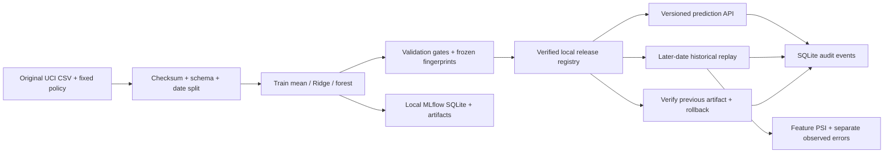

# Architecture and release contracts

This is a self-contained single-user local application, intended to make model engineering decisions reviewable.

## Components

| File | Responsibility |
|---|---|
| backend/data.py | Original-byte verification, feature allowlist, normalization, chronological partitions and audit report |
| backend/training.py | Fixed pipelines, validation scores/gates, serialization/reload check, real MLflow client logging and freeze |
| backend/monitoring.py | Training-quantile PSI, separate label-dependent errors, synthetic input-only fault |
| backend/store.py | SQLite tables, connection/transaction boundaries, append-only API event/replay access |
| backend/service.py | Single-process lock, version lookup, verified inference, atomic release/rollback and immutable replay snapshots |
| backend/api.py | Typed HTTP contracts, rejection codes, local exports and static React assets |
| frontend/src/App.tsx | Six views, version-aware inference, current controls separated from saved replay settings |
| evaluate_lab.py | Post-freeze reference metrics, predictions and static scientific plot |
| verify_http.py | Actual local HTTP checks, sequential request timings and release/rollback verification |

## Data and prediction boundary

Only four inputs reach a pipeline: targeted productivity, SMV, worker count and normalized department. Source row and date are traceability fields. Actual productivity is a label only. A scaler/encoder fits on the training partition inside each pipeline; the three model kinds use identical date boundaries.

The source checksum freezes the original input version. Its target-range anomaly is preserved. The source does not establish input timestamps, causal relationships or individual worker performance. Inference outputs a source productivity ratio, unbounded rather than silently clipped. Its numeric validation bounds (target 0–1, SMV>0 and ≤100, workers >0 and ≤200) are broad authored API limits, not empirically verified operational limits.

## Predeclared comparison and freeze

The policy file existed before the first model fit. Exactly three fixed algorithms run, without parameter search, on 35 training dates; 12 validation dates determine gates. The forest is compared with Ridge, Ridge with the mean. The minimum 2% relative MAE gain is an illustrative demonstration requirement, not a significance test. The fallback's gate is intentionally weaker and disclosed.

Each model's locally generated artifact is reloaded and checked against its validation predictions. A real MLflow run stores parameters, validation metrics and two artifacts (model plus validation report). MLflow uses its own SQLite schema and local artifact directory, through the skinny Python client; there is no separate tracking server. The app's release registry is separate SQLite application state.

A freeze contains model metadata, eligible flags/check outcomes, source checksum, policy checksum, model-engine checksum, selected version, timestamps, run IDs and artifact hashes. The engine fingerprint concatenates normalized-newline data.py, training.py and monitoring.py. It does not claim a signed whole-repository software supply-chain attestation. The selection is the lowest validation MAE among eligible models, before later labels are scored. There is no refit on validation/replay.

The first recorded freeze was 12:18 UTC and the first browser replay 12:28 UTC on 26 October 2026. Reference evaluation later scored all three frozen models transparently. That comparison does not retroactively change the selection. Subsequent replays of the same dates are repeated observations, not fresh holdouts. Future research needs new independent dates/rolling backtests.

## Release state machine

1. First startup trains a comparison if none exists and bootstraps the verified mean fallback at generation 1.
2. A release request carries a version and the caller's expected generation.
3. The service holds one reentrant process lock, checks the expected generation, finds the frozen metadata, checks current policy/engine compatibility, verifies bytes and loads the artifact.
4. Ineligible artifacts, corrupt/missing files, unknown IDs, stale requests and releasing the already-active model do not change the pointer.
5. A single SQLite transaction sets active, previous and generation, and appends a release event. Any database failure rolls back the pointer and event together.
6. Rollback resolves the previous pointer, repeats eligibility/fingerprint/artifact checks and atomically restores it. The previous pointer becomes the former active version, so the local demo can toggle verified deployments. Generation is always incremented rather than restored.
7. Every prediction identifies active model version, generation and SHA-256. A saved browser response is never relabelled after a release; it displays a stale-generation notice.

New training comparisons reread source/policy, preserve the current deployment and create new IDs. Changed code/policy can make an old deployment incompatible: predictions/release are blocked until an appropriate new comparison/version is released. Rollback can also be refused if its code/policy no longer matches. These are local lifecycle constraints, not zero-downtime migration.

## Monitoring boundary

Each replay snapshots one model/generation for all 12 later dates and 254 records. Numeric PSI uses training-only quantile boundaries, infinite tail bins and a 1e-6 probability floor. Duplicate quantile edges are collapsed. Values ≥0.20 raise a policy alert; the metric is not calibrated as a confidence/risk probability or a significance test. Small batches and zero-probability bins can produce large values. Department shift is not measured.

Unchanged historical rows may expose their recorded outcomes to compute MAE, RMSE and R². Withheld-label mode returns null metrics/actuals. Multiplying SMV by 1.8 is an explicitly synthetic input fault; original actuals are hidden and error metrics remain null regardless of the label-toggle request. Its changed prediction distribution is measurable; counterfactual accuracy is not.

Replays are persisted as complete snapshots, including inputs' source-row traceability, predictions, available labels, model identity, per-date diagnostics and duration. Current UI controls do not mutate those snapshots. The UI warns when controls or active versions differ from an opened saved report.

## HTTP contracts

| Endpoint | Purpose / important response |
|---|---|
| GET /api/health | Process readiness and current version state |
| GET /api/lab | Current experiment, policy/data report, latest 100 events/replays |
| POST /api/train | New fixed comparison; active deployment preserved |
| POST /api/release | {version, expected_generation};409 on stale/ineligible/incompatible release |
| POST /api/rollback | {expected_generation}; restores previous verified deployment |
| POST /api/predict | Exactly the four allowed fields;422 for invalid/extra fields |
| POST /api/replay | {shifted, labels}; saved historical/synthetic replay |
| GET /api/replays/{id}/export/{json,csv,md} | Local evidence export;404 if not in latest 100 exposed records |
| GET /api/export/audit | Current snapshot and latest event/replay records |
| GET /openapi.json | Actual generated request/response contract |

## Persistence, trust and packaging

`runtime/registry.sqlite3` stores comparisons, state, events and replay snapshots. `runtime/mlflow.sqlite3` stores MLflow metadata. Model files/freeze reports and copied MLflow artifacts live below runtime. Runtime data, dependencies and compiled assets are ignored; a fresh checkout regenerates its own local IDs/artifacts. Committed outputs are review evidence rather than a production registry backup.

The app binds to 127.0.0.1, uses one origin and one server worker, and has no authentication. The process lock is not distributed coordination. SQLite events are append-only through the API, but a machine owner can edit files. SHA-256 protects accidental artifact changes relative to trusted metadata; it is not a signature against an attacker controlling both. Joblib deserialization is only appropriate for artifacts created by this trusted local project. There is no arbitrary artifact-upload endpoint.

MLflow telemetry is disabled before imports; no third-party inference/service is used. Package installation uses public registries; normal execution uses bundled data/assets and local stores. UI fonts use the operating system. No cloud, Docker, live stream, hosted CI, scheduler or automatic retraining/deployment is claimed.

## Verification evidence

The 11 automated tests use real tiny models, an isolated MLflow SQLite store and temporary app databases. They check feature/date separation, training-only transforms, failed quality enforcement, corrupt model rejection, generation concurrency, version/prediction restoration, label withholding, PSI identity/finite handling, actual logged run/artifact content, API inputs, exports and persistence through a new app lifespan. A test-only metadata fixture marks a candidate ineligible to exercise refusal; it is not a claim that the real trained candidate failed.

Actual HTTP verification and browser QA cover the served workflow separately. Ten sequential warm HTTP timings describe local requests, not concurrent throughput. Scientific plots use measured reference outputs, without invented metrics or company savings.
