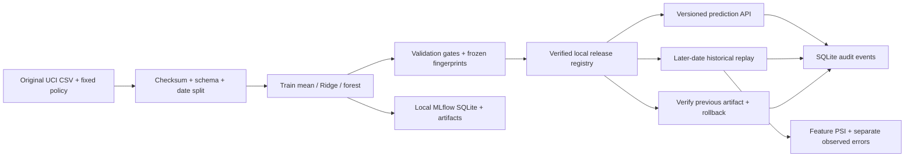
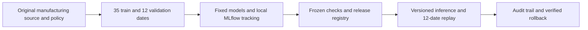
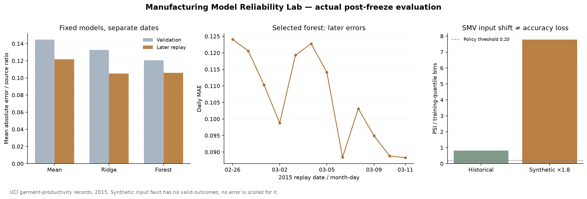

# F3 — folder structure and copyable files

The complete project is saved beside this file. Each source/configuration file has its own block below, including the small public original CSV. Generated evaluation artifacts and screenshots are linked from README.md rather than pasted as source. setup_project.py verifies the source, installs the locked environment and builds the local interface.

## Folder structure

```text
f3-manufacturing-model-reliability-lab/
  .gitattributes
  .gitignore
  ARCHITECTURE.md
  INTERVIEW_GUIDE.md
  README.md
  backend/__init__.py
  backend/api.py
  backend/data.py
  backend/monitoring.py
  backend/service.py
  backend/store.py
  backend/training.py
  constraints.txt
  data/SOURCE.md
  data/garments_worker_productivity.csv
  data/policy.json
  evaluate_lab.py
  frontend/index.html
  frontend/package-lock.json
  frontend/package.json
  frontend/src/App.tsx
  frontend/src/main.tsx
  frontend/src/styles.css
  frontend/src/types.ts
  frontend/src/vite-env.d.ts
  frontend/tsconfig.json
  launch.py
  outputs/api_verification.json
  outputs/audit.png
  outputs/data_contract.png
  outputs/demo_audit.json
  outputs/experiments.png
  outputs/first_browser_replay.json
  outputs/frozen_comparison.json
  outputs/http_historical_replay.json
  outputs/http_synthetic_replay.json
  outputs/model_comparison.csv
  outputs/monitor.png
  outputs/overview.png
  outputs/reference_evaluation.json
  outputs/release.png
  outputs/reliability_evaluation.png
  outputs/replay_chart.png
  outputs/replay_predictions.csv
  outputs/synthetic_fault.png
  outputs/verification.md
  prepare_data.py
  requirements.txt
  setup_project.py
  tests/__init__.py
  tests/test_lab.py
  verify_http.py
  PROJECT_FILES.md
```

## .gitattributes

```text
# Preserve the original public CSV's checksum and native CRLF record endings.
data/garments_worker_productivity.csv -text whitespace=cr-at-eol
data/policy.json -text
```

## .gitignore

```text
.venv/
__pycache__/
*.py[cod]
.env
.env.*
runtime/
frontend/node_modules/
frontend/dist/
*.sqlite3*
```

## ARCHITECTURE.md

````markdown
# Architecture and release contracts

This is a self-contained single-user local application, intended to make model engineering decisions reviewable.



## Components

| File | Responsibility |
|---|---|
| backend/data.py | Original-byte verification, feature allowlist, normalization, chronological partitions and audit report |
| backend/training.py | Fixed pipelines, validation scores/gates, serialization/reload check, real MLflow client logging and freeze |
| backend/monitoring.py | Training-quantile PSI, separate label-dependent errors, synthetic input-only fault |
| backend/store.py | SQLite tables, connection/transaction boundaries, append-only API event/replay access |
| backend/service.py | Single-process lock, version lookup, verified inference, atomic release/rollback and immutable replay snapshots |
| backend/api.py | Typed HTTP contracts, rejection codes, local exports and static React assets |
| frontend/src/App.tsx | Six views, version-aware inference, current controls separated from saved replay settings |
| evaluate_lab.py | Post-freeze reference metrics, predictions and static scientific plot |
| verify_http.py | Actual local HTTP checks, sequential request timings and release/rollback verification |

## Data and prediction boundary

Only four inputs reach a pipeline: targeted productivity, SMV, worker count and normalized department. Source row and date are traceability fields. Actual productivity is a label only. A scaler/encoder fits on the training partition inside each pipeline; the three model kinds use identical date boundaries.

The source checksum freezes the original input version. Its target-range anomaly is preserved. The source does not establish input timestamps, causal relationships or individual worker performance. Inference outputs a source productivity ratio, unbounded rather than silently clipped. Its numeric validation bounds (target 0–1, SMV>0 and ≤100, workers >0 and ≤200) are broad authored API limits, not empirically verified operational limits.

## Predeclared comparison and freeze

The policy file existed before the first model fit. Exactly three fixed algorithms run, without parameter search, on 35 training dates; 12 validation dates determine gates. The forest is compared with Ridge, Ridge with the mean. The minimum 2% relative MAE gain is an illustrative demonstration requirement, not a significance test. The fallback's gate is intentionally weaker and disclosed.

Each model's locally generated artifact is reloaded and checked against its validation predictions. A real MLflow run stores parameters, validation metrics and two artifacts (model plus validation report). MLflow uses its own SQLite schema and local artifact directory, through the skinny Python client; there is no separate tracking server. The app's release registry is separate SQLite application state.

A freeze contains model metadata, eligible flags/check outcomes, source checksum, policy checksum, model-engine checksum, selected version, timestamps, run IDs and artifact hashes. The engine fingerprint concatenates normalized-newline data.py, training.py and monitoring.py. It does not claim a signed whole-repository software supply-chain attestation. The selection is the lowest validation MAE among eligible models, before later labels are scored. There is no refit on validation/replay.

The first recorded freeze was 12:18 UTC and the first browser replay 12:28 UTC on 26 October 2026. Reference evaluation later scored all three frozen models transparently. That comparison does not retroactively change the selection. Subsequent replays of the same dates are repeated observations, not fresh holdouts. Future research needs new independent dates/rolling backtests.

## Release state machine

1. First startup trains a comparison if none exists and bootstraps the verified mean fallback at generation 1.
2. A release request carries a version and the caller's expected generation.
3. The service holds one reentrant process lock, checks the expected generation, finds the frozen metadata, checks current policy/engine compatibility, verifies bytes and loads the artifact.
4. Ineligible artifacts, corrupt/missing files, unknown IDs, stale requests and releasing the already-active model do not change the pointer.
5. A single SQLite transaction sets active, previous and generation, and appends a release event. Any database failure rolls back the pointer and event together.
6. Rollback resolves the previous pointer, repeats eligibility/fingerprint/artifact checks and atomically restores it. The previous pointer becomes the former active version, so the local demo can toggle verified deployments. Generation is always incremented rather than restored.
7. Every prediction identifies active model version, generation and SHA-256. A saved browser response is never relabelled after a release; it displays a stale-generation notice.

New training comparisons reread source/policy, preserve the current deployment and create new IDs. Changed code/policy can make an old deployment incompatible: predictions/release are blocked until an appropriate new comparison/version is released. Rollback can also be refused if its code/policy no longer matches. These are local lifecycle constraints, not zero-downtime migration.

## Monitoring boundary

Each replay snapshots one model/generation for all 12 later dates and 254 records. Numeric PSI uses training-only quantile boundaries, infinite tail bins and a 1e-6 probability floor. Duplicate quantile edges are collapsed. Values ≥0.20 raise a policy alert; the metric is not calibrated as a confidence/risk probability or a significance test. Small batches and zero-probability bins can produce large values. Department shift is not measured.

Unchanged historical rows may expose their recorded outcomes to compute MAE, RMSE and R². Withheld-label mode returns null metrics/actuals. Multiplying SMV by 1.8 is an explicitly synthetic input fault; original actuals are hidden and error metrics remain null regardless of the label-toggle request. Its changed prediction distribution is measurable; counterfactual accuracy is not.

Replays are persisted as complete snapshots, including inputs' source-row traceability, predictions, available labels, model identity, per-date diagnostics and duration. Current UI controls do not mutate those snapshots. The UI warns when controls or active versions differ from an opened saved report.

## HTTP contracts

| Endpoint | Purpose / important response |
|---|---|
| GET /api/health | Process readiness and current version state |
| GET /api/lab | Current experiment, policy/data report, latest 100 events/replays |
| POST /api/train | New fixed comparison; active deployment preserved |
| POST /api/release | {version, expected_generation};409 on stale/ineligible/incompatible release |
| POST /api/rollback | {expected_generation}; restores previous verified deployment |
| POST /api/predict | Exactly the four allowed fields;422 for invalid/extra fields |
| POST /api/replay | {shifted, labels}; saved historical/synthetic replay |
| GET /api/replays/{id}/export/{json,csv,md} | Local evidence export;404 if not in latest 100 exposed records |
| GET /api/export/audit | Current snapshot and latest event/replay records |
| GET /openapi.json | Actual generated request/response contract |

## Persistence, trust and packaging

`runtime/registry.sqlite3` stores comparisons, state, events and replay snapshots. `runtime/mlflow.sqlite3` stores MLflow metadata. Model files/freeze reports and copied MLflow artifacts live below runtime. Runtime data, dependencies and compiled assets are ignored; a fresh checkout regenerates its own local IDs/artifacts. Committed outputs are review evidence rather than a production registry backup.

The app binds to 127.0.0.1, uses one origin and one server worker, and has no authentication. The process lock is not distributed coordination. SQLite events are append-only through the API, but a machine owner can edit files. SHA-256 protects accidental artifact changes relative to trusted metadata; it is not a signature against an attacker controlling both. Joblib deserialization is only appropriate for artifacts created by this trusted local project. There is no arbitrary artifact-upload endpoint.

MLflow telemetry is disabled before imports; no third-party inference/service is used. Package installation uses public registries; normal execution uses bundled data/assets and local stores. UI fonts use the operating system. No cloud, Docker, live stream, hosted CI, scheduler or automatic retraining/deployment is claimed.

## Verification evidence

The 11 automated tests use real tiny models, an isolated MLflow SQLite store and temporary app databases. They check feature/date separation, training-only transforms, failed quality enforcement, corrupt model rejection, generation concurrency, version/prediction restoration, label withholding, PSI identity/finite handling, actual logged run/artifact content, API inputs, exports and persistence through a new app lifespan. A test-only metadata fixture marks a candidate ineligible to exercise refusal; it is not a claim that the real trained candidate failed.

Actual HTTP verification and browser QA cover the served workflow separately. Ten sequential warm HTTP timings describe local requests, not concurrent throughput. Scientific plots use measured reference outputs, without invented metrics or company savings.
````

## INTERVIEW_GUIDE.md

````markdown
# Explain this project in an interview

## Thirty-second introduction

I built a local model-lifecycle application for manufacturing productivity. It goes beyond a regression notebook: it validates a public dataset, compares three fixed models on separate dates, logs real MLflow runs, enforces release checks, serves version-stamped predictions, replays later records and verifies rollback. I kept the model mistakes and data limitations visible. Ridge slightly beat the selected forest on later MAE, which is a useful reminder that validation rank does not guarantee future rank.

## Three-minute walkthrough

1. **Overview:** identify the active model/generation and the validation recommendation. Explain that they are different concepts.
2. **Dataset contract:** show711/232/254 rows across 35/12/12 dates. Explain why the same date never appears on both sides. Point out 37 labels above the documented range and unverified input timing.
3. **Experiments:** select each model. Show the fixed parameters, validation/department scores, gate checklist and actual local MLflow run ID. No parameter search used later data.
4. **Release console:** release Ridge if needed, request the sample prediction, then release the forest. Observe that the old displayed prediction keeps its original version and stale-generation notice. Request again to verify the change.
5. **Replay monitor:** run unchanged history with outcomes, inspect per-date errors and PSI, then inject the labelled SMV fault. The altered inputs cannot use the old outcomes for an accuracy claim.
6. **Rollback:** restore the previous model and request identical inputs. Verify model ID, hash and exact prediction match while generation increases.
7. **Audit:** inspect state changes and export local evidence. Explain why an append-only API ledger is not tamper-proof against a machine owner.

## Questions to prepare for

- **Why this split?** A fixed chronological date split approximates later-date evaluation without mixing team observations from the same date across partitions. One short window is limited; real work would need rolling backtests and independent future dates.
- **Why not pick Ridge after the replay?** Forest was selected before replay on a declared validation rule. Its later MAE was 0.1059 versus Ridge 0.1052; the forest's later RMSE was lower. I report both and do not retune or change the rule to flatter the result. Another independent period is needed for a new comparison.
- **What does the gate prove?** Compliance with this authored validation policy, finite outputs and artifact round-trip equality. It does not prove acceptable real business error or production readiness.
- **Why a mean model?** A transparent fallback and a verified version to restore. Its minimal gate is explicitly weaker; no claim that a constant predictor meets a manufacturing service level.
- **What is actually in MLflow?** Three finished runs with algorithm parameters, source/policy/artifact hashes, validation metrics, serialized models and validation reports. SQLite/application tables implement release state separately. No hosted MLflow UI or Model Registry is claimed.
- **How do you avoid leakage?** Only four allowed inputs; fit scaling/encoding/models on training dates; validation determines eligibility; replay is evaluated only after freeze. Feature timing remains an unresolved source limitation rather than a proven absence of all leakage.
- **Does drift mean the model is failing?** No. PSI measures a feature-distribution difference. In this history SMV PSI was 0.827 even though replay MAE was lower than validation MAE. Label-based errors answer a separate question.
- **Why no error for shifted SMV?** Multiplying an input changes the hypothetical situation. The source label belongs to the original observation; using it as the changed situation's truth would invent a counterfactual.
- **What stops a bad release?** Version eligibility, policy/engine compatibility, expected-generation check, artifact hash/reload, and one transaction for pointer/event mutation. Tests exercise negative paths. A trusted machine owner remains outside that security boundary.
- **What makes rollback verifiable?** The earlier artifact and same input request restore the exact model ID/hash/prediction, with a new generation. The active pointer and rollback event commit atomically.
- **How would you extend it?** Independent new dates; rolling backtests; documented feature timestamps; business-specific asymmetric error costs; categorical monitoring; signed artifacts; authentication; concurrency controls; a controlled deployment pipeline. Add only what the target job needs.

## Honest résumé wording

Say: “Built and evaluated a local model lifecycle with reproducible evidence.” Do not say: “Improved factory productivity”, “eliminated drift”, “real-time MLOps”, “production ready”, “automated employee decisions”, or “certified in MLflow”. These were not established by this project.

## Suggested short recording

Record your screen for 90–120 seconds: overview → one dataset boundary → forest's gate → versioned prediction → historical/synthetic monitoring distinction → rollback → audit export. A narration should explain a decision or limitation rather than merely reading UI labels. No video has been generated by the project.
````

## README.md

````markdown
# Manufacturing Model Reliability Lab — F3

A local model-lifecycle system combining date-based regression comparisons, MLflow experiment tracking, predeclared release gates, artifact integrity checks, versioned inference, historical replay diagnostics and verified rollback.

> Lifecycle boundary: model eligibility is determined before later replay outcomes are scored. A feature-distribution alert is not evidence of worsening accuracy, and synthetic input faults have no valid counterfactual outcome labels.

## Contents

- [Overview](#overview)
- [Dataset and data contract](#dataset-and-data-contract)
- [Architecture and components](#architecture-and-components)
- [Processing pipeline](#processing-pipeline)
- [Configuration and metric definitions](#configuration-and-metric-definitions)
- [Recorded results and evidence](#recorded-results-and-evidence)
- [Interpretation and operational use](#interpretation-and-operational-use)
- [Running locally](#running-locally)
- [API reference](#api-reference)
- [Validation and reproducibility](#validation-and-reproducibility)
- [Project structure](#project-structure)
- [Technology stack](#technology-stack)
- [Limitations and next steps](#limitations-and-next-steps)
- [Further technical documentation](#further-technical-documentation)

## Overview

**Does this candidate productivity model deserve a local release, and what evidence would support keeping or replacing it?**

The six sections are **Lab overview → Dataset contract → Experiments → Release console → Replay monitor → Audit & architecture**. A reviewer can inspect model checks, release an eligible artifact, request a prediction with a version stamp, replay later dates, inject a labelled input fault and restore a previous verified version. This is a local model-lifecycle demonstration, not a production factory system.

## Dataset and data contract

[UCI Productivity Prediction of Garment Employees](https://archive.ics.uci.edu/dataset/597/productivity+prediction+of+garment+employees), **1,197 historical team-level observations, 15 source columns and 59 dates**, 1 January–11 March 2015. Attribution: Productivity Prediction of Garment Employees [Dataset]. (2020). UCI Machine Learning Repository. [DOI 10.24432/C51S6D](https://doi.org/10.24432/C51S6D), [CC BY 4.0](https://creativecommons.org/licenses/by/4.0/). The small unchanged CSV is bundled for offline execution; [provenance](data/SOURCE.md) records its checksum and transformations.

| Field | Use and meaning |
|---|---|
| date / source_row | Date partition and traceability; not model inputs |
| targeted_productivity | Authority's team/day target; plausible planning input |
| smv | Standard minute value: time allocated to a task |
| no_of_workers | Reported team worker count; fractional values retained |
| department | Finishing or sewing, after spelling/whitespace normalization |
| actual_productivity | Source productivity ratio: the regression label |

**Input timing is assumed**, not established by observation timestamps. WIP, overtime, incentives, idle measures, team IDs and other fields are excluded. The source describes a 0–1 target but **37 labels exceed 1**, maximum **1.1204375**. All are retained and predictions are not clipped. The excluded WIP column has 506 missing values; selected inputs and labels have none.

| Partition | Dates | Rows | Purpose |
|---|---|---:|---|
| Training | 1 Jan–10 Feb 2015 / 35 distinct dates | 711 |Fit preprocessing and all three models|
| Validation |11–25 Feb 2015 / 12 dates| 232 |Compare models and decide eligibility|
| Replay |26 Feb–11 Mar 2015 / 12 dates| 254 |Post-freeze historical evaluation|

Every date belongs to exactly one partition. **Historical replay is not live monitoring**. The optional **synthetic SMV ×1.8 fault** changes only inputs. Its original outcomes are not valid counterfactual labels, so it receives no error/accuracy score. No paid data, private files, login or cloud service is needed.

## Architecture and components



| Component | Entry points or assets | Responsibility |
|---|---|---|
| [backend/data.py](backend/data.py) | Source contract and partitions | Verify original bytes, normalize labels and create whole-date partitions. |
| [backend/training.py](backend/training.py) | Training, checks and MLflow | Fit fixed pipelines, log real local runs and freeze validation evidence. |
| [data/policy.json](data/policy.json) | Predeclared thresholds | Define date counts, quality limits and numeric drift alert thresholds. |
| [backend/monitoring.py](backend/monitoring.py) | Replay diagnostics | Separate training-reference PSI from label-dependent error measurements. |
| [backend/service.py](backend/service.py) | Lab lifecycle | Serialize local actions, verify artifacts and orchestrate release/replay/rollback. |
| [backend/store.py](backend/store.py) | Registry and ledger | Atomically persist active/previous versions, generations and audit events. |
| [backend/api.py](backend/api.py) | Typed HTTP interface | Validate prediction payloads and expected-generation release requests. |
| [evaluate_lab.py](evaluate_lab.py) | Post-freeze evidence | Export all fixed-model scores, selected replay predictions and a static evaluation plot. |
| [verify_http.py](verify_http.py) | Served workflow verification | Exercise the running local API, record timings and verify exact rollback restoration. |
| [frontend/src/App.tsx](frontend/src/App.tsx) | Model workflow interface | Expose comparisons, release controls, saved replays and audit evidence. |

## Processing pipeline

1. Verify the original CSV's SHA-256, schema, finite selected fields and dates. Normalize two department spelling/spacing variants without removing observations.
2. Fix the [policy](data/policy.json) and 35/12/12-date design before training. Fit the numeric scaler, department encoder and models only on 711 training rows.
3. Compare a training-mean fallback, Ridge regression with α=1 and a fixed random forest with 80 trees, depth 6, minimum leaf 8, random state 42 and one CPU worker. There is no hyperparameter search or refit using later records.
4. Require finite validation predictions and an artifact serialization/reload match. Learned models must also improve reference MAE by at least 2%, have validation MAE ≤0.16, each department MAE ≤0.22 and at least 20 validation rows per department. Ridge's reference is the mean; the forest's is Ridge. These thresholds are illustrative authored policy, not validated business tolerances. The fallback has only the minimal finite-output/artifact gate.
5. Write real parameters, validation metrics and artifacts through the **MLflow Python tracking client** to a local SQLite database and local artifact files. Freeze the comparison with source, policy and model-engine fingerprints before scoring replay labels. Choose the lowest-validation-MAE eligible model.
6. Start with the verified mean fallback. A local release verifies eligibility, code/policy compatibility and model bytes, then atomically updates the active pointer/generation and appends an audit event. Every inference response identifies its version and artifact. Stale generations return 409; invalid prediction fields return 422.
7. Replay the final 12 dates with the active frozen model. Compute observed MAE/RMSE/R² only when valid outcomes are available. Calculate numeric-feature population stability index (PSI) with training-only quantile bins, a 1e-6 floor and an illustrative 0.20 alert threshold. Daily small-batch values are noisy diagnostics, not significance tests.
8. Roll back by checking and restoring the immediately previous verified artifact. A new request must reproduce its earlier prediction and identity. Save/export immutable replay snapshots and append-only API audit events.

[Architecture and contracts](ARCHITECTURE.md) explain the boundaries. MLflow supports direct local database/artifact tracking without a tracking-server process; see its [official architecture](https://mlflow.org/docs/latest/self-hosting/architecture/overview/). This application implements its own SQLite release registry; it does not claim MLflow Model Registry or an MLflow UI server.

## Configuration and metric definitions

### Release and inference contracts

| Setting or gate | Implemented policy |
|---|---|
| Partitions | 35 training dates / 12 validation dates / 12 replay dates |
| Mean fallback | Training-target mean; finite output and artifact round-trip gates |
| Ridge | α=1; at least 2% lower validation MAE than the mean |
| Forest | 80 trees, depth 6, minimum leaf 8, seed 42, one worker; at least 2% lower validation MAE than Ridge |
| Learned-model absolute error | Validation MAE ≤0.16 and each department MAE ≤0.22 |
| Department support | At least 20 validation rows per department |
| Artifact check | Recorded SHA-256 and validation reload equivalence within 1e-12 |
| Release concurrency | Caller supplies expected generation; stale state returns HTTP 409 |
| Prediction contract | Target productivity 0-1; SMV >0 and ≤100; workers >0 and ≤200; sewing/finishing department; no extra fields |
| Input shift | Numeric PSI in training-only quantile bins, 1e-6 floor, alert at 0.20 |

Thresholds and broad API bounds are authored demonstration rules, not verified factory tolerances. Every inference response includes the active model version, generation and artifact hash. A single SQLite transaction updates the active/previous pointers and event ledger. Rollback restores the previous compatible verified artifact with a new generation, rather than rewriting past predictions or events.

The synthetic SMV ×1.8 replay suppresses original outcomes even if labels are requested. Unchanged records may also be replayed with labels hidden; in either case unavailable metrics remain null. MLflow stores real run metadata/artifacts locally, while the application maintains its own release registry.

## Recorded results and evidence

The first comparison froze at **26 October 2026, 12:18 UTC**, before the first browser replay at 12:28 UTC. The models/policy were not changed after viewing replay errors. Saved IDs, full precision and fingerprints are in [frozen_comparison.json](outputs/frozen_comparison.json).

| Fixed model | Validation MAE | Later replay MAE | Replay RMSE | Replay R² | Eligible before replay |
|---|---:|---:|---:|---:|---|
|Mean fallback|0.144607|0.121653|0.169860|−0.102116|Yes / minimal gate|
|Ridge incumbent|0.132481|**0.105153**|0.153938|0.094817|Yes|
|Forest candidate|**0.120537**|0.105865|**0.144332**|**0.204267**|Yes / 6 checks|

The forest was selected on validation MAE, **16.6% lower than the mean fallback**. Ridge had marginally lower later MAE, while the forest had lower later RMSE. This small one-window comparison does not establish a universally better model. There was no switch of selection rules or tuning using replay outcomes.



- **11 automated lifecycle tests passed**, including failed gate enforcement, tampered-artifact rejection, stale generations, API input checks, training-only preprocessing, MLflow artifacts, persistence and exact prediction restoration after rollback.
- Actual localhost verification returned 422 for three invalid input shapes and 409 for a stale release. Ten sequential warm forest requests had **40.52 ms median HTTP round trip** and **17.09 ms median backend duration**, including artifact checking/loading. These are laptop observations, not load-test or production latency claims.
- The sample request `{targeted_productivity:0.8, smv:26, no_of_workers:56, department:"sewing"}` returned a Ridge prediction of approximately **0.7914**; the forest returned **0.8390**. After rollback, the Ridge prediction, version and artifact fingerprint matched exactly, with a later generation number.
- Historical replay SMV PSI was **0.827**; synthetic SMV ×1.8 increased it to **7.777** and placed 10 of 254 records outside the training SMV range. Neither value proves deteriorated model accuracy. **No error score was calculated for the altered inputs.**
- The initial comparison fit/log/freeze took **4.12 seconds**; post-freeze scoring and table export took **0.123 seconds**, excluding Python imports and chart rendering. Machine/setup time varies.

[Application screenshot](outputs/experiments.png)

Evidence: [full reference evaluation](outputs/reference_evaluation.json), [model comparison CSV](outputs/model_comparison.csv), [selected replay predictions](outputs/replay_predictions.csv), [first browser replay](outputs/first_browser_replay.json), [actual HTTP/rollback verification](outputs/api_verification.json), [historical HTTP replay](outputs/http_historical_replay.json), [synthetic HTTP replay](outputs/http_synthetic_replay.json) and [verification record](outputs/verification.md). Screenshots show the [overview](outputs/overview.png), [release/API](outputs/release.png), [monitor](outputs/monitor.png) and [synthetic fault](outputs/synthetic_fault.png).

## Interpretation and operational use

- **Keep validation selection separate from later observations.** The forest passed its declared gate, yet Ridge had slightly lower later MAE. Use additional independent dates and operational error costs before recommending a real deployment; repeated inspection of these 254 rows is not fresh evidence.
- **Investigate drift rather than equating it with failure.** SMV shifted even in the unchanged history, while aggregate replay error was lower than validation error. Inspect input semantics, batch sizes and observed errors together.
- **Make reversibility observable.** Versioned responses and a verified rollback reproduced the earlier Ridge output exactly. This is measurable engineering evidence; it does not establish real factory safety, productivity improvement or savings.

## Running locally

The three setup/launch commands below start at the repository root.

Prerequisites: **Python 3.12+ and Node.js/npm compatible with Vite 8**. Tested here with Python 3.12.14, Node 25.2.0 and npm 11.19.0.

```powershell
cd projects/f3-manufacturing-model-reliability-lab
python setup_project.py
python launch.py
```

Open **http://127.0.0.1:8534**. Later starts need only `python launch.py`. Ctrl+C stops the app. Use `python launch.py --port 8535` to select another local port.

First launch verifies the source, trains/logs three small models locally and bootstraps the mean fallback. **Experiments → Release console → Release locally → Request prediction → Replay monitor → Run historical replay → Roll back to previous** demonstrates the lifecycle. On an existing workspace the previous active version/history is preserved, so the starting model may differ. New comparisons use fixed parameters and preserve the active deployment. Saved reports retain their model/settings even after controls change.

Setup verifies the bundled source, creates this project's ignored `.venv`, installs constrained Python dependencies and builds locked frontend packages. If the original CSV is missing, `prepare_data.py` recovers it from the public UCI ZIP and verifies its bytes; an altered existing file is refused. Installation/recovery may require network access; normal application execution is local/offline and MLflow telemetry is disabled. No model download, API key, account, paid API, cloud, GPU or other project is required.

Optional developer checks, separate from the three launch commands: `.venv/Scripts/python.exe -m unittest discover -s tests -v`; `.venv/Scripts/python.exe evaluate_lab.py` regenerates post-freeze outputs; `.venv/Scripts/python.exe verify_http.py` exercises the running app on 8534 and explicitly releases/restores demo models. The last script mutates local demo history. Reused replay dates must never be described as a new holdout. [PROJECT_FILES.md](PROJECT_FILES.md) contains the folder tree and individual copyable source blocks.

## API reference

The interface and API share one localhost origin. Route declarations are implemented in [backend/api.py](backend/api.py); `/openapi.json` exposes the generated schemas.

| Method | Route | Handler |
|---|---|---|
| GET | `/api/health` | `health` |
| GET | `/api/lab` | `snapshot` |
| POST | `/api/train` | `train` |
| POST | `/api/release` | `release` |
| POST | `/api/rollback` | `rollback` |
| POST | `/api/predict` | `predict` |
| POST | `/api/replay` | `replay` |
| GET | `/api/export/audit` | `export_audit` |
| GET | `/api/replays/{replay_id}/export/{format}` | `export_replay` |

### Versioned prediction request

Example body for `POST /api/predict`:

```json
{
  "targeted_productivity": 0.8,
  "smv": 26,
  "no_of_workers": 56,
  "department": "sewing"
}
```

The response includes the prediction, model version, generation, artifact SHA-256 and measured backend duration. Releases supply `version` and `expected_generation`; rollbacks supply `expected_generation`. A stale generation or failed release check returns 409, and invalid prediction fields return 422. Replay requests use `shifted` and `labels` booleans; changed-input mode never exposes original outcomes as valid new labels. JSON, CSV and Markdown replay exports preserve the saved model identity.

The server is intended for a trusted single-user local environment. These routes do not constitute an authenticated public deployment. Saved output identifiers refer to immutable analytical snapshots rather than editable browser drafts.

## Validation and reproducibility

The automated suite contains **11 tests**. It checks the following implementation boundaries:

Test implementation: [tests/test_lab.py](tests/test_lab.py).

- Source and date boundaries.
- Preprocessing fits training only.
- Failed quality gate is not eligible.
- Gate rejection preserves active pointer.
- Tampered artifact cannot release.
- Stale generation rejected.
- Release and rollback restore prediction and identity.
- Shift has no counterfactual error score.
- Labels can be withheld on unchanged replay.
- Mlflow has real metrics and artifacts.
- Api validation state export and restart.

From the project directory, run:

```powershell
.venv/Scripts/python.exe -m unittest discover -s tests -v
```

Recorded execution and any browser-review evidence is retained in [outputs/verification.md](outputs/verification.md). Reported figures correspond to saved execution artifacts; running a report generator can overwrite its generated outputs. Package requirements, source checksums and fixed parameters define the reproducibility boundary; elapsed times and some model/solver outputs can vary across environments. The setup script also performs TypeScript checking and a production frontend build using the npm lockfile.

## Project structure

```text
f3-manufacturing-model-reliability-lab/
  ARCHITECTURE.md
  constraints.txt
  evaluate_lab.py
  INTERVIEW_GUIDE.md
  launch.py
  prepare_data.py
  PROJECT_FILES.md
  README.md
  requirements.txt
  setup_project.py
  verify_http.py
  backend/
    __init__.py
    api.py
    data.py
    monitoring.py
    service.py
    store.py
    training.py
  frontend/
    package.json
    package-lock.json
    tsconfig.json
    index.html
    src/
      App.tsx
      main.tsx
      styles.css
      types.ts
      vite-env.d.ts
  tests/
    __init__.py
    test_lab.py
  data/
    Bundled inputs, provenance and prepared data
  outputs/
    Recorded metrics, audit files, tables and figures
```

Generated environments, database files, model artifacts and compiled assets follow the project's [.gitignore](.gitignore). The [copyable source bundle](PROJECT_FILES.md) mirrors the README and contains individual file blocks.

## Technology stack

**React + TypeScript + Vite + Lucide**, **FastAPI + Pydantic**, **pandas + NumPy + scikit-learn**, **MLflow skinny 3.17.2** with **SQLAlchemy/Alembic and SQLite**, joblib artifacts and matplotlib evidence. Custom SVG displays daily errors; CSS displays comparison bars. This is a single local server with bundled assets; there are no external fonts or runtime CDN assets.

## Limitations and next steps

Historical 2015 data covers one short setting with no documented prediction-time feature timestamps. The target-range discrepancy and fractional worker counts need source-owner clarification for real operational use. Scores are team-observation errors, not individual-worker assessments or causal effects of staffing/targets.

There is one fixed chronological split and no nested tuning, rolling backtest or uncertainty interval. Thresholds, numeric input bounds, SMV fault size and PSI settings are authored demonstrations. Numeric PSI does not monitor categorical department shift. Tiny daily batches can exaggerate alerts. Finite predictions outside 0–1 are retained and not interpreted as feasible production targets.

The app assumes a trusted single-user localhost with one server worker. Its Python lock serializes local actions; SQLite transactions make pointer/event updates atomic. It has no authentication, multi-worker coordination, signed artifact store, tamper-proof log, live ingestion, scheduling, Docker deployment or hosted CI. A machine owner can alter local databases; checks are accidental-corruption controls, not a hostile-user security boundary. Only locally created trusted joblib files may be loaded.

Rollback restores the immediately previous verified artifact, rather than an arbitrary version selected from a full production registry. Latest 100 events/replays appear in the interface. Code/policy changes require a new comparison; first-time imports, tracking initialization and installation are excluded from request latency. App histories, weights, build outputs and dependency directories are intentionally ignored; a fresh clone trains its own artifacts/IDs while reproducing the fixed calculation design. Re-evaluate on new independent dates before changing a release decision.

## Further technical documentation

- [Dataset attribution, licensing and source transformations](data/SOURCE.md)
- [Pinned Python dependencies](requirements.txt)
- [Recorded transitive dependency constraints](constraints.txt)
- [Frontend dependency lockfile](frontend/package-lock.json)
- [Detailed architecture, contracts and implementation boundaries](ARCHITECTURE.md)
- [Recorded execution and verification evidence](outputs/verification.md)
- [Folder structure and individually copyable source files](PROJECT_FILES.md)

[Back to contents](#contents)
````

## backend/__init__.py

```python
"""Local application package; disable optional MLflow telemetry before imports."""
import os
os.environ["MLFLOW_DISABLE_TELEMETRY"] = "true"
os.environ["MLFLOW_DISABLE_AGENT_HINT"] = "1"
```

## backend/api.py

```python
"""Single-origin localhost API. No authentication: intended for one user's laptop."""
from contextlib import asynccontextmanager
import csv
import io
import json
from pathlib import Path
from typing import Literal
from fastapi import FastAPI, Request
from fastapi.responses import JSONResponse, Response
from fastapi.staticfiles import StaticFiles
from pydantic import BaseModel, ConfigDict, Field
from .data import ROOT
from .service import Lab, LabError


class ReleaseRequest(BaseModel):
    model_config = ConfigDict(extra="forbid")
    version: str = Field(min_length=1, max_length=80)
    expected_generation: int = Field(ge=1)


class RollbackRequest(BaseModel):
    model_config = ConfigDict(extra="forbid")
    expected_generation: int = Field(ge=1)


class ReplayRequest(BaseModel):
    model_config = ConfigDict(extra="forbid")
    shifted: bool = False
    labels: bool = True


class PredictionRequest(BaseModel):
    model_config = ConfigDict(extra="forbid", allow_inf_nan=False)
    targeted_productivity: float = Field(ge=0, le=1)
    smv: float = Field(gt=0, le=100)
    no_of_workers: float = Field(gt=0, le=200)
    department: Literal["sewing", "finishing"]


def create_app(runtime=None):
    @asynccontextmanager
    async def lifespan(app):
        app.state.lab = Lab(runtime)
        yield

    app = FastAPI(title="Manufacturing Model Reliability Lab", lifespan=lifespan)

    @app.exception_handler(LabError)
    async def lab_error(request: Request, exc: LabError):
        return JSONResponse(status_code=exc.status, content={"detail": str(exc)})

    @app.get("/api/health")
    def health():
        return {"status": "ok", "active": app.state.lab.store.state()}

    @app.get("/api/lab")
    def snapshot():
        return app.state.lab.snapshot()

    @app.post("/api/train")
    def train():
        return app.state.lab.train_new()

    @app.post("/api/release")
    def release(body: ReleaseRequest):
        return app.state.lab.release(body.version, body.expected_generation)

    @app.post("/api/rollback")
    def rollback(body: RollbackRequest):
        return app.state.lab.release(None, body.expected_generation, rollback=True)

    @app.post("/api/predict")
    def predict(body: PredictionRequest):
        return app.state.lab.predict(body.model_dump())

    @app.post("/api/replay")
    def replay(body: ReplayRequest):
        return app.state.lab.replay(body.shifted, body.labels)

    @app.get("/api/export/audit")
    def export_audit():
        return Response(json.dumps(app.state.lab.snapshot(), indent=2), media_type="application/json",
                        headers={"Content-Disposition": 'attachment; filename="model-audit.json"'})

    @app.get("/api/replays/{replay_id}/export/{format}")
    def export_replay(replay_id: str, format: Literal["json", "csv", "md"]):
        result = app.state.lab.replay_by_id(replay_id)
        if format == "json":
            content, media = json.dumps(result, indent=2), "application/json"
        elif format == "csv":
            stream = io.StringIO(newline="")
            writer = csv.DictWriter(stream, fieldnames=["model_version", "source_row", "date", "prediction", "actual"])
            writer.writeheader()
            writer.writerows({"model_version": result["model_version"], **row} for row in result["predictions"])
            content, media = stream.getvalue(), "text/csv"
        else:
            content = f"# Historical replay brief\n\nModel: {result['model_version']}\n\nRows: {result['rows']}\n\nSynthetic input shift: {result['synthetic_shift']}\n\nObserved errors: {result['metrics'] or 'Unavailable; no valid labels'}\n\n{result['interpretation']}\n\n{result['scope']}\n"
            media = "text/markdown"
        return Response(content, media_type=media, headers={"Content-Disposition": f'attachment; filename="{replay_id}.{format}"'})

    dist = ROOT / "frontend/dist"
    if dist.is_dir():
        app.mount("/", StaticFiles(directory=dist, html=True), name="interface")
    return app


app = create_app()
```

## backend/data.py

```python
"""Load the unchanged public source; validate before constructing date partitions."""
from hashlib import sha256
from pathlib import Path
import json
import numpy as np
import pandas as pd

ROOT = Path(__file__).resolve().parents[1]
SOURCE_SHA = "763ffcdd39b7f7f360243c2af8f89ed733e8b5f9e511efeb0c886b83e1b76866"
NUMERIC = ["targeted_productivity", "smv", "no_of_workers"]
FEATURES = NUMERIC + ["department"]
TARGET = "actual_productivity"


def digest(path):
    return sha256(Path(path).read_bytes()).hexdigest()


def load_data(path=None):
    path = Path(path or ROOT / "data/garments_worker_productivity.csv")
    if digest(path) != SOURCE_SHA:
        raise ValueError("Source checksum mismatch. Restore the bundled UCI CSV.")
    frame = pd.read_csv(path)
    if frame.shape != (1197, 15):
        raise ValueError("Expected 1,197 rows and 15 source columns.")
    frame["source_row"] = np.arange(1, len(frame) + 1)
    frame["date"] = pd.to_datetime(frame["date"], format="%m/%d/%Y", errors="raise")
    frame["department"] = frame["department"].str.strip().str.lower().replace({"sweing": "sewing"})
    if frame[FEATURES + [TARGET]].isna().any().any():
        raise ValueError("A selected feature or label is missing.")
    if not np.isfinite(frame[NUMERIC + [TARGET]].to_numpy()).all():
        raise ValueError("Nonfinite feature or label.")
    if set(frame.department) != {"sewing", "finishing"}:
        raise ValueError("Unexpected department.")
    if not frame.targeted_productivity.between(0, 1).all() or (frame[["smv", "no_of_workers"]] <= 0).any().any():
        raise ValueError("Selected feature outside the source contract.")
    return frame.sort_values(["date", "source_row"], kind="stable").reset_index(drop=True)


def partition(frame, policy):
    dates = sorted(frame.date.unique())
    if len(dates) != sum(policy[k] for k in ["train_dates", "validation_dates", "replay_dates"]):
        raise ValueError("Expected 59 dates for the fixed 35/12/12-date design.")
    a, b = policy["train_dates"], policy["train_dates"] + policy["validation_dates"]
    return [frame[frame.date.isin(group)].copy() for group in [dates[:a], dates[a:b], dates[b:]]]


def load_policy():
    return json.loads((ROOT / "data/policy.json").read_text(encoding="utf-8"))


def data_report(frame, groups):
    return {
        "source_sha256": SOURCE_SHA, "rows": len(frame), "dates": int(frame.date.nunique()),
        "target_above_one": int((frame[TARGET] > 1).sum()),
        "missing_excluded_wip": int(frame.wip.isna().sum()),
        "exact_source_duplicates": int(frame.drop(columns="source_row").duplicated().sum()),
        "target_max": float(frame[TARGET].max()),
        "features": FEATURES,
        "splits": [{"name": name, "rows": len(group), "dates": int(group.date.nunique()),
                    "start": str(group.date.min().date()), "end": str(group.date.max().date())}
                   for name, group in zip(["Train", "Validation", "Replay"], groups)],
        "sample": json.loads(frame[["source_row", "date"] + FEATURES + [TARGET]].head(8).to_json(orient="records", date_format="iso")),
    }
```

## backend/monitoring.py

```python
"""Feature shift and observed errors are deliberately separate measurements."""
import numpy as np
from .data import NUMERIC, TARGET, FEATURES
from .training import scores


def psi(reference, observed):
    # Quantile boundaries are fitted ONLY to the training reference.
    edges = np.unique(np.quantile(reference, np.linspace(0, 1, 6)))
    edges = np.concatenate(([-np.inf], edges[1:-1], [np.inf]))
    expected = np.histogram(reference, bins=edges)[0].astype(float)
    actual = np.histogram(observed, bins=edges)[0].astype(float)
    expected = np.maximum(expected / expected.sum(), 1e-6)
    actual = np.maximum(actual / actual.sum(), 1e-6)
    return float(np.sum((actual - expected) * np.log(actual / expected)))


def monitor(train, batch, model, policy, shifted=False, labels=True):
    observed = batch.copy()
    if shifted:
        # Synthetic input-only fault. Its original outcome is NOT a valid new label.
        observed["smv"] = observed.smv * 1.8
    predicted = model.predict(observed[FEATURES])
    drift = [{"feature": field, "psi": psi(train[field], observed[field]),
              "reference_mean": float(train[field].mean()), "batch_mean": float(observed[field].mean()),
              "out_of_training_range": int(((observed[field] < train[field].min()) | (observed[field] > train[field].max())).sum())}
             for field in NUMERIC]
    for row in drift:
        row["alert"] = row["psi"] >= policy["psi_alert_threshold"]
    return {"rows": len(observed), "synthetic_shift": shifted, "labels_available": labels and not shifted,
            "metrics": scores(observed[TARGET], predicted) if labels and not shifted else None,
            "drift": drift, "prediction_mean": float(predicted.mean()),
            "predictions": [{"source_row": int(row.source_row), "date": str(row.date.date()),
                             "prediction": float(value), "actual": float(row[TARGET]) if labels and not shifted else None}
                            for (_, row), value in zip(observed.iterrows(), predicted)],
            "interpretation": "Input distribution alert is not proof of deteriorated accuracy. Shifted inputs have no valid counterfactual outcomes."}
```

## backend/service.py

```python
"""Readable single-process lifecycle orchestration, with optimistic release versions."""
import json
from pathlib import Path
from threading import RLock
import time
from uuid import uuid4
from .data import ROOT, FEATURES, load_data, load_policy, partition, data_report
from .training import train_experiment, load_model, now, digest, engine_digest
from .monitoring import monitor
from .store import Store


class LabError(Exception):
    def __init__(self, message, status=409):
        super().__init__(message)
        self.status = status


class Lab:
    def __init__(self, runtime=None):
        self.runtime = Path(runtime or ROOT / "runtime").resolve()
        self.runtime.mkdir(parents=True, exist_ok=True)
        self.lock = RLock()
        self.policy = load_policy()
        self.frame = load_data()
        self.train, self.validation, self.replay_data = partition(self.frame, self.policy)
        self.report = data_report(self.frame, [self.train, self.validation, self.replay_data])
        self.store = Store(self.runtime / "registry.sqlite3")
        if not self.store.experiments():
            self.train_new()

    def train_new(self):
        with self.lock:
            # Reread source/policy so a new comparison really uses the current contract.
            # Existing deployment eligibility remains tied to its original fingerprints.
            self.policy = load_policy()
            self.frame = load_data()
            self.train, self.validation, self.replay_data = partition(self.frame, self.policy)
            self.report = data_report(self.frame, [self.train, self.validation, self.replay_data])
            experiment = train_experiment(self.runtime, self.train, self.validation, self.policy)
            with self.store.connect() as db:
                db.execute("INSERT INTO experiments VALUES(?,?,?)", (experiment["id"], experiment["frozen_at"], json.dumps(experiment)))
                self.store.event(db, "comparison_frozen", {"experiment": experiment["id"], "selected_version": experiment["selected_version"], "engine_sha256": experiment["engine_sha256"]})
                if not db.execute("SELECT 1 FROM state WHERE id=1").fetchone():
                    baseline = experiment["models"][0]["version"]
                    db.execute("INSERT INTO state VALUES(1,?,NULL,1)", (baseline,))
                    self.store.event(db, "bootstrap_fallback", {"version": baseline, "generation": 1})
            return experiment

    def metadata(self, version):
        for experiment in self.store.experiments():
            for model in experiment["models"]:
                if model["version"] == version:
                    return model, experiment
        raise LabError("Unknown model version.", 404)

    def verified(self, version):
        metadata, experiment = self.metadata(version)
        if experiment["policy_sha256"] != digest(ROOT / "data/policy.json") or experiment["engine_sha256"] != engine_digest():
            raise LabError("Code/policy differs from this frozen comparison. Train a new comparison first.")
        try:
            return load_model(self.runtime, metadata), metadata
        except (ValueError, OSError) as exc:
            raise LabError(str(exc)) from exc

    def snapshot(self):
        with self.lock:
            return {"state": self.store.state(), "experiment": self.store.experiments()[0], "data": self.report,
                    "events": self.store.events(), "replays": self.store.replays(), "policy": self.policy}

    def release(self, version, expected_generation, rollback=False):
        with self.lock:
            state = self.store.state()
            if state["generation"] != expected_generation:
                raise LabError("State changed. Refresh before releasing a model.")
            if rollback:
                version = state["previous"]
                if not version:
                    raise LabError("There is no previous verified deployment.")
            model, metadata = self.verified(version)
            if not metadata["eligible"]:
                raise LabError("Release blocked: this model failed its frozen validation checks.")
            if version == state["active"]:
                raise LabError("That version is already active.")
            # Integrity is checked BEFORE changing the active pointer. Model is loaded now.
            del model
            generation = state["generation"] + 1
            with self.store.connect() as db:
                db.execute("UPDATE state SET active=?,previous=?,generation=? WHERE id=1", (version, state["active"], generation))
                self.store.event(db, "rollback" if rollback else "release", {"from": state["active"], "to": version, "generation": generation,
                    "artifact_sha256": metadata["artifact_sha256"], "mlflow_run_id": metadata["mlflow_run_id"]})
            return self.store.state()

    def predict(self, fields):
        import pandas as pd
        with self.lock:
            start = time.perf_counter()
            state = self.store.state()
            model, metadata = self.verified(state["active"])
            value = float(model.predict(pd.DataFrame([fields])[FEATURES])[0])
            result = {"prediction": value, "model_version": metadata["version"], "generation": state["generation"],
                      "artifact_sha256": metadata["artifact_sha256"], "duration_ms": round((time.perf_counter()-start)*1000, 3),
                      "unit": "source productivity ratio; not clipped to 0–1"}
            with self.store.connect() as db:
                self.store.event(db, "prediction", {"model_version": metadata["version"], "generation": state["generation"], "prediction": value})
            return result

    def replay(self, shifted=False, labels=True):
        with self.lock:
            start = time.perf_counter()
            state = self.store.state()
            model, metadata = self.verified(state["active"])
            batches = []
            for date, batch in self.replay_data.groupby("date", sort=True):
                item = monitor(self.train, batch, model, self.policy, shifted, labels)
                item.pop("predictions")
                batches.append({"date": str(date.date()), **item})
            total = monitor(self.train, self.replay_data, model, self.policy, shifted, labels)
            result = {"id": "replay-" + uuid4().hex[:12], "created": now(), "model_version": metadata["version"],
                      "generation": state["generation"], "batches": batches, **total,
                      "duration_ms": round((time.perf_counter()-start)*1000, 3),
                      "scope": "Historical replay after configuration freeze; repeated replay is not new unseen evidence."}
            with self.store.connect() as db:
                db.execute("INSERT INTO replays VALUES(?,?,?)", (result["id"], result["created"], json.dumps(result)))
                self.store.event(db, "synthetic_input_replay" if shifted else "historical_replay", {"id": result["id"], "model_version": metadata["version"], "labels_available": result["labels_available"], "rows": result["rows"]})
            return result

    def replay_by_id(self, replay_id):
        for item in self.store.replays():
            if item["id"] == replay_id:
                return item
        raise LabError("Unknown replay.", 404)
```

## backend/store.py

```python
"""One local transaction updates the active version and appends its audit event."""
from contextlib import contextmanager
import json
import sqlite3
from .training import now


class Store:
    def __init__(self, path):
        self.path = path
        with self.connect() as db:
            db.executescript("""
            CREATE TABLE IF NOT EXISTS experiments(id TEXT PRIMARY KEY, created TEXT, payload TEXT);
            CREATE TABLE IF NOT EXISTS state(id INTEGER PRIMARY KEY CHECK(id=1), active TEXT, previous TEXT, generation INTEGER);
            CREATE TABLE IF NOT EXISTS events(id INTEGER PRIMARY KEY AUTOINCREMENT, created TEXT, action TEXT, payload TEXT);
            CREATE TABLE IF NOT EXISTS replays(id TEXT PRIMARY KEY, created TEXT, payload TEXT);
            """)

    @contextmanager
    def connect(self):
        db = sqlite3.connect(self.path, timeout=20)
        db.row_factory = sqlite3.Row
        try:
            with db:
                yield db
        finally:
            db.close()

    def event(self, db, action, payload):
        db.execute("INSERT INTO events(created,action,payload) VALUES(?,?,?)", (now(), action, json.dumps(payload)))

    def state(self):
        with self.connect() as db:
            row = db.execute("SELECT * FROM state WHERE id=1").fetchone()
        return dict(row) if row else {"active": None, "previous": None, "generation": 0}

    def experiments(self):
        with self.connect() as db:
            return [json.loads(row[0]) for row in db.execute("SELECT payload FROM experiments ORDER BY created DESC")]

    def events(self):
        with self.connect() as db:
            return [{**dict(row), "payload": json.loads(row["payload"])} for row in db.execute("SELECT * FROM events ORDER BY id DESC LIMIT 100")]

    def replays(self):
        with self.connect() as db:
            return [json.loads(row[0]) for row in db.execute("SELECT payload FROM replays ORDER BY created DESC LIMIT 100")]
```

## backend/training.py

```python
"""Fixed models, validation-only release rules, and real local MLflow tracking."""
from datetime import datetime, timezone
from hashlib import sha256
import json
from pathlib import Path
import time
from uuid import uuid4
import joblib
import numpy as np
from sklearn.compose import ColumnTransformer
from sklearn.dummy import DummyRegressor
from sklearn.ensemble import RandomForestRegressor
from sklearn.linear_model import Ridge
from sklearn.metrics import mean_absolute_error, root_mean_squared_error, r2_score
from sklearn.pipeline import Pipeline
from sklearn.preprocessing import OneHotEncoder, StandardScaler
from mlflow.tracking import MlflowClient
from .data import ROOT, FEATURES, NUMERIC, TARGET, SOURCE_SHA, digest


def now():
    return datetime.now(timezone.utc).isoformat()


def scores(actual, predicted):
    return {"mae": float(mean_absolute_error(actual, predicted)),
            "rmse": float(root_mean_squared_error(actual, predicted)),
            "r2": float(r2_score(actual, predicted))}


def pipeline(kind):
    transform = ColumnTransformer([
        ("numeric", StandardScaler(), NUMERIC),
        ("department", OneHotEncoder(handle_unknown="error", sparse_output=False), ["department"]),
    ])
    models = {"mean": DummyRegressor(strategy="mean"), "ridge": Ridge(alpha=1.0),
              "forest": RandomForestRegressor(n_estimators=80, max_depth=6,
                         min_samples_leaf=8, random_state=42, n_jobs=1)}
    return Pipeline([("features", transform), ("model", models[kind])])


def release_checks(kind, metric, departments, reference_mae, finite, policy):
    checks = [{"name": "Finite validation predictions", "passed": bool(finite), "detail": "Every validation prediction is finite."}]
    if kind != "mean":
        threshold = reference_mae * (1 - policy["minimum_relative_mae_improvement"])
        checks.extend([
            {"name": "MAE improves reference by ≥2%", "passed": metric["mae"] <= threshold,
             "detail": f"{metric['mae']:.5f} ≤ {threshold:.5f}; reference is mean for ridge, ridge for forest."},
            {"name": "Validation MAE ≤ 0.16", "passed": metric["mae"] <= policy["maximum_validation_mae"], "detail": "Illustrative absolute-error ceiling."},
            {"name": "Department MAE ≤ 0.22", "passed": all(d["mae"] <= policy["maximum_department_mae"] for d in departments), "detail": "Each department is checked separately."},
            {"name": "Department support ≥20", "passed": all(d["rows"] >= policy["minimum_department_rows"] for d in departments), "detail": "Both observed departments need validation support."},
        ])
    return checks


def engine_digest():
    # Normalize newlines so the fingerprint survives Windows Git checkouts.
    text = "\n".join((ROOT / "backend" / name).read_text(encoding="utf-8")
                     for name in ["data.py", "training.py", "monitoring.py"])
    return sha256(text.encode()).hexdigest()


def train_experiment(runtime, train, validation, policy):
    started = time.perf_counter()
    experiment_id = "exp-" + uuid4().hex[:12]
    directory = runtime / "artifacts" / experiment_id
    directory.mkdir(parents=True)
    uri = "sqlite:///" + (runtime / "mlflow.sqlite3").resolve().as_posix()
    client = MlflowClient(tracking_uri=uri)
    tracking_id = client.get_experiment_by_name("Manufacturing Reliability")
    tracking_id = tracking_id.experiment_id if tracking_id else client.create_experiment(
        "Manufacturing Reliability", artifact_location=(runtime / "mlflow-artifacts").resolve().as_uri())
    models = []
    for kind, title in [("mean", "Mean fallback"), ("ridge", "Ridge incumbent"), ("forest", "Forest candidate")]:
        start = time.perf_counter()
        model = pipeline(kind).fit(train[FEATURES], train[TARGET])
        predictions = model.predict(validation[FEATURES])
        metric = scores(validation[TARGET], predictions)
        departments = [{"department": name, "rows": int(mask.sum()), "mae": float(mean_absolute_error(validation.loc[mask, TARGET], predictions[mask]))}
                       for name in sorted(validation.department.unique()) for mask in [validation.department.eq(name).to_numpy()]]
        reference = models[-1]["validation"]["mae"] if kind != "mean" else metric["mae"]
        checks = release_checks(kind, metric, departments, reference, np.isfinite(predictions).all(), policy)
        artifact = directory / (kind + ".joblib")
        joblib.dump(model, artifact)
        artifact_sha = digest(artifact)
        # Reload before release; only locally created, hash-checked artifacts are used.
        reloaded = joblib.load(artifact)
        same = np.allclose(predictions, reloaded.predict(validation[FEATURES]), rtol=0, atol=1e-12)
        checks.append({"name": "Artifact round-trip matches", "passed": bool(same), "detail": "Serialized/reloaded validation predictions agree within 1e-12."})
        version = kind + "-" + experiment_id[4:]
        run = client.create_run(tracking_id, tags={"mlflow.runName": version, "stage": "validation", "source_sha256": SOURCE_SHA, "lab_experiment": experiment_id})
        run_id = run.info.run_id
        for key, value in {"kind": kind, "seed": 42, "train_rows": len(train), "validation_rows": len(validation),
                           "policy_sha256": digest(ROOT / "data/policy.json"), "artifact_sha256": artifact_sha,
                           "parameters": str(model.named_steps["model"].get_params())}.items():
            client.log_param(run_id, key, str(value))
        for key, value in metric.items():
            client.log_metric(run_id, "validation_" + key, value)
        report_path = directory / (kind + "_validation.json")
        report_path.write_text(json.dumps({"metrics": metric, "checks": checks, "departments": departments}, indent=2), encoding="utf-8")
        client.log_artifact(run_id, str(artifact))
        client.log_artifact(run_id, str(report_path))
        client.set_terminated(run_id)
        models.append({"version": version, "kind": kind, "title": title, "validation": metric, "departments": departments,
                       "checks": checks, "eligible": all(c["passed"] for c in checks), "artifact": str(artifact.relative_to(runtime)),
                       "artifact_sha256": artifact_sha, "mlflow_run_id": run_id,
                       "fit_and_log_seconds": round(time.perf_counter() - start, 6)})
    eligible = [m for m in models if m["eligible"]]
    selected = min(eligible, key=lambda m: m["validation"]["mae"])["version"]
    freeze = {"id": experiment_id, "frozen_at": now(), "models": models, "selected_version": selected,
              "policy": policy, "policy_sha256": digest(ROOT / "data/policy.json"), "source_sha256": SOURCE_SHA,
              "engine_sha256": engine_digest(), "tracking_uri": uri, "duration_seconds": round(time.perf_counter() - started, 6),
              "training_rows": len(train), "validation_rows": len(validation),
              "scope": "Release eligibility uses validation only; replay labels have not been scored here."}
    (directory / "freeze.json").write_text(json.dumps(freeze, indent=2), encoding="utf-8")
    return freeze


def load_model(runtime, metadata):
    artifact = (runtime / metadata["artifact"]).resolve()
    if not artifact.is_relative_to(runtime.resolve() / "artifacts") or digest(artifact) != metadata["artifact_sha256"]:
        raise ValueError("Model artifact integrity check failed.")
    return joblib.load(artifact)
```

## constraints.txt

```text
alembic==1.18.4
annotated-doc==0.0.5
annotated-types==0.8.0
anyio==4.15.1
cachetools==7.2.5
certifi==2026.10.23
cffi==2.1.1
charset-normalizer==3.5.2
click==8.5.0
cloudpickle==3.1.2
contourpy==1.4.0
cryptography==50.0.2
cycler==0.12.1
databricks-sdk==0.157.0
fastapi==0.162.0
fonttools==4.67.0
gitdb==4.0.12
GitPython==3.2.1
google-auth==2.62.0
greenlet==3.5.6
h11==0.16.0
httpcore==1.0.9
httpx==0.28.1
idna==3.20
importlib_metadata==9.1.0
joblib==1.6.0
kiwisolver==1.5.1
Mako==1.4.3
MarkupSafe==3.0.4
matplotlib==3.11.0
mlflow-skinny==3.17.2
narwhals==2.27.1
numpy==2.5.4
opentelemetry-api==1.45.1
opentelemetry-proto==1.45.1
opentelemetry-sdk==1.45.1
opentelemetry-semantic-conventions==0.66b1
packaging==26.3
pandas==3.0.3
pillow==13.0.0
protobuf==7.36.2
pyasn1==0.6.4
pyasn1_modules==0.4.2
pycparser==3.12
pydantic==2.14.1
pydantic_core==2.50.1
pyparsing==3.3.3
python-dateutil==3.0.0
python-dotenv==1.2.4
PyYAML==6.0.3
requests==2.34.2
scikit-learn==1.9.1
scipy==1.18.1
six==1.17.0
smmap==5.0.3
SQLAlchemy==2.0.48
sqlparse==0.6.0
starlette==1.10.0
threadpoolctl==3.7.0
typing-inspection==0.4.4
typing_extensions==4.16.0
tzdata==2026.5
urllib3==2.8.0
uvicorn==0.54.0
zipp==4.1.2
```

## data/SOURCE.md

````markdown
# Public source and transformations

- Dataset: **Productivity Prediction of Garment Employees**, UCI 597, 2020.
- Source: https://archive.ics.uci.edu/dataset/597/productivity+prediction+of+garment+employees
- DOI / attribution: Productivity Prediction of Garment Employees [Dataset]. (2020). UCI Machine Learning Repository. https://doi.org/10.24432/C51S6D
- Public ZIP: https://archive.ics.uci.edu/static/public/597/productivity%2Bprediction%2Bof%2Bgarment%2Bemployees.zip
- License: CC BY 4.0, https://creativecommons.org/licenses/by/4.0/
- Bundled original: `garments_worker_productivity.csv`, unchanged 1,197 rows ×15 columns, SHA-256 `763ffcdd39b7f7f360243c2af8f89ed733e8b5f9e511efeb0c886b83e1b76866`.

The small original was copied from the portfolio's previously attributed source bundle and independently verified against the same original SHA-256. Normal operation requires no download or other project. UCI describes manually collected garment-production records; these are historical team-level observations, not individual worker records or current factory telemetry.

Dates are parsed as month/day/year. Add a one-based source-row ID, stably sort by date/source row, trim department labels and normalize `sweing` to `sewing`. No observation is dropped or duplicated. Preserve fractional worker counts. All selected fields are present; the excluded WIP column has 506 missing entries. There are 37 actual-productivity labels above the metadata's documented 0–1 range, maximum 1.1204375. Preserve and disclose them rather than clipping/removing them.

Only targeted productivity, standard minute value, reported worker count and department enter models. Their availability before a shift is a stated teaching assumption; source timestamps do not prove it. No target-derived columns, overtime, incentives, idle measures, team IDs, WIP, style-change measures or calendar labels enter prediction.

Split all 59 distinct dates once: first 35 dates / 711 rows for training, next 12 / 232 for validation, final 12 / 254 for replay. The forest's random state is 42; no randomized row split is used. The seed does not apply to this public data's collection.

`policy.json` contains authored teaching thresholds, not empirical industrial standards. The only synthetic input-fault scenario multiplies replay SMV by 1.8. It has no valid changed outcomes, so its actual labels are hidden and no error score is computed. No synthetic observations replace the unchanged historical evaluation.
````

## data/garments_worker_productivity.csv

```csv
date,quarter,department,day,team,targeted_productivity,smv,wip,over_time,incentive,idle_time,idle_men,no_of_style_change,no_of_workers,actual_productivity
1/1/2015,Quarter1,sweing,Thursday,8,0.8,26.16,1108,7080,98,0,0,0,59,0.940725424
1/1/2015,Quarter1,finishing ,Thursday,1,0.75,3.94,,960,0,0,0,0,8,0.8865
1/1/2015,Quarter1,sweing,Thursday,11,0.8,11.41,968,3660,50,0,0,0,30.5,0.800570492
1/1/2015,Quarter1,sweing,Thursday,12,0.8,11.41,968,3660,50,0,0,0,30.5,0.800570492
1/1/2015,Quarter1,sweing,Thursday,6,0.8,25.9,1170,1920,50,0,0,0,56,0.800381944
1/1/2015,Quarter1,sweing,Thursday,7,0.8,25.9,984,6720,38,0,0,0,56,0.800125
1/1/2015,Quarter1,finishing ,Thursday,2,0.75,3.94,,960,0,0,0,0,8,0.755166667
1/1/2015,Quarter1,sweing,Thursday,3,0.75,28.08,795,6900,45,0,0,0,57.5,0.753683478
1/1/2015,Quarter1,sweing,Thursday,2,0.75,19.87,733,6000,34,0,0,0,55,0.753097531
1/1/2015,Quarter1,sweing,Thursday,1,0.75,28.08,681,6900,45,0,0,0,57.5,0.750427826
1/1/2015,Quarter1,sweing,Thursday,9,0.7,28.08,872,6900,44,0,0,0,57.5,0.721126957
1/1/2015,Quarter1,sweing,Thursday,10,0.75,19.31,578,6480,45,0,0,0,54,0.712205247
1/1/2015,Quarter1,sweing,Thursday,5,0.8,11.41,668,3660,50,0,0,0,30.5,0.707045902
1/1/2015,Quarter1,finishing ,Thursday,10,0.65,3.94,,960,0,0,0,0,8,0.705916667
1/1/2015,Quarter1,finishing ,Thursday,8,0.75,2.9,,960,0,0,0,0,8,0.676666667
1/1/2015,Quarter1,finishing ,Thursday,4,0.75,3.94,,2160,0,0,0,0,18,0.593055556
1/1/2015,Quarter1,finishing ,Thursday,7,0.8,2.9,,960,0,0,0,0,8,0.540729167
1/1/2015,Quarter1,sweing,Thursday,4,0.65,23.69,861,7200,0,0,0,0,60,0.52118
1/1/2015,Quarter1,finishing,Thursday,11,0.7,4.15,,1440,0,0,0,0,12,0.436326389
1/3/2015,Quarter1,finishing ,Saturday,4,0.8,4.15,,6600,0,0,0,0,20,0.988024691
1/3/2015,Quarter1,finishing ,Saturday,11,0.75,2.9,,5640,0,0,0,0,17,0.987880435
1/3/2015,Quarter1,finishing ,Saturday,9,0.8,4.15,,960,0,0,0,0,8,0.956270833
1/3/2015,Quarter1,finishing ,Saturday,3,0.75,3.94,,1560,0,0,0,0,8,0.945277778
1/3/2015,Quarter1,finishing ,Saturday,1,0.8,3.94,,960,0,0,0,0,8,0.902916667
1/3/2015,Quarter1,sweing,Saturday,1,0.8,28.08,772,6300,50,0,0,0,56.5,0.800725314
1/3/2015,Quarter1,sweing,Saturday,3,0.8,28.08,913,6540,50,0,0,0,54.5,0.800322936
1/3/2015,Quarter1,sweing,Saturday,8,0.8,26.16,1261,7080,50,0,0,0,59,0.800318644
1/3/2015,Quarter1,sweing,Saturday,12,0.8,26.16,844,7080,63,0,0,0,59,0.800318644
1/3/2015,Quarter1,sweing,Saturday,11,0.8,11.61,1005,7080,50,0,0,0,29.5,0.800237288
1/3/2015,Quarter1,sweing,Saturday,5,0.8,11.61,659,7080,50,0,0,0,31.5,0.800148649
1/3/2015,Quarter1,sweing,Saturday,6,0.8,25.9,1152,6720,50,0,0,0,56,0.800125
1/3/2015,Quarter1,sweing,Saturday,7,0.8,25.9,1138,6720,38,0,0,0,56,0.800125
1/3/2015,Quarter1,sweing,Saturday,10,0.75,19.31,610,6480,56,0,0,0,54,0.787299691
1/3/2015,Quarter1,finishing ,Saturday,2,0.8,4.15,,960,0,0,0,0,8,0.782447917
1/3/2015,Quarter1,sweing,Saturday,2,0.75,19.87,944,6600,45,0,0,0,55,0.75024303
1/3/2015,Quarter1,finishing ,Saturday,10,0.7,4.15,,960,0,0,0,0,8,0.7018125
1/3/2015,Quarter1,sweing,Saturday,4,0.7,23.69,544,13800,0,0,0,0,60,0.700134038
1/3/2015,Quarter1,sweing,Saturday,9,0.7,28.08,1072,6900,40,0,0,0,57.5,0.699965217
1/3/2015,Quarter1,finishing ,Saturday,8,0.8,2.9,,960,0,0,0,0,8,0.628333333
1/3/2015,Quarter1,finishing ,Saturday,7,0.8,3.94,,960,0,0,0,0,8,0.6253125
1/4/2015,Quarter1,finishing ,Sunday,3,0.75,4.15,,1560,0,0,0,0,8,0.991388889
1/4/2015,Quarter1,finishing ,Sunday,9,0.8,3.94,,960,0,0,0,0,8,0.931645833
1/4/2015,Quarter1,finishing ,Sunday,1,0.8,3.94,,960,0,0,0,0,8,0.915229167
1/4/2015,Quarter1,sweing,Sunday,6,0.8,11.61,539,6975,50,0,0,0,31,0.879714482
1/4/2015,Quarter1,finishing ,Sunday,4,0.8,3.94,,6600,0,0,0,0,20,0.861679012
1/4/2015,Quarter1,sweing,Sunday,9,0.8,26.16,1278,7080,60,0,0,0,59,0.850569492
1/4/2015,Quarter1,sweing,Sunday,7,0.8,25.9,1227,7020,60,0,0,0,56.5,0.850436438
1/4/2015,Quarter1,sweing,Sunday,8,0.8,25.9,1039,6780,45,0,0,0,56.5,0.850345133
1/4/2015,Quarter1,sweing,Sunday,4,0.8,28.08,878,4260,50,0,0,0,55.5,0.800598058
1/4/2015,Quarter1,sweing,Sunday,1,0.8,26.16,1033,7080,63,0,0,0,59,0.800318644
1/4/2015,Quarter1,sweing,Sunday,2,0.8,28.08,782,6660,50,0,0,0,55.5,0.800237838
1/4/2015,Quarter1,sweing,Sunday,12,0.8,11.61,1216,6975,50,0,0,0,31,0.800030199
1/4/2015,Quarter1,finishing ,Sunday,2,0.8,3.94,,960,0,0,0,0,8,0.792104167
1/4/2015,Quarter1,finishing ,Sunday,10,0.7,3.94,,4320,0,0,0,0,18,0.759228395
1/4/2015,Quarter1,sweing,Sunday,11,0.75,19.31,513,6480,45,0,0,0,54,0.750348457
1/4/2015,Quarter1,sweing,Sunday,3,0.75,19.87,734,6600,45,0,0,0,55,0.75024303
1/4/2015,Quarter1,sweing,Sunday,10,0.7,28.08,1202,6900,40,0,0,0,57.5,0.699965217
1/4/2015,Quarter1,finishing ,Sunday,8,0.8,2.9,,960,0,0,0,0,8,0.682708333
1/4/2015,Quarter1,finishing ,Sunday,7,0.8,2.9,,960,0,0,0,0,8,0.667604167
1/4/2015,Quarter1,sweing,Sunday,5,0.7,45.67,884,6960,26,0,0,0,58,0.603432184
1/4/2015,Quarter1,finishing ,Sunday,11,0.75,4.15,,960,0,0,0,0,8,0.345833333
1/5/2015,Quarter1,finishing ,Monday,1,0.8,3.94,,1920,0,0,0,0,8,0.961059028
1/5/2015,Quarter1,finishing ,Monday,11,0.8,3.94,,2400,0,0,0,0,10,0.939513889
1/5/2015,Quarter1,finishing ,Monday,4,0.8,3.94,,3840,0,0,0,0,16,0.893663194
1/5/2015,Quarter1,finishing ,Monday,3,0.75,4.15,,1920,0,0,0,0,8,0.875390625
1/5/2015,Quarter1,sweing,Monday,9,0.8,26.16,1227,7080,75,0,0,0,59,0.850569492
1/5/2015,Quarter1,finishing ,Monday,9,0.8,2.9,,1920,0,0,0,0,8,0.820833333
1/5/2015,Quarter1,finishing ,Monday,2,0.8,3.94,,960,0,0,0,0,8,0.804416667
1/5/2015,Quarter1,sweing,Monday,7,0.8,25.9,1255,6780,50,0,0,0,56.5,0.800684366
1/5/2015,Quarter1,sweing,Monday,8,0.8,25.9,1047,6780,38,0,0,0,56.5,0.800684366
1/5/2015,Quarter1,sweing,Monday,1,0.8,26.16,1138,7080,63,0,0,0,59,0.800318644
1/5/2015,Quarter1,sweing,Monday,11,0.8,19.31,678,4800,50,0,0,0,55,0.800250962
1/5/2015,Quarter1,sweing,Monday,6,0.8,11.61,712,7200,50,0,0,0,32,0.800246011
1/5/2015,Quarter1,sweing,Monday,12,0.8,11.61,1037,7200,50,0,0,0,32,0.800246011
1/5/2015,Quarter1,sweing,Monday,2,0.8,28.08,757,6900,50,0,0,0,57.5,0.800076522
1/5/2015,Quarter1,sweing,Monday,4,0.8,28.08,759,6900,50,0,0,0,57.5,0.800076522
1/5/2015,Quarter1,finishing ,Monday,10,0.75,2.9,,960,0,0,0,0,8,0.763375
1/5/2015,Quarter1,finishing ,Monday,5,0.6,2.9,,960,0,0,0,0,8,0.759270833
1/5/2015,Quarter1,sweing,Monday,10,0.75,28.08,1083,7020,45,0,0,0,58.5,0.7504
1/5/2015,Quarter1,sweing,Monday,3,0.75,19.87,944,6600,45,0,0,0,55,0.75024303
1/5/2015,Quarter1,finishing ,Monday,7,0.8,3.94,,960,0,0,0,0,8,0.676666667
1/5/2015,Quarter1,finishing ,Monday,8,0.8,2.9,,960,0,0,0,0,8,0.664583333
1/5/2015,Quarter1,sweing,Monday,5,0.6,21.98,666,6960,23,0,0,0,58,0.600028736
1/6/2015,Quarter1,finishing ,Tuesday,4,0.8,3.94,,4440,0,0,0,0,18,0.966781346
1/6/2015,Quarter1,finishing ,Tuesday,1,0.8,3.94,,1440,0,0,0,0,8,0.936496212
1/6/2015,Quarter1,finishing ,Tuesday,3,0.75,4.15,,1800,0,0,0,0,10,0.899166667
1/6/2015,Quarter1,finishing ,Tuesday,11,0.8,4.15,,2700,0,0,0,0,15,0.888686869
1/6/2015,Quarter1,finishing ,Tuesday,9,0.8,3.94,,1440,0,0,0,0,8,0.858143939
1/6/2015,Quarter1,sweing,Tuesday,1,0.8,26.16,1187,10620,75,0,0,0,59,0.850502311
1/6/2015,Quarter1,sweing,Tuesday,9,0.8,26.16,1305,10620,75,0,0,0,59,0.850502311
1/6/2015,Quarter1,finishing ,Tuesday,10,0.75,3.94,,1440,0,0,0,0,8,0.809640152
1/6/2015,Quarter1,finishing ,Tuesday,2,0.8,3.94,,1440,0,0,0,0,8,0.805909091
1/6/2015,Quarter1,sweing,Tuesday,2,0.8,28.08,716,10350,50,0,0,0,57.5,0.800594466
1/6/2015,Quarter1,sweing,Tuesday,4,0.8,28.08,925,10350,50,0,0,0,57.5,0.800594466
1/6/2015,Quarter1,sweing,Tuesday,3,0.8,19.87,963,9900,50,0,0,0,55,0.800273829
1/6/2015,Quarter1,sweing,Tuesday,12,0.8,11.61,1101,5310,50,0,0,0,31.5,0.800140969
1/6/2015,Quarter1,sweing,Tuesday,7,0.8,25.9,1035,10170,38,0,0,0,56.5,0.800128721
1/6/2015,Quarter1,sweing,Tuesday,8,0.8,25.9,1083,10170,38,0,0,0,56.5,0.800128721
1/6/2015,Quarter1,sweing,Tuesday,6,0.8,11.61,910,4470,38,0,0,0,31.5,0.80007657
1/6/2015,Quarter1,sweing,Tuesday,10,0.75,28.08,1209,10530,45,0,0,0,58.5,0.750545455
1/6/2015,Quarter1,sweing,Tuesday,11,0.75,19.31,590,9900,45,0,0,0,55,0.750057851
1/6/2015,Quarter1,finishing ,Tuesday,8,0.8,2.9,,1440,0,0,0,0,8,0.681060606
1/6/2015,Quarter1,sweing,Tuesday,5,0.65,21.98,808,10440,35,0,0,0,58,0.649983281
1/6/2015,Quarter1,finishing ,Tuesday,7,0.8,2.9,,1440,0,0,0,0,8,0.61625
1/7/2015,Quarter1,finishing ,Wednesday,1,0.8,3.94,,1440,0,0,0,0,8,0.951420455
1/7/2015,Quarter1,finishing ,Wednesday,9,0.8,3.94,,1440,0,0,0,0,8,0.880530303
1/7/2015,Quarter1,sweing,Wednesday,1,0.8,26.16,1179,10620,75,0,0,0,59,0.850502311
1/7/2015,Quarter1,sweing,Wednesday,9,0.8,26.16,1324,10620,75,0,0,0,59,0.850502311
1/7/2015,Quarter1,sweing,Wednesday,8,0.8,25.9,1135,10170,60,0,0,0,56.5,0.850136766
1/7/2015,Quarter1,finishing ,Wednesday,3,0.75,4.15,,2700,0,0,0,0,15,0.83
1/7/2015,Quarter1,finishing ,Wednesday,4,0.8,3.94,,4440,0,0,0,0,18,0.827186544
1/7/2015,Quarter1,finishing ,Wednesday,2,0.8,3.94,,1440,0,0,0,0,8,0.813371212
1/7/2015,Quarter1,finishing ,Wednesday,10,0.75,3.94,,1440,0,0,0,0,8,0.805909091
1/7/2015,Quarter1,finishing ,Wednesday,7,0.8,2.9,,1440,0,0,0,0,8,0.804640152
1/7/2015,Quarter1,sweing,Wednesday,2,0.8,28.08,776,10350,63,0,0,0,57.5,0.800594466
1/7/2015,Quarter1,sweing,Wednesday,4,0.8,28.08,990,10350,50,0,0,0,57.5,0.800594466
1/7/2015,Quarter1,sweing,Wednesday,6,0.8,11.41,986,5490,50,0,0,0,30.5,0.800343766
1/7/2015,Quarter1,sweing,Wednesday,3,0.8,19.87,924,9900,50,0,0,0,55,0.800273829
1/7/2015,Quarter1,sweing,Wednesday,12,0.8,11.61,1120,5670,50,0,0,0,31.5,0.800246753
1/7/2015,Quarter1,sweing,Wednesday,7,0.8,25.9,1066,10170,50,0,0,0,56.5,0.800128721
1/7/2015,Quarter1,sweing,Wednesday,10,0.75,28.08,1144,10530,69,0,0,0,58.5,0.8
1/7/2015,Quarter1,sweing,Wednesday,5,0.7,21.98,413,9720,40,0,0,0,58,0.700480831
1/7/2015,Quarter1,finishing ,Wednesday,8,0.8,2.9,,1440,0,0,0,0,8,0.681060606
1/7/2015,Quarter1,finishing ,Wednesday,6,0.8,2.9,,1800,0,0,0,0,10,0.666515152
1/7/2015,Quarter1,sweing,Wednesday,11,0.8,31.83,568,9900,40,0,0,0,55,0.412119835
1/7/2015,Quarter1,finishing ,Wednesday,5,0.7,4.15,,1440,0,0,0,0,8,0.330113636
1/8/2015,Quarter2,finishing ,Thursday,1,0.8,3.94,,1440,0,0,0,0,8,0.947689394
1/8/2015,Quarter2,finishing ,Thursday,4,0.8,3.94,,12600,0,0,0,0,20,0.919905405
1/8/2015,Quarter2,sweing,Thursday,9,0.8,26.16,1216,10620,88,0,0,0,59,0.900215716
1/8/2015,Quarter2,finishing ,Thursday,9,0.8,3.94,,1440,0,0,0,0,8,0.891723485
1/8/2015,Quarter2,sweing,Thursday,1,0.8,26.16,1189,10620,75,0,0,0,59,0.850502311
1/8/2015,Quarter2,sweing,Thursday,4,0.8,28.08,942,10530,75,0,0,0,58.5,0.850181818
1/8/2015,Quarter2,sweing,Thursday,7,0.8,25.9,1050,10170,60,0,0,0,56.5,0.850136766
1/8/2015,Quarter2,sweing,Thursday,8,0.8,25.9,1026,10170,60,0,0,0,56.5,0.850136766
1/8/2015,Quarter2,finishing ,Thursday,2,0.8,3.94,,1440,0,0,0,0,8,0.835757576
1/8/2015,Quarter2,finishing ,Thursday,5,0.7,4.15,,3840,0,0,0,0,8,0.821354167
1/8/2015,Quarter2,sweing,Thursday,2,0.8,28.08,783,10050,63,0,0,0,58.5,0.800497246
1/8/2015,Quarter2,sweing,Thursday,3,0.8,19.87,857,9900,50,0,0,0,55,0.800273829
1/8/2015,Quarter2,sweing,Thursday,12,0.8,11.61,548,15120,63,0,0,0,31.5,0.800107143
1/8/2015,Quarter2,sweing,Thursday,6,0.8,11.41,411,14640,50,0,0,0,30.5,0.800024932
1/8/2015,Quarter2,sweing,Thursday,10,0.75,28.08,1066,10530,69,0,0,0,58.5,0.8
1/8/2015,Quarter2,finishing ,Thursday,10,0.75,3.94,,1440,0,0,0,0,8,0.779791667
1/8/2015,Quarter2,finishing ,Thursday,8,0.8,2.9,,1440,0,0,0,0,8,0.735984848
1/8/2015,Quarter2,finishing ,Thursday,3,0.75,4.15,,2160,0,0,0,0,12,0.712626263
1/8/2015,Quarter2,finishing ,Thursday,7,0.8,2.9,,1440,0,0,0,0,8,0.681060606
1/8/2015,Quarter2,finishing ,Thursday,11,0.8,4.15,,900,0,0,0,0,5,0.515606061
1/8/2015,Quarter2,sweing,Thursday,11,0.35,12.52,287,25920,38,0,0,0,54,0.349951389
1/8/2015,Quarter2,sweing,Thursday,5,0.7,42.41,724,10260,0,0,0,0,57,0.233705476
1/10/2015,Quarter2,finishing ,Saturday,1,0.8,3.94,,2160,0,0,0,0,8,0.985
1/10/2015,Quarter2,finishing ,Saturday,3,0.75,4.15,,2760,0,0,0,0,12,0.930340376
1/10/2015,Quarter2,finishing ,Saturday,4,0.8,3.94,,6000,0,0,0,0,20,0.911589744
1/10/2015,Quarter2,finishing ,Saturday,9,0.8,3.94,,1440,0,0,0,0,8,0.858143939
1/10/2015,Quarter2,sweing,Saturday,9,0.8,26.16,1122,10620,75,0,0,0,59,0.851174114
1/10/2015,Quarter2,sweing,Saturday,7,0.8,25.9,970,10170,60,0,0,0,56.5,0.850136766
1/10/2015,Quarter2,sweing,Saturday,8,0.8,25.9,1158,10170,60,0,0,0,56.5,0.850136766
1/10/2015,Quarter2,finishing ,Saturday,10,0.8,3.94,,1440,0,0,0,0,8,0.846950758
1/10/2015,Quarter2,finishing ,Saturday,11,0.8,4.15,,1440,0,0,0,0,8,0.817424242
1/10/2015,Quarter2,finishing ,Saturday,2,0.8,3.94,,1440,0,0,0,0,8,0.817102273
1/10/2015,Quarter2,sweing,Saturday,4,0.8,28.08,660,10440,63,0,0,0,58,0.801028213
1/10/2015,Quarter2,sweing,Saturday,2,0.8,28.08,749,10350,63,0,0,0,57.5,0.800594466
1/10/2015,Quarter2,sweing,Saturday,12,0.8,11.61,893,4710,50,0,0,0,31.5,0.800346445
1/10/2015,Quarter2,sweing,Saturday,6,0.8,11.41,887,5490,50,0,0,0,30.5,0.800343766
1/10/2015,Quarter2,sweing,Saturday,1,0.8,26.16,1335,10620,63,0,0,0,59,0.800117103
1/10/2015,Quarter2,sweing,Saturday,10,0.8,28.08,1082,10530,63,0,0,0,58.5,0.8
1/10/2015,Quarter2,sweing,Saturday,3,0.75,19.87,1075,7080,45,0,0,0,56,0.750098351
1/10/2015,Quarter2,sweing,Saturday,11,0.5,12.52,749,9540,38,0,0,0,53,0.673245283
1/10/2015,Quarter2,finishing ,Saturday,7,0.8,2.9,,1440,0,0,0,0,8,0.670075758
1/10/2015,Quarter2,finishing ,Saturday,8,0.8,2.9,,1440,0,0,0,0,8,0.628882576
1/10/2015,Quarter2,sweing,Saturday,5,0.5,20.79,966,7680,0,0,0,0,56,0.388007813
1/10/2015,Quarter2,finishing ,Saturday,5,0.5,4.15,,1440,0,0,0,0,8,0.337973485
1/11/2015,Quarter2,finishing ,Sunday,3,0.75,4.15,,1440,0,0,0,0,8,0.93532197
1/11/2015,Quarter2,finishing ,Sunday,4,0.8,3.94,,3600,0,0,0,0,20,0.925643939
1/11/2015,Quarter2,sweing,Sunday,9,0.8,26.16,1095,10620,88,0,0,0,59,0.900215716
1/11/2015,Quarter2,finishing ,Sunday,1,0.8,3.94,,1440,0,0,0,0,8,0.873068182
1/11/2015,Quarter2,finishing ,Sunday,9,0.8,3.94,,1440,0,0,0,0,8,0.858143939
1/11/2015,Quarter2,sweing,Sunday,1,0.8,26.16,1383,10620,75,0,0,0,59,0.850502311
1/11/2015,Quarter2,sweing,Sunday,7,0.8,25.9,1012,10170,45,0,0,0,56.5,0.850136766
1/11/2015,Quarter2,sweing,Sunday,8,0.8,25.9,1209,10170,60,0,0,0,56.5,0.850136766
1/11/2015,Quarter2,finishing ,Sunday,10,0.8,3.94,,1440,0,0,0,0,8,0.828295455
1/11/2015,Quarter2,finishing ,Sunday,2,0.8,3.94,,1440,0,0,0,0,8,0.820833333
1/11/2015,Quarter2,sweing,Sunday,6,0.8,11.41,887,5490,50,0,0,0,30.5,0.800343766
1/11/2015,Quarter2,sweing,Sunday,12,0.8,11.61,896,5670,50,0,0,0,31.5,0.800246753
1/11/2015,Quarter2,sweing,Sunday,2,0.8,28.08,805,10530,63,0,0,0,58.5,0.8
1/11/2015,Quarter2,sweing,Sunday,10,0.8,28.08,762,10530,38,0,0,0,58.5,0.8
1/11/2015,Quarter2,sweing,Sunday,3,0.8,19.87,1043,6420,0,0,0,0,55,0.690182815
1/11/2015,Quarter2,finishing ,Sunday,11,0.8,4.15,,1440,0,0,0,0,8,0.668087121
1/11/2015,Quarter2,finishing ,Sunday,8,0.8,2.9,,1440,0,0,0,0,8,0.653598485
1/11/2015,Quarter2,finishing ,Sunday,5,0.5,4.15,,1440,0,0,0,0,8,0.609138258
1/11/2015,Quarter2,sweing,Sunday,11,0.6,12.52,831,9540,30,0,0,0,53,0.600229846
1/11/2015,Quarter2,finishing ,Sunday,6,0.8,2.9,,1440,0,0,0,0,8,0.597348485
1/11/2015,Quarter2,finishing ,Sunday,7,0.8,2.9,,1440,0,0,0,0,8,0.590435606
1/11/2015,Quarter2,sweing,Sunday,4,0.8,50.48,562,10440,0,0,0,0,58,0.473134796
1/11/2015,Quarter2,sweing,Sunday,5,0.6,20.79,1208,7980,0,0,0,0,57,0.452979626
1/12/2015,Quarter2,finishing ,Monday,1,0.8,3.94,,1440,0,0,0,0,8,0.955151515
1/12/2015,Quarter2,finishing ,Monday,4,0.35,4.3,,3240,0,0,0,0,18,0.942213805
1/12/2015,Quarter2,finishing ,Monday,3,0.8,4.15,,1800,0,0,0,0,10,0.905454545
1/12/2015,Quarter2,finishing ,Monday,2,0.8,3.94,,1440,0,0,0,0,8,0.880530303
1/12/2015,Quarter2,finishing ,Monday,9,0.8,3.94,,1440,0,0,0,0,8,0.858143939
1/12/2015,Quarter2,sweing,Monday,1,0.8,26.16,1099,8220,75,0,0,0,59,0.850522167
1/12/2015,Quarter2,sweing,Monday,9,0.8,26.16,1093,10620,75,0,0,0,59,0.850502311
1/12/2015,Quarter2,sweing,Monday,7,0.8,25.9,1031,10170,60,0,0,0,56.5,0.850136766
1/12/2015,Quarter2,sweing,Monday,8,0.8,25.9,1233,10170,60,0,0,0,56.5,0.850136766
1/12/2015,Quarter2,finishing ,Monday,6,0.8,2.9,,1440,0,0,0,0,8,0.817424242
1/12/2015,Quarter2,finishing ,Monday,5,0.65,4.15,,1440,0,0,0,0,8,0.809564394
1/12/2015,Quarter2,sweing,Monday,3,0.8,19.87,941,9900,0,0,0,0,55,0.800273829
1/12/2015,Quarter2,sweing,Monday,6,0.8,11.41,843,5670,50,0,0,0,31.5,0.800181818
1/12/2015,Quarter2,sweing,Monday,12,0.8,11.61,760,4470,50,0,0,0,31.5,0.80007657
1/12/2015,Quarter2,sweing,Monday,2,0.8,28.08,737,10530,63,0,0,0,58.5,0.8
1/12/2015,Quarter2,finishing ,Monday,8,0.8,2.9,,1440,0,0,0,0,8,0.725
1/12/2015,Quarter2,sweing,Monday,10,0.8,50.48,381,6930,45,0,0,0,58.5,0.688557555
1/12/2015,Quarter2,sweing,Monday,5,0.65,20.79,1141,8460,0,0,0,0,59,0.650040783
1/12/2015,Quarter2,sweing,Monday,11,0.65,12.52,1004,9540,44,0,0,0,53,0.64998056
1/12/2015,Quarter2,finishing ,Monday,7,0.8,2.9,,1440,0,0,0,0,8,0.648106061
1/12/2015,Quarter2,finishing ,Monday,11,0.8,4.15,,1440,0,0,0,0,8,0.640577652
1/12/2015,Quarter2,sweing,Monday,4,0.35,22.4,581,7350,0,0,0,0,51.5,0.35063299
1/12/2015,Quarter2,finishing ,Monday,10,0.8,3.94,,1440,0,0,0,0,8,0.24625
1/13/2015,Quarter2,finishing ,Tuesday,4,0.35,4.3,,2160,0,0,0,0,12,0.952020202
1/13/2015,Quarter2,finishing ,Tuesday,1,0.8,3.94,,1440,0,0,0,0,2,0.951420455
1/13/2015,Quarter2,finishing ,Tuesday,10,0.8,3.94,,5400,0,0,0,0,20,0.912766667
1/13/2015,Quarter2,finishing ,Tuesday,3,0.8,4.15,,1620,0,0,0,0,9,0.901262626
1/13/2015,Quarter2,finishing ,Tuesday,9,0.8,3.94,,1440,0,0,0,0,8,0.858143939
1/13/2015,Quarter2,sweing,Tuesday,1,0.8,26.16,1073,10620,75,0,0,0,59,0.850502311
1/13/2015,Quarter2,sweing,Tuesday,9,0.8,26.16,1156,10620,75,0,0,0,59,0.850502311
1/13/2015,Quarter2,sweing,Tuesday,8,0.8,25.9,1211,10260,60,0,0,0,57,0.850252525
1/13/2015,Quarter2,sweing,Tuesday,7,0.8,25.9,1126,10170,60,0,0,0,56.5,0.850136766
1/13/2015,Quarter2,finishing ,Tuesday,5,0.65,4.15,,1440,0,0,0,0,8,0.821354167
1/13/2015,Quarter2,finishing ,Tuesday,2,0.8,3.94,,1440,0,0,0,0,8,0.805909091
1/13/2015,Quarter2,sweing,Tuesday,6,0.8,11.61,1004,5670,50,0,0,0,31.5,0.800246753
1/13/2015,Quarter2,sweing,Tuesday,12,0.8,11.61,1063,5670,50,0,0,0,31.5,0.800246753
1/13/2015,Quarter2,sweing,Tuesday,2,0.8,28.08,723,10530,50,0,0,0,58.5,0.8
1/13/2015,Quarter2,sweing,Tuesday,3,0.8,42.27,465,9900,54,0,0,0,55,0.705576584
1/13/2015,Quarter2,finishing ,Tuesday,8,0.8,2.9,,1440,0,0,0,0,8,0.681060606
1/13/2015,Quarter2,finishing ,Tuesday,7,0.8,2.9,,1440,0,0,0,0,8,0.670075758
1/13/2015,Quarter2,finishing ,Tuesday,11,0.8,4.15,,1440,0,0,0,0,8,0.601278409
1/13/2015,Quarter2,sweing,Tuesday,11,0.7,27.13,530,9540,37,0,0,0,53,0.582301029
1/13/2015,Quarter2,sweing,Tuesday,5,0.7,20.79,1297,10440,0,0,0,0,58,0.526810345
1/13/2015,Quarter2,sweing,Tuesday,4,0.5,22.4,783,10170,23,0,0,0,56.5,0.500380799
1/13/2015,Quarter2,sweing,Tuesday,10,0.35,22.4,715,10170,23,0,0,0,56.5,0.35020649
1/14/2015,Quarter2,finishing ,Wednesday,11,0.8,4.15,,1980,0,0,0,0,7,0.934607438
1/14/2015,Quarter2,finishing ,Wednesday,4,0.35,4.3,,2700,0,0,0,0,8,0.908080808
1/14/2015,Quarter2,sweing,Wednesday,7,0.8,25.9,1150,10170,70,0,0,0,56.5,0.900144811
1/14/2015,Quarter2,finishing ,Wednesday,1,0.8,3.94,,1440,0,0,0,0,8,0.891723485
1/14/2015,Quarter2,finishing ,Wednesday,5,0.65,4.15,,1440,0,0,0,0,15,0.864583333
1/14/2015,Quarter2,finishing ,Wednesday,9,0.8,3.94,,1440,0,0,0,0,8,0.858143939
1/14/2015,Quarter2,sweing,Wednesday,9,0.8,26.16,1232,10620,75,0,0,0,59,0.850502311
1/14/2015,Quarter2,sweing,Wednesday,8,0.8,25.9,1218,10170,60,0,0,0,56.5,0.850136766
1/14/2015,Quarter2,finishing ,Wednesday,7,0.8,2.9,,1440,0,0,0,0,8,0.837594697
1/14/2015,Quarter2,finishing ,Wednesday,3,0.8,4.15,,1440,0,0,0,0,7,0.820833333
1/14/2015,Quarter2,sweing,Wednesday,12,0.8,11.61,1159,2970,50,0,0,0,31.5,0.800313433
1/14/2015,Quarter2,sweing,Wednesday,6,0.8,11.61,972,5670,38,0,0,0,31.5,0.800246753
1/14/2015,Quarter2,sweing,Wednesday,1,0.8,26.16,1092,10620,63,0,0,0,59,0.800117103
1/14/2015,Quarter2,sweing,Wednesday,5,0.7,20.79,965,7320,0,0,0,0,58,0.700095563
1/14/2015,Quarter2,finishing ,Wednesday,8,0.8,2.9,,1440,0,0,0,0,8,0.667329545
1/14/2015,Quarter2,sweing,Wednesday,4,0.6,22.4,816,5100,23,0,0,0,57,0.600369686
1/14/2015,Quarter2,sweing,Wednesday,10,0.5,22.4,947,3390,23,0,0,0,56.5,0.499980334
1/14/2015,Quarter2,sweing,Wednesday,11,0.35,14.61,838,7200,23,0,0,0,55,0.35003125
1/14/2015,Quarter2,finishing ,Wednesday,10,0.8,3.94,,1260,0,0,0,0,8,0.332359307
1/14/2015,Quarter2,sweing,Wednesday,2,0.8,51.02,1086,4260,27,0,0,0,57,0.311207464
1/14/2015,Quarter2,finishing ,Wednesday,2,0.8,3.94,,1260,0,0,0,0,8,0.247316017
1/15/2015,Quarter3,finishing ,Thursday,4,0.35,4.3,,3600,0,0,0,0,20,0.988636364
1/15/2015,Quarter3,finishing ,Thursday,10,0.8,3.94,,3420,0,0,0,0,19,0.953110048
1/15/2015,Quarter3,finishing ,Thursday,1,0.8,3.94,,1440,0,0,0,0,8,0.884261364
1/15/2015,Quarter3,finishing ,Thursday,5,0.65,4.15,,1440,0,0,0,0,8,0.860653409
1/15/2015,Quarter3,finishing ,Thursday,9,0.8,3.94,,1440,0,0,0,0,8,0.858143939
1/15/2015,Quarter3,sweing,Thursday,1,0.8,26.16,1160,10620,75,0,0,0,59,0.850502311
1/15/2015,Quarter3,sweing,Thursday,8,0.8,25.9,1177,8970,60,0,0,0,56.5,0.850415628
1/15/2015,Quarter3,sweing,Thursday,7,0.8,25.9,1281,10170,60,0,0,0,56.5,0.850136766
1/15/2015,Quarter3,sweing,Thursday,9,0.8,26.16,1369,10620,63,0,0,0,59,0.800117103
1/15/2015,Quarter3,sweing,Thursday,6,0.8,11.61,1084,4950,38,0,0,0,31.5,0.80003139
1/15/2015,Quarter3,sweing,Thursday,12,0.8,11.61,1216,4950,50,0,0,0,31.5,0.80003139
1/15/2015,Quarter3,sweing,Thursday,5,0.7,20.79,391,10440,0,0,0,0,58,0.700060345
1/15/2015,Quarter3,finishing ,Thursday,7,0.8,2.9,,1440,0,0,0,0,8,0.689299242
1/15/2015,Quarter3,sweing,Thursday,3,0.5,22.52,1102,10170,30,0,0,0,56.5,0.660683293
1/15/2015,Quarter3,sweing,Thursday,4,0.65,22.52,872,10080,26,0,0,0,56,0.650130952
1/15/2015,Quarter3,finishing ,Thursday,8,0.8,2.9,,1440,0,0,0,0,8,0.606912879
1/15/2015,Quarter3,sweing,Thursday,10,0.6,22.52,1076,10170,23,0,0,0,56.5,0.600291767
1/15/2015,Quarter3,sweing,Thursday,11,0.5,14.89,917,9900,30,0,0,0,55,0.500025069
1/15/2015,Quarter3,sweing,Thursday,2,0.5,22.94,1044,9810,23,0,0,0,54.5,0.499998888
1/17/2015,Quarter3,finishing ,Saturday,5,0.65,4.15,,2700,0,0,0,0,15,0.98719697
1/17/2015,Quarter3,finishing ,Saturday,2,0.8,3.94,,1800,0,0,0,0,10,0.980909091
1/17/2015,Quarter3,finishing ,Saturday,10,0.8,3.94,,1440,0,0,0,0,8,0.974621212
1/17/2015,Quarter3,finishing ,Saturday,1,0.8,3.94,,1440,0,0,0,0,8,0.884261364
1/17/2015,Quarter3,finishing ,Saturday,9,0.8,3.94,,1800,0,0,0,0,10,0.82680303
1/17/2015,Quarter3,sweing,Saturday,6,0.8,11.41,1067,5490,63,0,0,0,30.5,0.800343766
1/17/2015,Quarter3,sweing,Saturday,12,0.8,11.61,1039,5670,63,0,0,0,31.5,0.800246753
1/17/2015,Quarter3,sweing,Saturday,7,0.8,25.9,1396,10170,50,0,0,0,56.5,0.800128721
1/17/2015,Quarter3,sweing,Saturday,8,0.8,25.9,1292,10170,50,0,0,0,56.5,0.800128721
1/17/2015,Quarter3,sweing,Saturday,1,0.8,48.68,171,10620,63,0,0,0,59,0.800117103
1/17/2015,Quarter3,sweing,Saturday,9,0.8,26.16,1128,10620,63,0,0,0,59,0.800117103
1/17/2015,Quarter3,sweing,Saturday,2,0.6,22.94,865,6570,23,0,0,0,56.5,0.77011398
1/17/2015,Quarter3,sweing,Saturday,4,0.7,22.52,825,10170,50,0,0,0,56.5,0.7005417
1/17/2015,Quarter3,finishing ,Saturday,8,0.8,2.9,,1440,0,0,0,0,8,0.675568182
1/17/2015,Quarter3,finishing ,Saturday,7,0.8,2.9,,1440,0,0,0,0,8,0.661837121
1/17/2015,Quarter3,sweing,Saturday,10,0.65,22.52,1163,9720,35,0,0,0,54,0.650198653
1/17/2015,Quarter3,sweing,Saturday,3,0.6,22.52,1140,10170,30,0,0,0,56.5,0.600291767
1/17/2015,Quarter3,sweing,Saturday,11,0.6,14.89,1027,10080,38,0,0,0,56,0.600273268
1/17/2015,Quarter3,finishing ,Saturday,6,0.8,2.9,,900,0,0,0,0,5,0.465757576
1/17/2015,Quarter3,sweing,Saturday,5,0.7,41.19,1052,10440,21,0,0,0,58,0.452012539
1/17/2015,Quarter3,finishing ,Saturday,11,0.8,4.15,,1260,0,0,0,0,7,0.313852814
1/18/2015,Quarter3,finishing ,Sunday,5,0.6,4.15,,1440,0,0,0,0,8,0.852793561
1/18/2015,Quarter3,finishing ,Sunday,11,0.65,4.15,,2160,0,0,0,0,12,0.838383838
1/18/2015,Quarter3,finishing ,Sunday,6,0.8,2.9,,1800,0,0,0,0,10,0.804848485
1/18/2015,Quarter3,sweing,Sunday,6,0.8,11.41,1140,5490,63,0,0,0,30.5,0.800343766
1/18/2015,Quarter3,sweing,Sunday,7,0.8,48.84,624,10170,50,0,0,0,56.5,0.800128721
1/18/2015,Quarter3,sweing,Sunday,8,0.8,25.9,1288,10170,38,0,0,0,56.5,0.800128721
1/18/2015,Quarter3,sweing,Sunday,9,0.8,26.16,1381,3660,50,0,0,0,59,0.800015009
1/18/2015,Quarter3,sweing,Sunday,4,0.7,22.52,882,10170,50,0,0,0,56.5,0.7005417
1/18/2015,Quarter3,sweing,Sunday,10,0.7,22.52,1002,10080,40,0,0,0,56,0.700094156
1/18/2015,Quarter3,finishing ,Sunday,7,0.8,2.9,,1440,0,0,0,0,8,0.692045455
1/18/2015,Quarter3,sweing,Sunday,12,0.8,26.87,585,5670,56,0,0,0,31.5,0.662255892
1/18/2015,Quarter3,sweing,Sunday,3,0.65,22.52,1138,10170,35,0,0,0,56.5,0.650416734
1/18/2015,Quarter3,sweing,Sunday,11,0.65,14.89,1140,10260,44,0,0,0,57,0.650299575
1/18/2015,Quarter3,sweing,Sunday,2,0.65,22.94,1025,10170,26,0,0,0,56.5,0.650243497
1/18/2015,Quarter3,finishing ,Sunday,8,0.8,2.9,,1440,0,0,0,0,8,0.639867424
1/18/2015,Quarter3,sweing,Sunday,5,0.6,20.4,1031,10440,30,0,0,0,58,0.600062696
1/18/2015,Quarter3,finishing ,Sunday,9,0.8,3.94,,1800,0,0,0,0,10,0.582045455
1/18/2015,Quarter3,sweing,Sunday,1,0.8,49.1,1381,10350,24,0,0,0,57.5,0.403242161
1/18/2015,Quarter3,finishing ,Sunday,10,0.7,3.94,,1440,0,0,0,0,8,0.235795455
1/19/2015,Quarter3,finishing ,Monday,4,0.7,4.3,,5040,0,0,0,0,28,0.977272727
1/19/2015,Quarter3,finishing ,Monday,9,0.8,3.94,,1800,0,0,0,0,10,0.964106061
1/19/2015,Quarter3,finishing ,Monday,5,0.65,4.15,,1440,0,0,0,0,8,0.958901515
1/19/2015,Quarter3,sweing,Monday,6,0.8,11.41,1028,4380,50,0,0,0,31,0.800358775
1/19/2015,Quarter3,sweing,Monday,8,0.8,25.9,1380,3630,50,0,0,0,56.5,0.800162602
1/19/2015,Quarter3,sweing,Monday,9,0.8,26.16,1196,10620,63,0,0,0,59,0.800117103
1/19/2015,Quarter3,finishing ,Monday,12,0.8,2.9,,1440,0,0,0,0,8,0.793844697
1/19/2015,Quarter3,sweing,Monday,2,0.7,22.94,1006,10170,38,0,0,0,56.5,0.750517565
1/19/2015,Quarter3,sweing,Monday,4,0.7,22.52,930,10260,63,0,0,0,57,0.750068049
1/19/2015,Quarter3,sweing,Monday,3,0.7,22.52,1095,10170,50,0,0,0,56.5,0.750062751
1/19/2015,Quarter3,sweing,Monday,10,0.7,22.52,938,10080,63,0,0,0,56,0.750057359
1/19/2015,Quarter3,sweing,Monday,11,0.7,14.89,1484,10260,50,0,0,0,57,0.700170388
1/19/2015,Quarter3,finishing ,Monday,8,0.8,2.9,,1440,0,0,0,0,8,0.683806818
1/19/2015,Quarter3,sweing,Monday,5,0.65,20.4,1255,8280,35,0,0,0,58,0.650066445
1/19/2015,Quarter3,sweing,Monday,7,0.8,48.84,1040,10260,30,0,0,0,57,0.576460393
1/19/2015,Quarter3,sweing,Monday,1,0.5,22.94,1492,10170,30,0,0,0,56.5,0.549969429
1/19/2015,Quarter3,finishing ,Monday,10,0.7,3.94,,1440,0,0,0,0,8,0.538399621
1/19/2015,Quarter3,finishing ,Monday,11,0.7,4.15,,1440,0,0,0,0,8,0.409545455
1/19/2015,Quarter3,sweing,Monday,12,0.35,15.26,1111,6120,23,0,0,0,34,0.35021836
1/20/2015,Quarter3,finishing ,Tuesday,5,0.7,4.15,,1440,0,0,0,0,8,1.033570076
1/20/2015,Quarter3,sweing,Tuesday,6,0.8,11.41,1047,5580,63,0,0,0,31,0.800261486
1/20/2015,Quarter3,sweing,Tuesday,8,0.8,25.9,1434,10170,50,0,0,0,56.5,0.800128721
1/20/2015,Quarter3,sweing,Tuesday,9,0.8,26.16,399,10620,63,0,0,0,59,0.800117103
1/20/2015,Quarter3,sweing,Tuesday,4,0.7,22.52,983,10260,63,0,0,0,57,0.750068049
1/20/2015,Quarter3,sweing,Tuesday,10,0.7,22.52,1108,10080,63,0,0,0,56,0.750057359
1/20/2015,Quarter3,sweing,Tuesday,3,0.7,22.52,1134,8460,50,0,0,0,57,0.750037968
1/20/2015,Quarter3,sweing,Tuesday,2,0.7,22.94,1363,10260,50,0,0,0,57,0.750031898
1/20/2015,Quarter3,finishing ,Tuesday,9,0.8,3.94,,1800,0,0,0,0,10,0.72830303
1/20/2015,Quarter3,sweing,Tuesday,11,0.7,14.89,1501,10260,50,0,0,0,57,0.700170388
1/20/2015,Quarter3,sweing,Tuesday,5,0.7,20.4,1352,10260,50,0,0,0,57,0.700063796
1/20/2015,Quarter3,finishing ,Tuesday,8,0.8,2.9,,1440,0,0,0,0,8,0.639867424
1/20/2015,Quarter3,sweing,Tuesday,12,0.5,15.26,1352,3720,23,0,0,0,34,0.500290419
1/20/2015,Quarter3,sweing,Tuesday,7,0.35,22.94,1450,10080,30,0,0,0,56,0.400332792
1/20/2015,Quarter3,finishing ,Tuesday,11,0.7,4.15,,2700,0,0,0,0,15,0.362666667
1/21/2015,Quarter3,finishing ,Wednesday,4,0.75,4.3,,6000,0,0,0,0,20,0.978525641
1/21/2015,Quarter3,finishing ,Wednesday,2,0.7,3.94,,5100,0,0,0,0,17,0.912202112
1/21/2015,Quarter3,sweing,Wednesday,4,0.75,22.52,825,10080,94,0,0,0,56,0.900556277
1/21/2015,Quarter3,sweing,Wednesday,6,0.8,11.61,916,5760,75,0,0,0,89,0.850410511
1/21/2015,Quarter3,finishing ,Wednesday,9,0.8,3.94,,2400,0,0,0,0,8,0.827147436
1/21/2015,Quarter3,sweing,Wednesday,8,0.8,25.9,562,7470,38,0,0,0,56.5,0.800436542
1/21/2015,Quarter3,sweing,Wednesday,2,0.7,22.94,1422,10500,60,0,0,0,57,0.800415742
1/21/2015,Quarter3,sweing,Wednesday,10,0.7,22.52,1206,10080,75,0,0,0,56,0.800020563
1/21/2015,Quarter3,finishing ,Wednesday,5,0.7,4.15,,2400,0,0,0,0,8,0.758173077
1/21/2015,Quarter3,sweing,Wednesday,5,0.7,20.4,1404,10440,50,0,0,0,58,0.750344828
1/21/2015,Quarter3,sweing,Wednesday,3,0.7,22.52,1139,10260,63,0,0,0,57,0.750068049
1/21/2015,Quarter3,sweing,Wednesday,11,0.7,14.89,1735,10260,50,0,0,0,57,0.700170388
1/21/2015,Quarter3,sweing,Wednesday,1,0.65,22.94,1595,10260,34,0,0,0,57,0.700029771
1/21/2015,Quarter3,sweing,Wednesday,12,0.6,15.26,1245,6360,23,0,0,0,34,0.60017284
1/21/2015,Quarter3,finishing ,Wednesday,8,0.8,2.9,,2400,0,0,0,0,8,0.594871795
1/21/2015,Quarter3,sweing,Wednesday,9,0.8,54.56,757,4140,29,0,0,0,58,0.520237649
1/21/2015,Quarter3,finishing ,Wednesday,1,0.65,3.94,,2400,0,0,0,0,8,0.505128205
1/21/2015,Quarter3,sweing,Wednesday,7,0.5,22.52,1720,10080,23,0,0,0,56,0.500241342
1/21/2015,Quarter3,finishing ,Wednesday,11,0.7,4.15,,2700,0,0,0,0,9,0.470769231
1/22/2015,Quarter4,finishing ,Thursday,7,0.6,3.94,,6000,0,0,0,0,10,0.957638889
1/22/2015,Quarter4,finishing ,Thursday,10,0.75,3.94,,8400,0,0,0,0,14,0.940701058
1/22/2015,Quarter4,sweing,Thursday,4,0.75,22.52,759,10080,81,0,0,0,56,0.849983766
1/22/2015,Quarter4,sweing,Thursday,2,0.7,22.94,1510,10620,60,0,0,0,57,0.800302791
1/22/2015,Quarter4,sweing,Thursday,6,0.8,11.61,955,6360,63,0,0,0,32,0.800191989
1/22/2015,Quarter4,sweing,Thursday,10,0.75,22.52,1328,10080,55,0,0,0,56,0.800020563
1/22/2015,Quarter4,sweing,Thursday,1,0.7,22.94,1384,12180,63,0,0,0,57,0.750162367
1/22/2015,Quarter4,sweing,Thursday,3,0.7,22.52,1244,10260,63,0,0,0,57,0.750068049
1/22/2015,Quarter4,finishing ,Thursday,5,0.7,4.15,,9000,0,0,0,0,15,0.742901235
1/22/2015,Quarter4,sweing,Thursday,5,0.7,20.4,1480,10440,40,0,0,0,58,0.700250784
1/22/2015,Quarter4,sweing,Thursday,11,0.7,14.89,1863,10260,50,0,0,0,57,0.700170388
1/22/2015,Quarter4,finishing ,Thursday,4,0.75,4.3,,9000,0,0,0,0,15,0.670216049
1/22/2015,Quarter4,finishing ,Thursday,1,0.7,3.94,,15000,0,0,0,0,25,0.649662222
1/22/2015,Quarter4,finishing ,Thursday,2,0.7,3.94,,15000,0,0,0,0,25,0.649662222
1/22/2015,Quarter4,finishing ,Thursday,6,0.8,2.9,,4800,0,0,0,0,8,0.626822917
1/22/2015,Quarter4,sweing,Thursday,12,0.6,15.26,1492,6960,23,0,0,0,34,0.600436426
1/22/2015,Quarter4,sweing,Thursday,7,0.6,22.52,1859,10260,23,0,0,0,57,0.60041361
1/22/2015,Quarter4,sweing,Thursday,8,0.8,40.99,980,10770,30,0,0,0,56.5,0.555500132
1/22/2015,Quarter4,sweing,Thursday,9,0.5,29.12,970,10440,30,0,0,0,58,0.500547544
1/22/2015,Quarter4,finishing ,Thursday,3,0.7,3.94,,12000,0,0,0,0,20,0.460578704
1/22/2015,Quarter4,finishing ,Thursday,8,0.8,2.9,,4800,0,0,0,0,8,0.397743056
1/22/2015,Quarter4,finishing ,Thursday,12,0.6,4.08,,5400,0,0,0,0,9,0.327407407
1/24/2015,Quarter4,finishing ,Saturday,5,0.7,4.15,,2700,0,0,0,0,15,0.966666667
1/24/2015,Quarter4,finishing ,Saturday,10,0.75,3.94,,1800,0,0,0,0,10,0.937242424
1/24/2015,Quarter4,finishing ,Saturday,8,0.8,2.9,,1620,0,0,0,0,9,0.910521886
1/24/2015,Quarter4,sweing,Saturday,2,0.75,22.94,1606,10260,94,0,0,0,57,0.90064806
1/24/2015,Quarter4,sweing,Saturday,4,0.75,22.52,727,10260,94,0,0,0,57,0.900321106
1/24/2015,Quarter4,finishing ,Saturday,11,0.75,4.15,,1800,0,0,0,0,10,0.896022727
1/24/2015,Quarter4,finishing ,Saturday,3,0.75,3.94,,1440,0,0,0,0,8,0.895454545
1/24/2015,Quarter4,finishing ,Saturday,7,0.65,3.94,,2160,0,0,0,0,12,0.870580808
1/24/2015,Quarter4,finishing ,Saturday,12,0.7,4.08,,1620,0,0,0,0,9,0.858585859
1/24/2015,Quarter4,sweing,Saturday,1,0.7,22.94,1472,10260,75,0,0,0,57,0.800643806
1/24/2015,Quarter4,sweing,Saturday,10,0.75,22.52,1332,10080,69,0,0,0,56,0.80062987
1/24/2015,Quarter4,sweing,Saturday,6,0.8,11.61,1009,5640,63,0,0,0,32,0.800537143
1/24/2015,Quarter4,sweing,Saturday,3,0.75,22.52,1266,10260,69,0,0,0,57,0.80035194
1/24/2015,Quarter4,sweing,Saturday,12,0.75,15.26,1316,6120,40,0,0,0,34,0.750079323
1/24/2015,Quarter4,sweing,Saturday,11,0.75,42.97,1282,10260,56,0,0,0,57,0.750041201
1/24/2015,Quarter4,sweing,Saturday,5,0.7,20.4,1382,10440,50,0,0,0,58,0.700250784
1/24/2015,Quarter4,finishing ,Saturday,4,0.75,4.3,,2160,0,0,0,0,12,0.651515152
1/24/2015,Quarter4,sweing,Saturday,7,0.65,22.52,1295,10170,26,0,0,0,56.5,0.650416734
1/24/2015,Quarter4,sweing,Saturday,9,0.6,29.12,925,6660,23,0,0,0,58,0.600125217
1/24/2015,Quarter4,finishing ,Saturday,2,0.75,3.94,,1440,0,0,0,0,8,0.578314394
1/24/2015,Quarter4,finishing ,Saturday,1,0.7,3.94,,1440,0,0,0,0,8,0.578314394
1/24/2015,Quarter4,sweing,Saturday,8,0.35,15.09,1448,9360,23,0,0,0,52,0.34998951
1/24/2015,Quarter4,finishing ,Saturday,9,0.6,3.94,,1440,0,0,0,0,8,0.261174242
1/25/2015,Quarter4,finishing ,Sunday,5,0.7,4.15,,3060,0,0,0,0,17,0.973796791
1/25/2015,Quarter4,finishing ,Sunday,2,0.75,3.94,,1440,0,0,0,0,8,0.970075758
1/25/2015,Quarter4,finishing ,Sunday,1,0.7,3.94,,1440,0,0,0,0,8,0.970075758
1/25/2015,Quarter4,finishing ,Sunday,3,0.75,3.94,,1620,0,0,0,0,9,0.961784512
1/25/2015,Quarter4,finishing ,Sunday,10,0.75,3.94,,3420,0,0,0,0,19,0.955151515
1/25/2015,Quarter4,finishing ,Sunday,4,0.75,4.3,,2160,0,0,0,0,12,0.952020202
1/25/2015,Quarter4,sweing,Sunday,4,0.75,22.52,867,10260,94,0,0,0,57,0.900321106
1/25/2015,Quarter4,sweing,Sunday,2,0.75,22.94,1636,10530,81,0,0,0,58.5,0.850223776
1/25/2015,Quarter4,sweing,Sunday,1,0.7,22.94,1682,10530,75,0,0,0,58.5,0.800909609
1/25/2015,Quarter4,sweing,Sunday,3,0.75,22.52,1495,10350,55,0,0,0,57.5,0.800513307
1/25/2015,Quarter4,sweing,Sunday,6,0.8,11.61,1181,5760,63,0,0,0,32,0.800386364
1/25/2015,Quarter4,sweing,Sunday,10,0.75,22.52,1413,10080,69,0,0,0,56,0.800020563
1/25/2015,Quarter4,finishing ,Sunday,7,0.65,3.94,,2520,0,0,0,0,14,0.749188312
1/25/2015,Quarter4,sweing,Sunday,7,0.7,22.52,360,10170,40,0,0,0,56.5,0.7005417
1/25/2015,Quarter4,sweing,Sunday,12,0.7,15.26,1296,6120,40,0,0,0,34,0.70043672
1/25/2015,Quarter4,sweing,Sunday,5,0.7,20.4,1217,10440,50,0,0,0,58,0.700250784
1/25/2015,Quarter4,sweing,Sunday,9,0.65,29.12,1086,10440,26,0,0,0,58,0.650407524
1/25/2015,Quarter4,finishing ,Sunday,12,0.7,4.08,,1620,0,0,0,0,9,0.618181818
1/25/2015,Quarter4,sweing,Sunday,11,0.75,42.97,532,10260,40,0,0,0,57,0.59114168
1/25/2015,Quarter4,sweing,Sunday,8,0.5,15.09,1557,720,23,0,0,0,52,0.500061916
1/25/2015,Quarter4,finishing ,Sunday,8,0.8,2.9,,720,0,0,0,0,4,0.329545455
1/26/2015,Quarter4,finishing ,Monday,3,0.75,3.94,,1800,0,0,0,0,10,1.059621212
1/26/2015,Quarter4,finishing ,Monday,10,0.75,3.94,,3780,0,0,0,0,21,0.997792208
1/26/2015,Quarter4,finishing ,Monday,4,0.75,4.3,,2160,0,0,0,0,12,0.963699495
1/26/2015,Quarter4,finishing ,Monday,5,0.7,4.15,,2700,0,0,0,0,15,0.959191919
1/26/2015,Quarter4,finishing ,Monday,2,0.75,3.94,,1800,0,0,0,0,10,0.910378788
1/26/2015,Quarter4,finishing ,Monday,1,0.7,3.94,,1800,0,0,0,0,10,0.910378788
1/26/2015,Quarter4,sweing,Monday,4,0.8,22.52,1016,10170,60,0,0,0,56.5,0.850312684
1/26/2015,Quarter4,sweing,Monday,6,0.8,11.61,1072,5760,50,0,0,0,32,0.800386364
1/26/2015,Quarter4,sweing,Monday,3,0.75,22.52,1584,10260,69,0,0,0,57,0.80035194
1/26/2015,Quarter4,sweing,Monday,2,0.75,22.94,1764,10260,55,0,0,0,57,0.800034024
1/26/2015,Quarter4,sweing,Monday,1,0.7,22.94,1745,10440,60,0,0,0,58,0.800023511
1/26/2015,Quarter4,sweing,Monday,10,0.75,22.52,1250,10080,55,0,0,0,56,0.800020563
1/26/2015,Quarter4,finishing ,Monday,12,0.7,4.08,,1620,0,0,0,0,9,0.769292929
1/26/2015,Quarter4,sweing,Monday,5,0.75,20.4,1118,10320,56,0,0,0,58,0.750031447
1/26/2015,Quarter4,sweing,Monday,9,0.7,29.12,1143,10440,40,0,0,0,58,0.70061442
1/26/2015,Quarter4,sweing,Monday,12,0.7,15.26,1337,6120,40,0,0,0,34,0.70043672
1/26/2015,Quarter4,finishing ,Monday,7,0.65,3.94,,1440,0,0,0,0,8,0.646306818
1/26/2015,Quarter4,sweing,Monday,8,0.6,15.09,1519,360,23,0,0,0,52,0.600143365
1/26/2015,Quarter4,sweing,Monday,11,0.35,28.08,749,10260,23,0,0,0,57,0.350066986
1/27/2015,Quarter4,sweing,Tuesday,2,0.75,22.52,1635,6840,119,0,0,0,57,1.000230409
1/27/2015,Quarter4,sweing,Tuesday,3,0.75,22.52,1299,6840,119,0,0,0,57,1.000230409
1/27/2015,Quarter4,finishing ,Tuesday,10,0.8,3.94,,1440,0,0,0,0,12,0.979527778
1/27/2015,Quarter4,finishing ,Tuesday,4,0.8,4.3,,1440,0,0,0,0,12,0.940625
1/27/2015,Quarter4,finishing ,Tuesday,5,0.5,4.15,,1440,0,0,0,0,12,0.926388889
1/27/2015,Quarter4,sweing,Tuesday,10,0.8,22.52,1134,6720,70,0,0,0,56,0.900129762
1/27/2015,Quarter4,finishing ,Tuesday,3,0.75,3.94,,1440,0,0,0,0,12,0.861875
1/27/2015,Quarter4,sweing,Tuesday,4,0.8,22.52,1106,6780,60,0,0,0,56.5,0.850312684
1/27/2015,Quarter4,finishing ,Tuesday,8,0.65,3.94,,960,0,0,0,0,8,0.845458333
1/27/2015,Quarter4,finishing ,Tuesday,12,0.7,4.15,,1080,0,0,0,0,9,0.823555556
1/27/2015,Quarter4,finishing ,Tuesday,7,0.5,4.15,,960,0,0,0,0,8,0.803541667
1/27/2015,Quarter4,sweing,Tuesday,1,0.75,22.94,1871,6960,55,0,0,0,58,0.800263218
1/27/2015,Quarter4,finishing ,Tuesday,2,0.75,3.94,,1200,0,0,0,0,10,0.788
1/27/2015,Quarter4,finishing ,Tuesday,1,0.75,3.94,,1200,0,0,0,0,10,0.77815
1/27/2015,Quarter4,sweing,Tuesday,9,0.7,29.12,1294,6960,50,0,0,0,58,0.700386207
1/27/2015,Quarter4,sweing,Tuesday,12,0.7,15.26,1462,4080,40,0,0,0,34,0.700164706
1/27/2015,Quarter4,sweing,Tuesday,8,0.65,15.09,976,240,23,0,0,0,52,0.650307143
1/27/2015,Quarter4,sweing,Tuesday,6,0.8,30.4,338,3840,34,0,0,0,32,0.622828125
1/27/2015,Quarter4,finishing ,Tuesday,6,0.8,2.9,,960,0,0,0,0,8,0.6225
1/27/2015,Quarter4,sweing,Tuesday,5,0.5,20.79,1455,6960,30,0,0,0,58,0.500035345
1/27/2015,Quarter4,sweing,Tuesday,11,0.5,48.18,1282,6480,23,0,0,0,54,0.37046657
1/28/2015,Quarter4,sweing,Wednesday,2,0.8,22.52,1559,6840,90,0,0,0,57,1.000230409
1/28/2015,Quarter4,sweing,Wednesday,3,0.8,22.52,1350,6840,113,0,0,0,57,1.000230409
1/28/2015,Quarter4,finishing ,Wednesday,6,0.35,2.9,,1800,0,0,0,0,15,0.977555556
1/28/2015,Quarter4,finishing ,Wednesday,1,0.75,3.94,,1200,0,0,0,0,10,0.9456
1/28/2015,Quarter4,finishing ,Wednesday,2,0.8,3.94,,1800,0,0,0,0,15,0.902222222
1/28/2015,Quarter4,sweing,Wednesday,10,0.8,22.52,1175,6720,60,0,0,0,56,0.850532143
1/28/2015,Quarter4,sweing,Wednesday,1,0.75,22.94,1868,6960,81,0,0,0,58,0.850362069
1/28/2015,Quarter4,finishing ,Wednesday,10,0.8,3.94,,1200,0,0,0,0,10,0.840533333
1/28/2015,Quarter4,sweing,Wednesday,5,0.6,20.79,1045,6960,88,0,0,0,58,0.800534483
1/28/2015,Quarter4,sweing,Wednesday,4,0.8,22.52,1342,6780,50,0,0,0,56.5,0.800489676
1/28/2015,Quarter4,finishing ,Wednesday,12,0.75,4.08,,1080,0,0,0,0,9,0.755555556
1/28/2015,Quarter4,sweing,Wednesday,9,0.7,29.12,1340,6960,63,0,0,0,58,0.750593103
1/28/2015,Quarter4,sweing,Wednesday,12,0.75,15.26,1429,3600,45,0,0,0,35,0.750283333
1/28/2015,Quarter4,finishing ,Wednesday,4,0.8,4.3,,1440,0,0,0,0,12,0.722638889
1/28/2015,Quarter4,finishing ,Wednesday,8,0.65,4.15,,960,0,0,0,0,8,0.553333333
1/28/2015,Quarter4,sweing,Wednesday,11,0.5,20.1,1413,5880,46,0,0,0,54,0.500567308
1/28/2015,Quarter4,sweing,Wednesday,8,0.7,38.09,336,6240,0,0,0,0,52,0.467693269
1/28/2015,Quarter4,sweing,Wednesday,6,0.35,18.79,511,1800,23,0,0,0,32,0.437995338
1/28/2015,Quarter4,finishing ,Wednesday,7,0.6,3.94,,960,0,0,0,0,8,0.406354167
1/28/2015,Quarter4,sweing,Wednesday,7,0.6,23.54,958,6600,0,0,0,0,55,0.285333333
1/28/2015,Quarter4,finishing ,Wednesday,11,0.5,2.9,,960,0,0,0,0,8,0.259375
1/29/2015,Quarter5,sweing,Thursday,2,0.8,22.52,1416,6840,113,0,0,0,57,1.000230409
1/29/2015,Quarter5,finishing ,Thursday,4,0.8,4.3,,1200,0,0,0,0,10,0.989
1/29/2015,Quarter5,sweing,Thursday,3,0.8,22.52,1287,6840,100,0,0,0,57,0.950185965
1/29/2015,Quarter5,sweing,Thursday,4,0.8,22.52,1444,6900,88,0,0,0,57.5,0.9008
1/29/2015,Quarter5,sweing,Thursday,10,0.8,22.52,1088,6720,88,0,0,0,56,0.900129762
1/29/2015,Quarter5,finishing ,Thursday,6,0.5,2.9,,1200,0,0,0,0,10,0.899
1/29/2015,Quarter5,finishing ,Thursday,8,0.65,4.15,,960,0,0,0,0,8,0.877552083
1/29/2015,Quarter5,finishing ,Thursday,11,0.6,2.9,,960,0,0,0,0,8,0.864583333
1/29/2015,Quarter5,finishing ,Thursday,10,0.8,3.94,,1200,0,0,0,0,10,0.85695
1/29/2015,Quarter5,finishing ,Thursday,1,0.75,3.94,,1200,0,0,0,0,10,0.853666667
1/29/2015,Quarter5,sweing,Thursday,1,0.75,22.94,1579,6960,81,0,0,0,58,0.850362069
1/29/2015,Quarter5,sweing,Thursday,9,0.7,29.12,1170,6960,53,0,0,0,58,0.850170115
1/29/2015,Quarter5,sweing,Thursday,5,0.65,20.79,1015,7080,81,0,0,0,59,0.800473729
1/29/2015,Quarter5,finishing ,Thursday,2,0.8,3.94,,1200,0,0,0,0,10,0.773333333
1/29/2015,Quarter5,sweing,Thursday,12,0.75,15.26,1436,4200,45,0,0,0,35,0.750646667
1/29/2015,Quarter5,finishing ,Thursday,12,0.75,4.08,,1080,0,0,0,0,9,0.634666667
1/29/2015,Quarter5,sweing,Thursday,11,0.6,20.1,1601,4320,46,0,0,0,51,0.60059761
1/29/2015,Quarter5,sweing,Thursday,6,0.5,18.79,717,3960,23,0,0,0,33,0.500117677
1/29/2015,Quarter5,finishing ,Thursday,3,0.8,3.94,,960,0,0,0,0,8,0.4925
1/29/2015,Quarter5,sweing,Thursday,7,0.65,23.54,830,6600,0,0,0,0,55,0.48792
1/31/2015,Quarter5,sweing,Saturday,3,0.8,22.52,1136,6960,113,0,0,0,58,1.000457471
1/31/2015,Quarter5,sweing,Saturday,2,0.8,22.52,1397,6840,113,0,0,0,57,1.000230409
1/31/2015,Quarter5,finishing ,Saturday,2,0.8,3.94,,1200,0,0,0,0,10,0.971866667
1/31/2015,Quarter5,finishing ,Saturday,3,0.8,3.94,,960,0,0,0,0,8,0.971866667
1/31/2015,Quarter5,finishing ,Saturday,4,0.8,3.94,,1200,0,0,0,0,10,0.971866667
1/31/2015,Quarter5,finishing ,Saturday,10,0.8,3.94,,1200,0,0,0,0,10,0.971866667
1/31/2015,Quarter5,finishing ,Saturday,1,0.75,3.94,,1800,0,0,0,0,15,0.971866667
1/31/2015,Quarter5,finishing ,Saturday,9,0.75,3.94,,240,0,0,0,0,2,0.971866667
1/31/2015,Quarter5,finishing ,Saturday,12,0.75,4.08,,1080,0,0,0,0,9,0.971866667
1/31/2015,Quarter5,finishing ,Saturday,5,0.7,3.94,,240,0,0,0,0,2,0.971866667
1/31/2015,Quarter5,finishing ,Saturday,7,0.7,3.94,,1200,0,0,0,0,10,0.971866667
1/31/2015,Quarter5,finishing ,Saturday,8,0.65,3.94,,960,0,0,0,0,8,0.971866667
1/31/2015,Quarter5,finishing ,Saturday,11,0.65,3.94,,600,0,0,0,0,5,0.971866667
1/31/2015,Quarter5,finishing ,Saturday,6,0.6,3.94,,1200,0,0,0,0,10,0.971866667
1/31/2015,Quarter5,sweing,Saturday,10,0.8,22.52,1116,6720,93,0,0,0,56,0.920236905
1/31/2015,Quarter5,sweing,Saturday,4,0.8,22.52,1432,6660,88,0,0,0,57.5,0.900537069
1/31/2015,Quarter5,sweing,Saturday,9,0.75,29.12,1082,6840,81,0,0,0,57,0.850610526
1/31/2015,Quarter5,sweing,Saturday,1,0.75,22.94,1502,6960,81,0,0,0,58,0.850362069
1/31/2015,Quarter5,sweing,Saturday,12,0.75,15.26,1209,4200,45,0,0,0,35,0.750646667
1/31/2015,Quarter5,sweing,Saturday,5,0.7,50.89,282,5880,56,0,0,0,59,0.656763743
1/31/2015,Quarter5,sweing,Saturday,11,0.65,20.1,1417,6480,49,0,0,0,54,0.650148148
1/31/2015,Quarter5,sweing,Saturday,6,0.6,18.79,799,3960,23,0,0,0,33,0.600710606
1/31/2015,Quarter5,sweing,Saturday,7,0.7,23.54,1109,6720,0,0,0,0,56,0.388830357
1/31/2015,Quarter5,sweing,Saturday,8,0.5,23.54,1144,6480,0,0,0,0,54,0.286984568
2/1/2015,Quarter1,finishing ,Sunday,8,0.65,4.15,,960,0,0,0,0,8,1.0115625
2/1/2015,Quarter1,sweing,Sunday,2,0.8,22.52,1396,6900,113,0,0,0,57.5,1.000671304
2/1/2015,Quarter1,sweing,Sunday,1,0.8,22.94,1582,3060,113,0,0,0,58.5,1.000402055
2/1/2015,Quarter1,finishing ,Sunday,1,0.75,3.94,,2280,0,0,0,0,19,0.950438596
2/1/2015,Quarter1,sweing,Sunday,3,0.8,22.52,1124,6840,100,0,0,0,57,0.950185965
2/1/2015,Quarter1,finishing ,Sunday,2,0.8,3.94,,1200,0,0,0,0,10,0.912766667
2/1/2015,Quarter1,finishing ,Sunday,7,0.7,3.94,,2160,0,0,0,0,18,0.892194444
2/1/2015,Quarter1,finishing ,Sunday,10,0.8,3.94,,1200,0,0,0,0,10,0.8865
2/1/2015,Quarter1,sweing,Sunday,10,0.8,22.52,1282,6720,75,0,0,0,56,0.850532143
2/1/2015,Quarter1,sweing,Sunday,4,0.8,22.52,1472,7020,60,0,0,0,58.5,0.85011396
2/1/2015,Quarter1,finishing ,Sunday,4,0.8,4.3,,1440,0,0,0,0,12,0.845069444
2/1/2015,Quarter1,sweing,Sunday,9,0.75,29.12,1282,6960,45,0,0,0,58,0.750593103
2/1/2015,Quarter1,sweing,Sunday,12,0.75,15.26,1276,1440,45,0,0,0,35,0.750450658
2/1/2015,Quarter1,finishing ,Sunday,12,0.75,4.08,,1080,0,0,0,0,9,0.702666667
2/1/2015,Quarter1,sweing,Sunday,11,0.7,20.1,1192,6120,75,0,0,0,54,0.700508929
2/1/2015,Quarter1,sweing,Sunday,6,0.65,18.79,881,3960,26,0,0,0,33,0.651007071
2/1/2015,Quarter1,sweing,Sunday,8,0.6,24.26,1196,6600,0,0,0,0,55,0.466821212
2/1/2015,Quarter1,sweing,Sunday,7,0.7,24.26,1400,6720,0,0,0,0,56,0.411553571
2/1/2015,Quarter1,finishing ,Sunday,6,0.6,2.9,,1200,0,0,0,0,10,0.314166667
2/2/2015,Quarter1,sweing,Monday,1,0.8,22.94,16882,7020,113,0,0,0,58.5,1.000602279
2/2/2015,Quarter1,finishing ,Monday,9,0.75,3.94,,960,0,0,0,0,8,0.994270833
2/2/2015,Quarter1,sweing,Monday,2,0.8,22.52,21385,7020,88,0,0,0,58.5,0.900158405
2/2/2015,Quarter1,sweing,Monday,3,0.8,22.52,21266,6840,70,0,0,0,57,0.90014152
2/2/2015,Quarter1,sweing,Monday,10,0.8,22.52,21540,6720,88,0,0,0,56,0.900129762
2/2/2015,Quarter1,finishing ,Monday,10,0.8,3.94,,1200,0,0,0,0,10,0.85695
2/2/2015,Quarter1,finishing ,Monday,4,0.8,4.3,,1440,0,0,0,0,12,0.809236111
2/2/2015,Quarter1,sweing,Monday,12,0.8,15.26,12261,3600,63,0,0,0,35,0.800401961
2/2/2015,Quarter1,sweing,Monday,4,0.8,22.52,23122,5940,50,0,0,0,56.5,0.800393224
2/2/2015,Quarter1,sweing,Monday,9,0.75,29.12,8992,6960,55,0,0,0,58,0.799963218
2/2/2015,Quarter1,finishing ,Monday,12,0.75,4.08,,1080,0,0,0,0,9,0.740444444
2/2/2015,Quarter1,sweing,Monday,11,0.7,20.55,9792,6480,60,0,0,0,54,0.700398148
2/2/2015,Quarter1,sweing,Monday,6,0.7,18.79,2984,3960,30,0,0,0,33,0.700354545
2/2/2015,Quarter1,finishing ,Monday,8,0.65,4.15,,960,0,0,0,0,8,0.561979167
2/2/2015,Quarter1,finishing ,Monday,1,0.75,3.94,,2280,0,0,0,0,19,0.504596491
2/2/2015,Quarter1,sweing,Monday,5,0.5,30.1,839,6960,0,0,0,0,58,0.500801724
2/2/2015,Quarter1,sweing,Monday,7,0.7,24.26,2698,6720,0,0,0,0,56,0.295307738
2/2/2015,Quarter1,finishing ,Monday,6,0.6,2.9,,1200,0,0,0,0,10,0.280333333
2/2/2015,Quarter1,sweing,Monday,8,0.65,24.26,1435,6600,0,0,0,0,55,0.260978788
2/3/2015,Quarter1,finishing ,Tuesday,2,0.8,3.94,,2400,0,0,0,0,20,1.001416667
2/3/2015,Quarter1,sweing,Tuesday,1,0.8,22.52,1500,6900,113,0,0,0,57.5,1.000018551
2/3/2015,Quarter1,sweing,Tuesday,10,0.8,22.52,1188,6720,90,0,0,0,56,0.999995238
2/3/2015,Quarter1,finishing ,Tuesday,1,0.8,3.94,,1200,0,0,0,0,10,0.99485
2/3/2015,Quarter1,finishing ,Tuesday,8,0.7,4.15,,960,0,0,0,0,8,0.976979167
2/3/2015,Quarter1,sweing,Tuesday,3,0.8,22.52,1112,6840,100,0,0,0,57,0.950185965
2/3/2015,Quarter1,sweing,Tuesday,2,0.8,22.52,1452,6960,100,0,0,0,58,0.949981609
2/3/2015,Quarter1,finishing ,Tuesday,9,0.75,3.94,,1320,0,0,0,0,11,0.919954545
2/3/2015,Quarter1,sweing,Tuesday,4,0.8,22.52,340,5460,63,0,0,0,56.5,0.800434622
2/3/2015,Quarter1,sweing,Tuesday,12,0.8,15.26,1029,2040,50,0,0,0,35,0.800259023
2/3/2015,Quarter1,finishing ,Tuesday,12,0.8,4.08,,1080,0,0,0,0,9,0.778222222
2/3/2015,Quarter1,sweing,Tuesday,9,0.75,29.12,1070,6960,34,0,0,0,58,0.750593103
2/3/2015,Quarter1,sweing,Tuesday,11,0.7,25.31,946,5760,60,0,0,0,54,0.700513566
2/3/2015,Quarter1,sweing,Tuesday,6,0.7,18.79,913,4020,30,0,0,0,33.5,0.700184577
2/3/2015,Quarter1,sweing,Tuesday,8,0.7,24.26,1363,6660,0,0,0,0,55.5,0.586465465
2/3/2015,Quarter1,sweing,Tuesday,7,0.7,24.26,1639,6720,0,0,0,0,56,0.541517857
2/3/2015,Quarter1,finishing ,Tuesday,4,0.8,4.3,,1440,0,0,0,0,12,0.5375
2/3/2015,Quarter1,finishing ,Tuesday,6,0.7,2.9,,960,0,0,0,0,8,0.495416667
2/3/2015,Quarter1,sweing,Tuesday,5,0.6,30.1,415,6960,0,0,0,0,58,0.415172414
2/4/2015,Quarter1,sweing,Wednesday,2,0.8,22.52,1263,6900,100,0,0,0,57.5,1.05028058
2/4/2015,Quarter1,sweing,Wednesday,3,0.8,22.52,968,6840,113,0,0,0,57,1.000230409
2/4/2015,Quarter1,sweing,Wednesday,10,0.8,22.52,1108,6720,113,0,0,0,56,0.999995238
2/4/2015,Quarter1,finishing,Wednesday,2,0.8,3.94,,2160,0,0,0,0,18,0.966759259
2/4/2015,Quarter1,finishing,Wednesday,1,0.8,3.94,,1200,0,0,0,0,10,0.929183333
2/4/2015,Quarter1,finishing,Wednesday,8,0.7,4.15,,3000,0,0,0,0,25,0.915766667
2/4/2015,Quarter1,sweing,Wednesday,1,0.8,22.52,1532,6900,88,0,0,0,57.5,0.900147246
2/4/2015,Quarter1,sweing,Wednesday,12,0.8,15.26,1094,4080,38,0,0,0,34,0.800401961
2/4/2015,Quarter1,sweing,Wednesday,9,0.8,22.52,1086,6960,50,0,0,0,58,0.799963218
2/4/2015,Quarter1,finishing,Wednesday,7,0.7,3.94,,960,0,0,0,0,8,0.779791667
2/4/2015,Quarter1,finishing,Wednesday,9,0.75,3.94,,960,0,0,0,0,8,0.755166667
2/4/2015,Quarter1,sweing,Wednesday,6,0.7,18.79,941,3360,30,0,0,0,33,0.700710417
2/4/2015,Quarter1,sweing,Wednesday,7,0.7,24.26,1471,6960,0,0,0,0,58,0.700612069
2/4/2015,Quarter1,sweing,Wednesday,11,0.7,10.05,1042,6120,60,0,0,0,53,0.700278846
2/4/2015,Quarter1,sweing,Wednesday,8,0.7,29.12,1248,6840,0,0,0,0,57,0.700135088
2/4/2015,Quarter1,finishing ,Wednesday,12,0.8,4.08,,1080,0,0,0,0,9,0.687555556
2/4/2015,Quarter1,sweing,Wednesday,5,0.65,30.1,326,5820,0,90,10,0,58.5,0.650834808
2/4/2015,Quarter1,finishing,Wednesday,6,0.7,2.9,,960,0,0,0,0,8,0.531666667
2/4/2015,Quarter1,sweing,Wednesday,4,0.35,30.1,287,6060,23,150,15,0,55.5,0.350706422
2/5/2015,Quarter1,sweing,Thursday,2,0.8,22.52,1300,6780,113,0,0,0,56.5,1.000446018
2/5/2015,Quarter1,sweing,Thursday,1,0.8,22.52,1485,6900,113,0,0,0,57.5,1.000018551
2/5/2015,Quarter1,sweing,Thursday,10,0.8,22.52,1039,6720,113,0,0,0,56,0.999995238
2/5/2015,Quarter1,finishing,Thursday,2,0.8,3.94,,2640,0,0,0,0,22,0.999924242
2/5/2015,Quarter1,sweing,Thursday,3,0.8,22.52,1063,6840,100,0,0,0,57,0.950185965
2/5/2015,Quarter1,finishing,Thursday,6,0.7,2.9,,960,0,0,0,0,8,0.9425
2/5/2015,Quarter1,finishing,Thursday,12,0.8,4.08,,1080,0,0,0,0,9,0.906666667
2/5/2015,Quarter1,finishing,Thursday,7,0.7,3.94,,1200,0,0,0,0,10,0.8471
2/5/2015,Quarter1,finishing,Thursday,1,0.8,3.94,,1440,0,0,0,0,12,0.845458333
2/5/2015,Quarter1,sweing,Thursday,12,0.8,15.26,1083,720,38,0,0,0,34,0.800612676
2/5/2015,Quarter1,sweing,Thursday,9,0.8,29.12,1069,6960,50,0,0,0,58,0.799963218
2/5/2015,Quarter1,finishing,Thursday,10,0.8,3.94,,960,0,0,0,0,8,0.771583333
2/5/2015,Quarter1,sweing,Thursday,11,0.75,10.05,668,2520,34,0,0,0,26,0.7504
2/5/2015,Quarter1,sweing,Thursday,6,0.7,18.79,766,2760,30,0,0,0,33,0.700079032
2/5/2015,Quarter1,sweing,Thursday,5,0.7,30.1,557,6960,0,0,0,0,58,0.562212644
2/5/2015,Quarter1,sweing,Thursday,7,0.07,24.26,1608,6960,0,0,0,0,58,0.522844828
2/5/2015,Quarter1,sweing,Thursday,4,0.5,30.1,417,6360,23,0,0,1,53,0.500720126
2/5/2015,Quarter1,sweing,Thursday,8,0.7,24.26,1167,6840,0,0,0,0,57,0.496549708
2/7/2015,Quarter1,finishing,Saturday,2,0.8,3.94,,3000,0,0,0,0,25,1.050666667
2/7/2015,Quarter1,sweing,Saturday,2,0.8,22.52,1186,6900,113,0,0,0,58,1.000018551
2/7/2015,Quarter1,sweing,Saturday,3,0.8,22.52,1060,6840,100,0,0,0,57,0.950185965
2/7/2015,Quarter1,sweing,Saturday,1,0.8,22.52,1534,6780,88,0,0,0,57,0.900135693
2/7/2015,Quarter1,sweing,Saturday,10,0.8,22.52,1142,6720,88,0,0,0,56,0.900129762
2/7/2015,Quarter1,finishing,Saturday,12,0.8,4.08,,1080,0,0,0,0,9,0.899111111
2/7/2015,Quarter1,finishing,Saturday,1,0.8,3.94,,1200,0,0,0,0,10,0.870083333
2/7/2015,Quarter1,finishing,Saturday,6,0.75,2.9,,960,0,0,0,0,8,0.845833333
2/7/2015,Quarter1,sweing,Saturday,12,0.8,15.26,1021,4080,63,0,0,0,34,0.800401961
2/7/2015,Quarter1,sweing,Saturday,9,0.8,29.12,829,6960,50,0,0,0,58,0.799963218
2/7/2015,Quarter1,finishing,Saturday,9,0.8,3.94,,960,0,0,0,0,8,0.771583333
2/7/2015,Quarter1,sweing,Saturday,6,0.75,18.79,813,1560,34,0,0,0,33,0.750520115
2/7/2015,Quarter1,sweing,Saturday,11,0.75,10.05,677,3240,45,0,0,0,27,0.750027778
2/7/2015,Quarter1,finishing,Saturday,7,0.7,3.94,,1200,0,0,0,0,10,0.715766667
2/7/2015,Quarter1,sweing,Saturday,7,0.7,24.26,658,6960,0,270,45,0,58,0.662270115
2/7/2015,Quarter1,sweing,Saturday,4,0.6,30.1,486,6780,30,0,0,1,57,0.600224189
2/7/2015,Quarter1,sweing,Saturday,5,0.7,30.1,687,7500,0,0,0,0,59,0.545657673
2/7/2015,Quarter1,finishing,Saturday,4,0.8,4.3,,960,0,0,0,0,8,0.447916667
2/7/2015,Quarter1,sweing,Saturday,8,0.7,24.26,652,6840,0,300,37,0,57,0.365318713
2/8/2015,Quarter2,sweing,Sunday,2,0.8,22.52,1233,6900,113,0,0,0,57.5,1.000018551
2/8/2015,Quarter2,finishing,Sunday,7,0.7,4.15,,1440,0,0,0,0,12,0.928680556
2/8/2015,Quarter2,sweing,Sunday,10,0.8,22.52,1388,6720,88,0,0,0,56,0.9008
2/8/2015,Quarter2,sweing,Sunday,1,0.8,22.52,1615,6780,88,0,0,0,56.5,0.900135693
2/8/2015,Quarter2,sweing,Sunday,3,0.8,22.52,1283,6720,88,0,0,0,56,0.900129762
2/8/2015,Quarter2,finishing,Sunday,1,0.8,3.94,,1200,0,0,0,0,10,0.893066667
2/8/2015,Quarter2,finishing,Sunday,12,0.8,4.08,,1080,0,0,0,0,9,0.891555556
2/8/2015,Quarter2,finishing,Sunday,2,0.8,3.94,,2160,0,0,0,0,18,0.875555556
2/8/2015,Quarter2,finishing,Sunday,8,0.7,4.15,,1800,0,0,0,0,15,0.840888889
2/8/2015,Quarter2,sweing,Sunday,12,0.8,15.26,1026,2880,63,0,0,0,34,0.800355208
2/8/2015,Quarter2,sweing,Sunday,9,0.8,29.12,909,6960,50,0,0,0,58,0.799963218
2/8/2015,Quarter2,sweing,Sunday,6,0.75,18.79,670,3960,34,0,0,0,33,0.75065101
2/8/2015,Quarter2,sweing,Sunday,11,0.75,10.05,629,3240,45,0,0,0,27,0.750027778
2/8/2015,Quarter2,sweing,Sunday,5,0.7,30.1,754,7020,0,0,0,0,58.5,0.700618234
2/8/2015,Quarter2,finishing,Sunday,6,0.75,2.9,,960,0,0,0,0,8,0.610208333
2/8/2015,Quarter2,finishing,Sunday,9,0.8,3.94,,960,0,0,0,0,8,0.607416667
2/8/2015,Quarter2,sweing,Sunday,4,0.65,30.1,712,6780,44,0,0,1,56.5,0.568259587
2/8/2015,Quarter2,sweing,Sunday,7,0.7,24.26,148,6960,0,0,0,0,58,0.355534483
2/8/2015,Quarter2,sweing,Sunday,8,0.7,24.26,154,6840,0,0,0,0,57,0.353259649
2/9/2015,Quarter2,finishing,Monday,2,0.8,3.94,,2160,0,0,0,0,18,1.057962963
2/9/2015,Quarter2,finishing,Monday,1,0.8,3.94,,1200,0,0,0,0,10,0.962016667
2/9/2015,Quarter2,sweing,Monday,10,0.8,22.52,1127,120,88,0,0,0,56,0.9008
2/9/2015,Quarter2,sweing,Monday,1,0.8,22.52,1506,3600,70,0,0,0,57,0.900509044
2/9/2015,Quarter2,sweing,Monday,2,0.8,22.52,1413,360,70,0,0,0,57,0.900477825
2/9/2015,Quarter2,finishing,Monday,6,0.75,2.9,,960,0,0,0,0,8,0.888125
2/9/2015,Quarter2,sweing,Monday,12,0.8,15.26,970,4080,63,0,0,0,34,0.800401961
2/9/2015,Quarter2,sweing,Monday,3,0.8,22.52,1271,5400,50,0,0,0,57,0.800161172
2/9/2015,Quarter2,sweing,Monday,9,0.8,29.12,1073,6960,50,0,0,0,58,0.799963218
2/9/2015,Quarter2,sweing,Monday,4,0.7,30.1,767,3300,50,0,0,1,57,0.790003236
2/9/2015,Quarter2,sweing,Monday,11,0.75,10.05,103,0,45,0,0,0,54,0.750648148
2/9/2015,Quarter2,finishing,Monday,8,0.35,4.15,,1800,0,0,0,0,15,0.707111111
2/9/2015,Quarter2,sweing,Monday,5,0.7,30.1,773,7020,40,0,0,0,58,0.700618234
2/9/2015,Quarter2,finishing,Monday,9,0.8,3.94,,960,0,0,0,0,8,0.697708333
2/9/2015,Quarter2,sweing,Monday,6,0.75,18.79,708,4080,0,0,0,0,34,0.612517157
2/9/2015,Quarter2,sweing,Monday,7,0.35,30.1,842,6960,0,0,0,1,58,0.350301724
2/9/2015,Quarter2,sweing,Monday,8,0.35,30.1,901,6960,0,0,0,1,58,0.350301724
2/9/2015,Quarter2,finishing,Monday,12,0.8,4.08,,1080,0,0,0,0,9,0.272
2/10/2015,Quarter2,finishing,Tuesday,12,0.8,4.08,,1080,0,0,0,0,9,1.004888889
2/10/2015,Quarter2,finishing,Tuesday,2,0.8,3.94,,2160,0,0,0,0,18,0.966759259
2/10/2015,Quarter2,sweing,Tuesday,10,0.8,22.52,1268,0,88,0,0,0,56,0.90063244
2/10/2015,Quarter2,sweing,Tuesday,1,0.8,22.52,1546,0,88,0,0,0,57,0.90047076
2/10/2015,Quarter2,sweing,Tuesday,3,0.8,22.52,813,0,88,0,0,0,57,0.90047076
2/10/2015,Quarter2,sweing,Tuesday,2,0.8,22.52,1512,0,88,0,0,0,57,0.899984058
2/10/2015,Quarter2,finishing,Tuesday,1,0.8,3.94,,1440,0,0,0,0,12,0.853666667
2/10/2015,Quarter2,sweing,Tuesday,9,0.8,29.12,1263,2160,38,0,0,0,58,0.8008
2/10/2015,Quarter2,sweing,Tuesday,12,0.8,15.26,900,4080,50,0,0,0,34,0.800401961
2/10/2015,Quarter2,finishing,Tuesday,4,0.7,4.15,,1800,0,0,0,0,15,0.796755556
2/10/2015,Quarter2,sweing,Tuesday,6,0.75,18.79,640,2400,0,0,0,0,34,0.750797009
2/10/2015,Quarter2,sweing,Tuesday,11,0.8,10.05,13,3240,34,0,0,0,54,0.750648148
2/10/2015,Quarter2,sweing,Tuesday,5,0.75,30.1,855,7020,45,0,0,0,58,0.750356125
2/10/2015,Quarter2,finishing,Tuesday,8,0.35,4.15,,960,0,0,0,0,8,0.703770833
2/10/2015,Quarter2,sweing,Tuesday,4,0.7,30.1,855,7020,40,0,0,1,58,0.700618234
2/10/2015,Quarter2,finishing,Tuesday,9,0.8,3.94,,960,0,0,0,0,8,0.6895
2/10/2015,Quarter2,finishing,Tuesday,6,0.75,2.9,,960,0,0,0,0,8,0.628333333
2/10/2015,Quarter2,sweing,Tuesday,7,0.5,30.1,1025,6960,23,0,0,1,58,0.500801724
2/10/2015,Quarter2,sweing,Tuesday,8,0.5,30.1,1061,6960,30,0,0,1,58,0.393548851
2/11/2015,Quarter2,finishing,Wednesday,4,0.7,4.15,,1800,0,0,0,0,15,1.033155556
2/11/2015,Quarter2,finishing,Wednesday,12,0.8,4.08,,1080,0,0,0,0,9,1.02
2/11/2015,Quarter2,sweing,Wednesday,2,0.8,22.52,1557,0,90,0,0,0,57.5,1.000344928
2/11/2015,Quarter2,sweing,Wednesday,1,0.8,22.52,1498,0,113,0,0,0,57,1.000065789
2/11/2015,Quarter2,finishing,Wednesday,8,0.35,4.15,,1440,0,0,0,0,12,0.994375
2/11/2015,Quarter2,finishing,Wednesday,2,0.8,3.94,,2160,0,0,0,0,18,0.912037037
2/11/2015,Quarter2,finishing,Wednesday,5,0.7,4.15,,240,0,0,0,0,2,0.87
2/11/2015,Quarter2,sweing,Wednesday,10,0.8,22.52,598,0,75,0,0,0,56,0.850364583
2/11/2015,Quarter2,sweing,Wednesday,6,0.8,18.79,656,3480,38,0,0,0,34,0.800947475
2/11/2015,Quarter2,sweing,Wednesday,12,0.8,15.26,854,4080,50,0,0,0,34,0.800401961
2/11/2015,Quarter2,sweing,Wednesday,9,0.8,29.12,609,3240,50,0,0,0,58,0.800144144
2/11/2015,Quarter2,sweing,Wednesday,5,0.75,30.1,788,7380,56,0,0,0,59.5,0.750406233
2/11/2015,Quarter2,sweing,Wednesday,8,0.6,30.1,1069,4560,30,0,0,1,58,0.714410494
2/11/2015,Quarter2,sweing,Wednesday,4,0.7,30.1,667,5940,40,0,0,1,59.5,0.700588406
2/11/2015,Quarter2,finishing,Wednesday,1,0.8,3.94,,1440,0,0,0,0,12,0.618361111
2/11/2015,Quarter2,sweing,Wednesday,7,0.6,30.1,829,3360,23,0,0,1,58,0.600070513
2/11/2015,Quarter2,finishing,Wednesday,9,0.8,3.94,,960,0,0,0,0,8,0.54175
2/11/2015,Quarter2,sweing,Wednesday,3,0.8,22.52,11,6840,0,0,0,1,57,0.536901754
2/11/2015,Quarter2,sweing,Wednesday,11,0.35,11.41,434,3240,0,0,0,1,52,0.507903226
2/12/2015,Quarter2,sweing,Thursday,1,0.8,22.52,1397,0,138,0,0,0,57,1.100483918
2/12/2015,Quarter2,finishing,Thursday,4,0.7,4.15,,1800,0,0,0,0,15,1.096633333
2/12/2015,Quarter2,sweing,Thursday,2,0.8,22.52,1327,0,113,0,0,0,57.5,1.000344928
2/12/2015,Quarter2,finishing,Thursday,12,0.8,4.08,,1080,0,0,0,0,9,0.838666667
2/12/2015,Quarter2,sweing,Thursday,12,0.8,15.26,894,4080,50,0,0,0,34,0.800401961
2/12/2015,Quarter2,finishing,Thursday,8,0.35,4.15,,1440,0,0,0,0,12,0.755486111
2/12/2015,Quarter2,sweing,Thursday,5,0.75,30.1,610,7080,56,0,0,0,59,0.750799435
2/12/2015,Quarter2,sweing,Thursday,6,0.8,18.79,779,3960,0,0,0,0,33,0.688017677
2/12/2015,Quarter2,finishing,Thursday,1,0.8,3.94,,1440,0,0,0,0,12,0.664875
2/12/2015,Quarter2,finishing,Thursday,9,0.8,3.94,,960,0,0,0,0,8,0.656666667
2/12/2015,Quarter2,sweing,Thursday,4,0.7,30.1,419,7080,0,0,0,1,59,0.637711864
2/12/2015,Quarter2,finishing,Thursday,2,0.8,3.94,,2160,0,0,0,0,18,0.601944444
2/12/2015,Quarter2,finishing,Thursday,5,0.7,4.15,,240,0,0,0,0,2,0.58
2/12/2015,Quarter2,sweing,Thursday,7,0.65,30.1,909,7080,0,0,0,1,59,0.535677966
2/12/2015,Quarter2,sweing,Thursday,11,0.5,11.41,1039,2280,0,0,0,2,55,0.50012336
2/12/2015,Quarter2,sweing,Thursday,9,0.8,29.12,14,6960,0,0,0,0,58,0.497885057
2/12/2015,Quarter2,sweing,Thursday,8,0.65,30.1,1193,7080,0,0,0,1,59,0.463403955
2/12/2015,Quarter2,sweing,Thursday,10,0.8,22.52,10,6000,0,0,0,0,50,0.441392
2/12/2015,Quarter2,sweing,Thursday,3,0.35,30.1,770,6960,0,0,0,1,58,0.350301724
2/14/2015,Quarter2,sweing,Saturday,1,0.8,22.52,1416,6840,113,0,0,0,57,1.000230409
2/14/2015,Quarter2,finishing,Saturday,7,0.7,4.15,,1800,0,0,0,0,15,0.929277778
2/14/2015,Quarter2,finishing,Saturday,4,0.75,4.15,,2400,0,0,0,0,20,0.902916667
2/14/2015,Quarter2,finishing,Saturday,12,0.8,4.08,,1080,0,0,0,0,9,0.800888889
2/14/2015,Quarter2,sweing,Saturday,12,0.8,15.26,942,4080,63,0,0,0,34,0.800401961
2/14/2015,Quarter2,sweing,Saturday,2,0.8,22.52,674,3660,63,0,0,0,57,0.80037492
2/14/2015,Quarter2,finishing,Saturday,1,0.8,3.94,,1440,0,0,0,0,12,0.796208333
2/14/2015,Quarter2,sweing,Saturday,4,0.75,30.1,481,7140,0,0,0,1,59,0.750392157
2/14/2015,Quarter2,sweing,Saturday,5,0.75,30.1,664,7140,56,0,0,0,59,0.750392157
2/14/2015,Quarter2,finishing,Saturday,8,0.7,4.15,,960,0,0,0,0,8,0.725625
2/14/2015,Quarter2,sweing,Saturday,8,0.7,30.1,824,5160,0,0,0,1,60,0.700206125
2/14/2015,Quarter2,sweing,Saturday,7,0.7,30.1,957,7200,0,0,0,1,60,0.602
2/14/2015,Quarter2,sweing,Saturday,11,0.6,11.41,1039,2280,23,0,0,2,55,0.600447507
2/14/2015,Quarter2,sweing,Saturday,6,0.8,18.79,822,4080,0,0,0,0,34,0.557252451
2/14/2015,Quarter2,sweing,Saturday,3,0.5,30.1,1261,6960,30,0,0,1,58,0.500801724
2/14/2015,Quarter2,finishing,Saturday,6,0.8,2.9,,960,0,0,0,0,8,0.483333333
2/14/2015,Quarter2,finishing,Saturday,9,0.8,3.94,,960,0,0,0,0,8,0.238041667
2/15/2015,Quarter3,finishing,Sunday,1,0.8,3.94,,960,0,0,0,0,8,1.1204375
2/15/2015,Quarter3,finishing,Sunday,2,0.8,3.94,,960,0,0,0,0,8,1.108125
2/15/2015,Quarter3,sweing,Sunday,1,0.8,22.52,1420,6840,113,0,0,0,57,1.000230409
2/15/2015,Quarter3,finishing,Sunday,12,0.8,4.08,,1080,0,0,0,0,9,0.876444444
2/15/2015,Quarter3,sweing,Sunday,12,0.8,15.26,1120,1440,50,0,0,0,34,0.800806306
2/15/2015,Quarter3,finishing,Sunday,5,0.75,4.15,,240,0,0,0,0,2,0.760833333
2/15/2015,Quarter3,sweing,Sunday,5,0.8,30.1,679,7140,0,0,0,0,59.5,0.722568627
2/15/2015,Quarter3,finishing,Sunday,11,0.6,2.9,,1200,0,0,0,0,10,0.715333333
2/15/2015,Quarter3,sweing,Sunday,7,0.7,30.1,881,7080,0,0,0,1,59,0.700632768
2/15/2015,Quarter3,sweing,Sunday,8,0.7,30.1,507,5880,40,2,10,1,59,0.700573099
2/15/2015,Quarter3,sweing,Sunday,6,0.75,18.79,814,4080,0,0,0,0,34,0.681598039
2/15/2015,Quarter3,sweing,Sunday,11,0.65,11.41,700,2640,23,0,0,2,53,0.650223718
2/15/2015,Quarter3,finishing,Sunday,8,0.7,4.15,,960,0,0,0,0,8,0.605208333
2/15/2015,Quarter3,finishing,Sunday,6,0.8,2.9,,960,0,0,0,0,8,0.604166667
2/15/2015,Quarter3,sweing,Sunday,4,0.75,30.1,919,7140,0,0,0,1,59.5,0.598627451
2/15/2015,Quarter3,sweing,Sunday,3,0.6,30.1,1361,6960,30,0,0,1,58,0.475718391
2/15/2015,Quarter3,sweing,Sunday,2,0.8,22.52,12,6900,0,0,0,0,57.5,0.432122899
2/15/2015,Quarter3,finishing,Sunday,4,0.75,4.15,,2400,0,0,0,0,20,0.287041667
2/15/2015,Quarter3,sweing,Sunday,9,0.5,18.79,1688,5280,0,0,0,1,54,0.283054487
2/16/2015,Quarter3,sweing,Monday,1,0.8,22.52,1422,6840,113,0,0,0,57,1.000230409
2/16/2015,Quarter3,finishing,Monday,9,0.8,3.94,,1200,0,0,0,0,10,0.960433333
2/16/2015,Quarter3,finishing,Monday,12,0.8,4.08,,1080,0,0,0,0,9,0.891555556
2/16/2015,Quarter3,finishing,Monday,3,0.5,4.15,,960,0,0,0,0,8,0.864583333
2/16/2015,Quarter3,sweing,Monday,3,0.65,30.1,1263,600,63,0,0,1,58,0.802243319
2/16/2015,Quarter3,sweing,Monday,5,0.8,30.1,461,0,0,0,0,0,59,0.800980392
2/16/2015,Quarter3,sweing,Monday,12,0.8,15.26,1079,3720,38,0,0,0,34,0.800312375
2/16/2015,Quarter3,finishing,Monday,6,0.8,2.9,,960,0,0,0,0,8,0.773333333
2/16/2015,Quarter3,sweing,Monday,6,0.75,18.79,895,3960,0,0,0,0,33,0.75065101
2/16/2015,Quarter3,sweing,Monday,4,0.75,30.1,912,7020,0,0,0,1,58,0.750356125
2/16/2015,Quarter3,finishing,Monday,4,0.75,4.15,,1800,0,0,0,0,15,0.722333333
2/16/2015,Quarter3,sweing,Monday,7,0.7,30.1,784,600,30,0,0,1,59,0.700459889
2/16/2015,Quarter3,finishing,Monday,5,0.75,4.15,,1200,0,0,0,0,10,0.629416667
2/16/2015,Quarter3,sweing,Monday,8,0.7,30.1,7,7080,27,2,10,2,59,0.621971751
2/16/2015,Quarter3,sweing,Monday,11,0.7,11.41,680,2160,30,0,0,2,54,0.565972222
2/16/2015,Quarter3,sweing,Monday,10,0.6,18.22,1131,5280,0,0,0,1,44,0.35542803
2/16/2015,Quarter3,sweing,Monday,9,0.6,18.79,2103,5400,0,0,0,1,54,0.329964879
2/16/2015,Quarter3,finishing,Monday,7,0.7,4.15,,1800,0,0,0,0,15,0.258
2/17/2015,Quarter3,sweing,Tuesday,1,0.8,22.52,1445,6840,113,0,0,0,57,1.000230409
2/17/2015,Quarter3,finishing,Tuesday,10,0.8,3.94,,960,0,0,0,0,8,0.927541667
2/17/2015,Quarter3,finishing,Tuesday,7,0.7,5.13,,1200,0,0,0,0,10,0.91375
2/17/2015,Quarter3,finishing,Tuesday,12,0.8,5.13,,1080,0,0,0,0,9,0.9025
2/17/2015,Quarter3,sweing,Tuesday,12,0.8,15.26,1133,4080,38,0,0,0,34,0.800401961
2/17/2015,Quarter3,finishing,Tuesday,3,0.5,5.13,,1800,0,0,0,0,15,0.7866
2/17/2015,Quarter3,sweing,Tuesday,6,0.75,18.79,726,3360,0,0,0,0,33,0.750621354
2/17/2015,Quarter3,sweing,Tuesday,4,0.75,30.1,849,7020,45,0,0,1,58,0.750356125
2/17/2015,Quarter3,finishing,Tuesday,6,0.8,2.9,,960,0,0,0,0,8,0.749166667
2/17/2015,Quarter3,sweing,Tuesday,7,0.7,30.1,562,840,30,0,0,1,59,0.700888203
2/17/2015,Quarter3,sweing,Tuesday,11,0.7,11.41,1054,3420,30,0,0,2,56,0.700614035
2/17/2015,Quarter3,sweing,Tuesday,3,0.7,30.1,1422,6960,50,0,0,1,58,0.700603448
2/17/2015,Quarter3,finishing,Tuesday,4,0.75,5.13,,960,0,0,0,0,8,0.656666667
2/17/2015,Quarter3,sweing,Tuesday,5,0.8,30.1,680,7140,0,0,0,0,59,0.653431373
2/17/2015,Quarter3,sweing,Tuesday,9,0.65,18.79,2120,5520,0,0,0,1,51,0.650134
2/17/2015,Quarter3,sweing,Tuesday,8,0.6,29.4,179,0,23,5,30,2,58,0.600982906
2/17/2015,Quarter3,finishing,Tuesday,9,0.8,3.94,,960,0,0,0,0,8,0.586041667
2/17/2015,Quarter3,finishing,Tuesday,2,0.8,5.13,,1800,0,0,0,0,15,0.5814
2/17/2015,Quarter3,sweing,Tuesday,2,0.5,30.33,838,6720,0,0,0,1,56,0.361071429
2/17/2015,Quarter3,sweing,Tuesday,10,0.65,18.22,741,0,0,8,35,1,49,0.302117347
2/18/2015,Quarter3,finishing,Wednesday,12,0.8,5.13,,1200,0,0,0,0,10,0.9918
2/18/2015,Quarter3,finishing,Wednesday,6,0.8,2.9,,1440,0,0,0,0,12,0.936861111
2/18/2015,Quarter3,finishing,Wednesday,2,0.8,5.13,,1440,0,0,0,0,12,0.919125
2/18/2015,Quarter3,sweing,Wednesday,11,0.7,11.41,685,3360,30,0,0,2,56,0.8211125
2/18/2015,Quarter3,sweing,Wednesday,4,0.8,30.1,864,480,50,0,0,1,58,0.800980392
2/18/2015,Quarter3,sweing,Wednesday,5,0.8,30.1,511,0,0,0,0,0,59,0.800980392
2/18/2015,Quarter3,sweing,Wednesday,12,0.8,15.26,1095,4080,63,0,0,0,34,0.800401961
2/18/2015,Quarter3,sweing,Wednesday,1,0.8,22.52,1374,3960,63,0,0,0,57,0.800279693
2/18/2015,Quarter3,sweing,Wednesday,6,0.75,18.79,759,3960,34,0,0,0,33,0.75065101
2/18/2015,Quarter3,sweing,Wednesday,7,0.75,30.1,553,2280,45,0,0,1,59,0.75053268
2/18/2015,Quarter3,finishing,Wednesday,4,0.75,5.13,,960,0,0,0,0,8,0.734645833
2/18/2015,Quarter3,sweing,Wednesday,3,0.7,30.1,1057,0,40,0,0,1,58,0.700603448
2/18/2015,Quarter3,sweing,Wednesday,9,0.7,18.79,1587,4560,30,0,0,1,51,0.70009573
2/18/2015,Quarter3,finishing,Wednesday,7,0.7,5.13,,960,0,0,0,0,8,0.671875
2/18/2015,Quarter3,finishing,Wednesday,10,0.8,3.94,,960,0,0,0,0,8,0.64025
2/18/2015,Quarter3,finishing,Wednesday,8,0.7,5.13,,960,0,0,0,0,8,0.58
2/18/2015,Quarter3,finishing,Wednesday,9,0.8,3.94,,960,0,0,0,0,8,0.549791667
2/18/2015,Quarter3,sweing,Wednesday,2,0.6,30.33,868,6840,0,0,0,1,57,0.328131579
2/18/2015,Quarter3,sweing,Wednesday,10,0.7,19.68,1119,5640,0,8,35,1,47,0.303574468
2/18/2015,Quarter3,finishing,Wednesday,3,0.5,5.13,,960,0,0,0,0,8,0.2565
2/18/2015,Quarter3,sweing,Wednesday,8,0.65,29.4,962,4560,0,4.5,30,2,57,0.251399254
2/19/2015,Quarter3,finishing,Thursday,3,0.5,5.13,,2880,0,0,0,0,12,0.81640625
2/19/2015,Quarter3,sweing,Thursday,12,0.8,15.26,1126,1080,38,0,0,0,34,0.800711494
2/19/2015,Quarter3,sweing,Thursday,1,0.8,22.52,265,3840,63,0,0,0,57,0.800470513
2/19/2015,Quarter3,sweing,Thursday,4,0.8,30.1,859,7020,63,0,0,1,58.5,0.800094017
2/19/2015,Quarter3,sweing,Thursday,5,0.8,30.1,276,600,63,3.5,15,0,59.5,0.799982853
2/19/2015,Quarter3,finishing,Thursday,6,0.8,2.9,,4320,0,0,0,0,18,0.785864198
2/19/2015,Quarter3,sweing,Thursday,6,0.75,18.79,899,3960,56,0,0,0,33,0.75065101
2/19/2015,Quarter3,finishing,Thursday,10,0.8,3.94,,2400,0,0,0,0,10,0.733277778
2/19/2015,Quarter3,finishing,Thursday,2,0.8,5.13,,3600,0,0,0,0,15,0.710125
2/19/2015,Quarter3,sweing,Thursday,3,0.7,30.1,247,6960,50,0,0,1,58,0.700603448
2/19/2015,Quarter3,sweing,Thursday,11,0.7,11.41,653,3480,30,0,0,2,58,0.700540441
2/19/2015,Quarter3,sweing,Thursday,8,0.7,29.4,1116,6240,0,0,0,2,57,0.7
2/19/2015,Quarter3,finishing,Thursday,4,0.75,5.13,,1920,0,0,0,0,8,0.684027778
2/19/2015,Quarter3,finishing,Thursday,8,0.7,5.13,,1920,0,0,0,0,8,0.672135417
2/19/2015,Quarter3,sweing,Thursday,9,0.7,18.79,1603,6120,30,0,0,1,51,0.638614379
2/19/2015,Quarter3,finishing,Thursday,5,0.75,5.13,,1920,0,0,0,0,8,0.631354167
2/19/2015,Quarter3,sweing,Thursday,7,0.75,30.1,444,0,0,5,20,1,59,0.611140537
2/19/2015,Quarter3,finishing,Thursday,12,0.8,5.13,,2160,0,0,0,0,9,0.609583333
2/19/2015,Quarter3,sweing,Thursday,2,0.65,30.33,841,6840,0,0,0,1,57,0.585315789
2/19/2015,Quarter3,sweing,Thursday,10,0.7,19.68,1410,5760,0,0,0,1,48,0.249416667
2/22/2015,Quarter4,finishing,Sunday,3,0.5,5.13,,1800,0,0,0,0,15,0.8721
2/22/2015,Quarter4,finishing,Sunday,6,0.8,2.9,,960,0,0,0,0,8,0.8319375
2/22/2015,Quarter4,finishing,Sunday,2,0.8,5.13,,4800,0,0,0,0,20,0.8300625
2/22/2015,Quarter4,finishing,Sunday,11,0.6,2.9,,2880,0,0,0,0,12,0.805555556
2/22/2015,Quarter4,sweing,Sunday,12,0.8,15.26,1103,4080,63,0,0,0,34,0.800401961
2/22/2015,Quarter4,sweing,Sunday,4,0.8,30.1,922,5820,63,0,0,1,59,0.80000295
2/22/2015,Quarter4,finishing,Sunday,12,0.8,5.13,,2400,0,0,0,0,10,0.78375
2/22/2015,Quarter4,finishing,Sunday,9,0.8,3.94,,2400,0,0,0,0,10,0.753525
2/22/2015,Quarter4,sweing,Sunday,6,0.75,18.79,1055,3960,45,0,0,0,33,0.75065101
2/22/2015,Quarter4,finishing,Sunday,1,0.8,3.94,,2880,0,0,0,0,12,0.727349537
2/22/2015,Quarter4,sweing,Sunday,8,0.7,29.4,1146,6840,40,0,0,2,57,0.700614035
2/22/2015,Quarter4,sweing,Sunday,2,0.7,30.33,746,6840,0,0,0,1,57,0.700605263
2/22/2015,Quarter4,sweing,Sunday,11,0.75,11.41,834,3480,0,0,0,2,58,0.672140805
2/22/2015,Quarter4,sweing,Sunday,9,0.7,18.79,1717,3240,30,0,0,1,57,0.627011183
2/22/2015,Quarter4,sweing,Sunday,3,0.7,30.1,1041,8160,33,0,0,2,58,0.626577778
2/22/2015,Quarter4,sweing,Sunday,10,0.7,21.25,1531,6000,0,0,0,1,50,0.456875
2/22/2015,Quarter4,sweing,Sunday,7,0.75,30.1,627,6960,0,3.5,20,1,58,0.393548851
2/22/2015,Quarter4,finishing,Sunday,10,0.8,3.94,,960,0,0,0,0,8,0.385791667
2/22/2015,Quarter4,sweing,Sunday,5,0.8,30.1,450,5700,0,4.5,25,0,60,0.307501459
2/22/2015,Quarter4,finishing,Sunday,7,0.7,5.13,,960,0,0,0,0,8,0.283958333
2/23/2015,Quarter4,finishing,Monday,10,0.8,3.94,,2400,0,0,0,0,20,0.955791667
2/23/2015,Quarter4,finishing,Monday,8,0.7,5.13,,960,0,0,0,0,8,0.930416667
2/23/2015,Quarter4,finishing,Monday,12,0.8,5.13,,1080,0,0,0,0,9,0.9025
2/23/2015,Quarter4,finishing,Monday,3,0.8,5.13,,2160,0,0,0,0,18,0.87115
2/23/2015,Quarter4,sweing,Monday,12,0.8,15.26,1060,4080,63,0,0,0,34,0.800401961
2/23/2015,Quarter4,sweing,Monday,4,0.8,30.1,891,7140,38,0,0,1,59,0.800137255
2/23/2015,Quarter4,sweing,Monday,5,0.8,30.1,541,7140,38,0,0,0,59,0.800137255
2/23/2015,Quarter4,sweing,Monday,7,0.75,30.1,709,6960,45,0,0,1,58,0.750770115
2/23/2015,Quarter4,sweing,Monday,6,0.75,18.79,1100,3960,45,0,0,0,33,0.75065101
2/23/2015,Quarter4,sweing,Monday,11,0.75,11.41,826,2820,0,0,0,2,58,0.750293939
2/23/2015,Quarter4,sweing,Monday,2,0.7,30.33,577,2160,30,0,0,1,58,0.700623
2/23/2015,Quarter4,sweing,Monday,8,0.7,29.4,1094,6840,40,0,0,2,57,0.700614035
2/23/2015,Quarter4,sweing,Monday,3,0.7,29.4,1228,6960,30,0,0,2,58,0.700362069
2/23/2015,Quarter4,sweing,Monday,9,0.7,18.79,1641,6000,40,0,0,1,50,0.60128
2/23/2015,Quarter4,sweing,Monday,10,0.7,21.25,1583,6000,0,0,0,1,50,0.417916667
2/23/2015,Quarter4,finishing,Monday,6,0.8,2.9,,960,0,0,0,0,8,0.3715625
2/23/2015,Quarter4,finishing,Monday,9,0.8,2.9,,960,0,0,0,0,8,0.3715625
2/23/2015,Quarter4,finishing,Monday,2,0.8,5.13,,960,0,0,0,0,8,0.36871875
2/23/2015,Quarter4,finishing,Monday,7,0.7,5.13,,960,0,0,0,0,8,0.356458333
2/24/2015,Quarter4,finishing,Tuesday,10,0.7,2.9,,1800,0,0,0,0,15,0.902222222
2/24/2015,Quarter4,finishing,Tuesday,3,0.8,4.6,,1440,0,0,0,0,12,0.811388889
2/24/2015,Quarter4,sweing,Tuesday,12,0.8,15.26,1062,4080,50,0,0,0,34,0.800401961
2/24/2015,Quarter4,sweing,Tuesday,5,0.8,30.1,450,7140,50,0,0,0,60,0.800137255
2/24/2015,Quarter4,sweing,Tuesday,4,0.8,30.1,901,6480,50,0,0,1,59,0.800071839
2/24/2015,Quarter4,finishing,Tuesday,8,0.7,4.6,,960,0,0,0,0,8,0.791458333
2/24/2015,Quarter4,sweing,Tuesday,7,0.75,30.1,739,5640,45,0,0,1,59,0.750727326
2/24/2015,Quarter4,sweing,Tuesday,6,0.75,18.79,913,3360,45,0,0,0,33,0.75065101
2/24/2015,Quarter4,sweing,Tuesday,11,0.75,11.61,698,3360,34,0,0,2,57,0.750437269
2/24/2015,Quarter4,sweing,Tuesday,3,0.75,29.4,1172,5340,45,0,0,2,60,0.750176991
2/24/2015,Quarter4,finishing,Tuesday,6,0.75,2.9,,1800,0,0,0,0,15,0.726933333
2/24/2015,Quarter4,finishing,Tuesday,9,0.7,2.9,,1800,0,0,0,0,15,0.726933333
2/24/2015,Quarter4,sweing,Tuesday,2,0.7,30.33,408,1680,30,0,0,1,59,0.700623
2/24/2015,Quarter4,sweing,Tuesday,8,0.7,29.4,1079,4560,40,0,0,2,58,0.700518519
2/24/2015,Quarter4,sweing,Tuesday,9,0.7,18.79,1068,3000,30,0,0,1,52,0.700256795
2/24/2015,Quarter4,finishing,Tuesday,11,0.7,2.9,,960,0,0,0,0,8,0.5046875
2/24/2015,Quarter4,sweing,Tuesday,10,0.7,21.25,1834,6360,0,0,0,1,53,0.471108491
2/24/2015,Quarter4,finishing,Tuesday,2,0.7,3.9,,960,0,0,0,0,8,0.325
2/24/2015,Quarter4,sweing,Tuesday,1,0.6,22.53,708,5040,0,0,0,1,42,0.268214286
2/25/2015,Quarter4,sweing,Wednesday,9,0.75,18.79,1085,6240,56,0,0,1,52,0.970816667
2/25/2015,Quarter4,finishing,Wednesday,5,0.8,4.6,,1080,0,0,0,0,9,0.902962963
2/25/2015,Quarter4,finishing,Wednesday,3,0.8,4.6,,2400,0,0,0,0,20,0.900833333
2/25/2015,Quarter4,finishing,Wednesday,12,0.8,4.6,,1800,0,0,0,0,15,0.899555556
2/25/2015,Quarter4,finishing,Wednesday,10,0.7,2.9,,1200,0,0,0,0,10,0.845833333
2/25/2015,Quarter4,sweing,Wednesday,4,0.8,30.1,323,4080,50,0,0,1,59,0.800808642
2/25/2015,Quarter4,sweing,Wednesday,12,0.8,15.26,1053,4080,50,0,0,0,34,0.800401961
2/25/2015,Quarter4,sweing,Wednesday,7,0.8,30.1,786,7080,50,0,0,2,59,0.800115819
2/25/2015,Quarter4,sweing,Wednesday,6,0.75,18.79,1003,3960,45,0,0,1,33,0.75065101
2/25/2015,Quarter4,sweing,Wednesday,11,0.75,11.61,635,3360,45,0,0,0,57,0.750503571
2/25/2015,Quarter4,sweing,Wednesday,3,0.75,29.4,1283,6960,45,0,0,2,58,0.750206897
2/25/2015,Quarter4,sweing,Wednesday,8,0.7,29.4,847,6960,30,0,0,1,58,0.700362069
2/25/2015,Quarter4,sweing,Wednesday,2,0.7,30.33,361,3960,30,0,0,1,58,0.700069811
2/25/2015,Quarter4,sweing,Wednesday,10,0.7,21.82,1653,6240,0,0,0,2,52,0.700058333
2/25/2015,Quarter4,finishing,Wednesday,7,0.75,4.6,,960,0,0,0,0,8,0.676666667
2/25/2015,Quarter4,finishing,Wednesday,8,0.7,4.6,,960,0,0,0,0,8,0.658541667
2/25/2015,Quarter4,sweing,Wednesday,5,0.8,30.1,15,1200,49,0,0,1,59,0.598792339
2/25/2015,Quarter4,sweing,Wednesday,1,0.65,22.53,762,5040,0,0,0,1,42,0.581130952
2/25/2015,Quarter4,finishing,Wednesday,2,0.7,3.9,,960,0,0,0,0,8,0.440375
2/25/2015,Quarter4,finishing,Wednesday,6,0.75,2.9,,960,0,0,0,0,8,0.410833333
2/25/2015,Quarter4,finishing,Wednesday,9,0.7,2.9,,960,0,0,0,0,8,0.410833333
2/26/2015,Quarter4,finishing,Thursday,3,0.8,4.6,,6300,0,0,0,0,15,0.921703704
2/26/2015,Quarter4,finishing,Thursday,5,0.8,4.6,,7560,0,0,0,0,18,0.921604938
2/26/2015,Quarter4,sweing,Thursday,7,0.8,30.1,694,4080,50,0,0,1,59,0.800808642
2/26/2015,Quarter4,sweing,Thursday,11,0.8,11.61,816,2820,50,0,0,2,57,0.800516667
2/26/2015,Quarter4,sweing,Thursday,12,0.8,15.26,1065,4080,63,0,0,0,34,0.800401961
2/26/2015,Quarter4,finishing,Thursday,1,0.5,3.94,,3360,0,0,0,0,8,0.768847222
2/26/2015,Quarter4,sweing,Thursday,6,0.75,18.79,912,3960,45,0,0,0,33,0.75065101
2/26/2015,Quarter4,sweing,Thursday,3,0.75,29.4,1244,6840,45,0,0,2,57,0.750473684
2/26/2015,Quarter4,sweing,Thursday,9,0.75,18.79,1020,5640,45,0,0,1,52,0.750371895
2/26/2015,Quarter4,sweing,Thursday,8,0.75,29.4,916,6960,56,0,0,2,58,0.750206897
2/26/2015,Quarter4,sweing,Thursday,10,0.7,21.82,1591,3240,0,0,0,1,52,0.700251773
2/26/2015,Quarter4,sweing,Thursday,2,0.7,30.33,398,6960,0,0,0,1,58,0.66237931
2/26/2015,Quarter4,finishing,Thursday,12,0.8,4.6,,3780,0,0,0,0,9,0.590617284
2/26/2015,Quarter4,finishing,Thursday,2,0.7,3.9,,960,0,0,0,0,8,0.5565625
2/26/2015,Quarter4,sweing,Thursday,4,0.8,30.1,437,7080,32,0,0,2,59,0.495617514
2/26/2015,Quarter4,sweing,Thursday,5,0.35,27.48,413,6840,38,0,0,1,57,0.449964912
2/26/2015,Quarter4,finishing,Thursday,10,0.7,2.9,,3360,0,0,0,0,8,0.410833333
2/26/2015,Quarter4,finishing,Thursday,9,0.75,2.9,,960,0,0,0,0,8,0.4078125
2/26/2015,Quarter4,sweing,Thursday,1,0.35,26.66,1164,6600,23,0,0,2,55,0.378895152
2/26/2015,Quarter4,finishing,Thursday,8,0.75,4.6,,3360,0,0,0,0,8,0.376597222
2/26/2015,Quarter4,finishing,Thursday,6,0.75,2.9,,3360,0,0,0,0,8,0.271875
2/28/2015,Quarter4,finishing,Saturday,3,0.8,4.6,,6300,0,0,0,0,15,0.921703704
2/28/2015,Quarter4,finishing,Saturday,5,0.8,4.6,,7560,0,0,0,0,18,0.921604938
2/28/2015,Quarter4,sweing,Saturday,11,0.8,11.61,954,0,50,0,0,2,58,0.800779018
2/28/2015,Quarter4,sweing,Saturday,12,0.8,15.26,1194,1700,62,0,0,0,34,0.800260821
2/28/2015,Quarter4,sweing,Saturday,7,0.8,30.1,644,840,38,0,0,1,59,0.799982853
2/28/2015,Quarter4,finishing,Saturday,1,0.5,3.94,,3360,0,0,0,0,8,0.768847222
2/28/2015,Quarter4,sweing,Saturday,3,0.75,29.4,1144,4440,45,0,0,2,57,0.750716981
2/28/2015,Quarter4,sweing,Saturday,6,0.75,18.79,1012,3960,45,0,0,0,33,0.75065101
2/28/2015,Quarter4,sweing,Saturday,8,0.75,29.4,792,4560,56,0,0,2,58,0.750425926
2/28/2015,Quarter4,sweing,Saturday,9,0.75,18.79,841,6240,45,0,0,1,52,0.750395513
2/28/2015,Quarter4,sweing,Saturday,10,0.7,21.82,1448,6120,40,0,0,1,51,0.700236601
2/28/2015,Quarter4,sweing,Saturday,2,0.7,30.33,512,4560,0,0,0,1,58,0.700211111
2/28/2015,Quarter4,finishing,Saturday,12,0.8,4.6,,3780,0,0,0,0,9,0.590617284
2/28/2015,Quarter4,finishing,Saturday,2,0.7,3.9,,960,0,0,0,0,8,0.5565625
2/28/2015,Quarter4,sweing,Saturday,5,0.5,27.48,609,6840,30,0,0,1,57,0.550403509
2/28/2015,Quarter4,sweing,Saturday,1,0.5,26.66,1448,6840,30,0,0,2,57,0.550349708
2/28/2015,Quarter4,sweing,Saturday,4,0.5,26.66,556,6960,23,0,0,2,58,0.500258046
2/28/2015,Quarter4,finishing,Saturday,10,0.7,2.9,,3360,0,0,0,0,8,0.410833333
2/28/2015,Quarter4,finishing,Saturday,9,0.75,2.9,,960,0,0,0,0,8,0.4078125
2/28/2015,Quarter4,finishing,Saturday,8,0.75,4.6,,3360,0,0,0,0,8,0.376597222
2/28/2015,Quarter4,finishing,Saturday,6,0.75,2.9,,3360,0,0,0,0,8,0.271875
3/1/2015,Quarter1,finishing,Sunday,3,0.8,4.6,,10500,0,0,0,0,25,0.936355556
3/1/2015,Quarter1,finishing,Sunday,8,0.75,4.6,,3360,0,0,0,0,8,0.813611111
3/1/2015,Quarter1,sweing,Sunday,12,0.8,15.26,1106,4080,63,0,0,0,34,0.800401961
3/1/2015,Quarter1,sweing,Sunday,8,0.75,29.4,622,6240,56,0,0,0,57,0.75075
3/1/2015,Quarter1,sweing,Sunday,6,0.75,18.79,1193,3960,45,0,0,0,33,0.75065101
3/1/2015,Quarter1,sweing,Sunday,3,0.75,29.4,1143,6840,45,0,0,0,57,0.750473684
3/1/2015,Quarter1,sweing,Sunday,9,0.75,18.79,895,6240,34,0,0,0,52,0.750395513
3/1/2015,Quarter1,sweing,Sunday,5,0.6,27.48,549,6720,38,0,0,0,56,0.707446429
3/1/2015,Quarter1,sweing,Sunday,10,0.7,21.82,1393,5640,30,0,0,0,52,0.700236601
3/1/2015,Quarter1,sweing,Sunday,1,0.6,26.66,1578,6840,38,0,0,0,57,0.700019883
3/1/2015,Quarter1,sweing,Sunday,2,0.7,30.33,254,1800,0,0,0,0,58,0.683550607
3/1/2015,Quarter1,sweing,Sunday,11,0.8,11.61,347,0,50,4,20,0,57,0.682433036
3/1/2015,Quarter1,finishing,Sunday,4,0.6,3.94,,960,0,0,0,0,8,0.673083333
3/1/2015,Quarter1,finishing,Sunday,10,0.7,2.9,,3360,0,0,0,0,8,0.664583333
3/1/2015,Quarter1,sweing,Sunday,4,0.6,26.66,692,6840,23,0,0,0,57,0.600239766
3/1/2015,Quarter1,finishing,Sunday,2,0.7,3.9,,960,0,0,0,0,8,0.585
3/1/2015,Quarter1,sweing,Sunday,7,0.8,30.1,934,6960,0,3.5,15,0,58,0.579511494
3/1/2015,Quarter1,finishing,Sunday,1,0.6,3.94,,3360,0,0,0,0,8,0.448722222
3/1/2015,Quarter1,finishing,Sunday,9,0.75,2.9,,960,0,0,0,0,8,0.447083333
3/1/2015,Quarter1,finishing,Sunday,7,0.8,4.6,,3360,0,0,0,0,8,0.350416667
3/2/2015,Quarter1,finishing,Monday,2,0.7,3.9,,1200,0,0,0,0,10,0.92885
3/2/2015,Quarter1,finishing,Monday,3,0.8,4.6,,10080,0,0,0,0,24,0.86037037
3/2/2015,Quarter1,finishing,Monday,4,0.65,3.94,,960,0,0,0,0,8,0.806879167
3/2/2015,Quarter1,sweing,Monday,1,0.65,26.66,1527,6840,65,0,0,0,57,0.800579532
3/2/2015,Quarter1,sweing,Monday,12,0.8,15.26,1035,4080,63,0,0,0,34,0.800401961
3/2/2015,Quarter1,finishing,Monday,9,0.75,2.9,,1200,0,0,0,0,10,0.8004
3/2/2015,Quarter1,sweing,Monday,11,0.8,11.61,632,0,50,0,0,0,57,0.800309211
3/2/2015,Quarter1,sweing,Monday,3,0.8,29.4,1231,4680,50,0,0,0,57,0.800149813
3/2/2015,Quarter1,sweing,Monday,7,0.8,30.1,616,7080,0,0,0,0,59,0.800115819
3/2/2015,Quarter1,finishing,Monday,8,0.75,4.6,,3360,0,0,0,0,8,0.773333333
3/2/2015,Quarter1,sweing,Monday,6,0.75,18.79,947,2880,34,0,0,0,33,0.750797009
3/2/2015,Quarter1,sweing,Monday,8,0.75,29.4,551,6840,45,0,0,0,57,0.750473684
3/2/2015,Quarter1,sweing,Monday,9,0.75,18.79,935,6240,45,0,0,0,52,0.750395513
3/2/2015,Quarter1,sweing,Monday,4,0.65,26.66,832,6780,55,0,0,0,57,0.750254867
3/2/2015,Quarter1,sweing,Monday,5,0.65,27.48,544,6720,34,0,0,0,56,0.700903571
3/2/2015,Quarter1,sweing,Monday,10,0.7,21.82,1511,3600,30,0,0,0,51,0.70013604
3/2/2015,Quarter1,finishing,Monday,10,0.7,2.9,,3360,0,0,0,0,8,0.632361111
3/2/2015,Quarter1,finishing,Monday,12,0.8,4.6,,3780,0,0,0,0,9,0.607654321
3/2/2015,Quarter1,finishing,Monday,1,0.65,3.94,,3360,0,0,0,0,8,0.537919444
3/2/2015,Quarter1,finishing,Monday,7,0.8,4.6,,3360,0,0,0,0,8,0.342361111
3/3/2015,Quarter1,finishing,Tuesday,7,0.8,4.6,,4200,0,0,0,0,10,0.999533333
3/3/2015,Quarter1,finishing,Tuesday,3,0.8,4.6,,6300,0,0,0,0,15,0.902962963
3/3/2015,Quarter1,sweing,Tuesday,11,0.8,11.41,601,0,50,0,0,0,56,0.800701754
3/3/2015,Quarter1,sweing,Tuesday,1,0.7,26.66,1562,6960,60,0,0,0,58,0.800566092
3/3/2015,Quarter1,sweing,Tuesday,12,0.8,15.26,983,4080,50,0,0,0,34,0.800401961
3/3/2015,Quarter1,sweing,Tuesday,3,0.8,29.4,1156,6840,50,0,0,0,57,0.800333333
3/3/2015,Quarter1,sweing,Tuesday,7,0.8,30.1,29,7080,50,0,0,0,59,0.800115819
3/3/2015,Quarter1,sweing,Tuesday,4,0.7,26.66,950,6960,50,0,0,0,58,0.750770115
3/3/2015,Quarter1,sweing,Tuesday,8,0.75,29.4,534,6840,56,0,0,0,57,0.750473684
3/3/2015,Quarter1,sweing,Tuesday,9,0.75,18.79,1096,6240,34,0,0,0,52,0.750395513
3/3/2015,Quarter1,sweing,Tuesday,6,0.75,20.2,402,3120,45,0,0,0,33,0.750212553
3/3/2015,Quarter1,finishing,Tuesday,8,0.75,4.6,,3360,0,0,0,0,8,0.702777778
3/3/2015,Quarter1,sweing,Tuesday,5,0.7,27.48,573,6840,30,0,0,0,57,0.700659649
3/3/2015,Quarter1,sweing,Tuesday,10,0.7,21.82,1313,5040,30,0,0,0,51,0.699984417
3/3/2015,Quarter1,finishing,Tuesday,12,0.8,4.6,,3780,0,0,0,0,9,0.636049383
3/3/2015,Quarter1,finishing,Tuesday,2,0.4,3.9,,6300,0,0,0,0,15,0.567377778
3/3/2015,Quarter1,finishing,Tuesday,1,0.7,3.94,,3360,0,0,0,0,8,0.555430556
3/3/2015,Quarter1,finishing,Tuesday,4,0.7,3.94,,3360,0,0,0,0,8,0.555430556
3/3/2015,Quarter1,finishing,Tuesday,10,0.7,2.9,,3360,0,0,0,0,8,0.463194444
3/3/2015,Quarter1,finishing,Tuesday,5,0.7,4.6,,3360,0,0,0,0,8,0.354444444
3/3/2015,Quarter1,finishing,Tuesday,6,0.75,2.9,,3360,0,0,0,0,8,0.309333333
3/3/2015,Quarter1,sweing,Tuesday,2,0.4,15.28,157,5400,0,6.5,30,1,45,0.30277037
3/4/2015,Quarter1,finishing,Wednesday,3,0.8,4.6,,1200,0,0,0,0,10,0.939166667
3/4/2015,Quarter1,finishing,Wednesday,8,0.8,4.6,,960,0,0,0,0,8,0.930416667
3/4/2015,Quarter1,finishing,Wednesday,12,0.8,4.6,,1080,0,0,0,0,9,0.885925926
3/4/2015,Quarter1,finishing,Wednesday,9,0.75,2.9,,960,0,0,0,0,8,0.83375
3/4/2015,Quarter1,finishing,Wednesday,1,0.7,3.94,,960,0,0,0,0,8,0.806879167
3/4/2015,Quarter1,finishing,Wednesday,4,0.7,3.94,,960,0,0,0,0,8,0.806058333
3/4/2015,Quarter1,sweing,Wednesday,11,0.8,11.41,433,0,38,0,0,0,56,0.800701754
3/4/2015,Quarter1,sweing,Wednesday,12,0.8,15.26,961,4080,50,0,0,0,34,0.800401961
3/4/2015,Quarter1,sweing,Wednesday,3,0.8,29.4,1169,6840,63,0,0,0,57,0.800333333
3/4/2015,Quarter1,sweing,Wednesday,7,0.8,30.1,874,3960,50,0,0,0,59,0.800055762
3/4/2015,Quarter1,sweing,Wednesday,4,0.7,26.82,1028,6960,60,0,0,0,58,0.799975862
3/4/2015,Quarter1,sweing,Wednesday,1,0.7,26.82,1772,6960,50,0,0,0,58,0.750651724
3/4/2015,Quarter1,sweing,Wednesday,9,0.75,18.79,1206,6240,34,0,0,0,52,0.750395513
3/4/2015,Quarter1,sweing,Wednesday,5,0.7,27.48,586,6960,40,0,0,0,58,0.700424138
3/4/2015,Quarter1,sweing,Wednesday,10,0.7,21.82,1334,5760,30,0,0,0,53,0.700058333
3/4/2015,Quarter1,finishing,Wednesday,7,0.8,4.6,,8400,0,0,0,0,20,0.684888889
3/4/2015,Quarter1,finishing,Wednesday,5,0.7,4.6,,960,0,0,0,0,8,0.592083333
3/4/2015,Quarter1,finishing,Wednesday,2,0.5,3.9,,960,0,0,0,0,8,0.5403125
3/4/2015,Quarter1,sweing,Wednesday,8,0.8,29.4,30,6840,0,0,0,0,57,0.433263158
3/4/2015,Quarter1,sweing,Wednesday,2,0.5,15.28,261,5520,0,0,0,1,46,0.404144928
3/4/2015,Quarter1,sweing,Wednesday,6,0.75,18.79,52,3960,0,0,0,0,33,0.332146465
3/5/2015,Quarter1,finishing,Thursday,8,0.8,4.6,,2640,0,0,0,0,22,0.980984848
3/5/2015,Quarter1,finishing,Thursday,2,0.6,3.9,,960,0,0,0,0,8,0.950625
3/5/2015,Quarter1,finishing,Thursday,11,0.8,2.9,,1200,0,0,0,0,10,0.927291667
3/5/2015,Quarter1,finishing,Thursday,12,0.8,4.6,,1080,0,0,0,0,9,0.868888889
3/5/2015,Quarter1,finishing,Thursday,1,0.7,3.94,,960,0,0,0,0,8,0.812625
3/5/2015,Quarter1,finishing,Thursday,4,0.7,3.94,,960,0,0,0,0,8,0.812625
3/5/2015,Quarter1,finishing,Thursday,3,0.8,4.6,,1800,0,0,0,0,15,0.810111111
3/5/2015,Quarter1,sweing,Thursday,11,0.8,11.41,455,3420,50,0,0,0,56,0.800701754
3/5/2015,Quarter1,sweing,Thursday,3,0.8,29.4,797,1800,63,0,0,0,57,0.800534979
3/5/2015,Quarter1,sweing,Thursday,12,0.8,15.26,959,4080,50,0,0,0,34,0.800401961
3/5/2015,Quarter1,sweing,Thursday,1,0.7,26.82,1373,6960,50,0,0,0,58,0.750651724
3/5/2015,Quarter1,sweing,Thursday,9,0.75,18.79,1228,6240,45,0,0,0,52,0.750395513
3/5/2015,Quarter1,sweing,Thursday,4,0.7,26.82,1117,7080,50,0,0,0,59,0.750050847
3/5/2015,Quarter1,sweing,Thursday,5,0.7,27.48,230,6960,40,0,0,0,58,0.700424138
3/5/2015,Quarter1,sweing,Thursday,10,0.7,21.82,1390,6000,30,0,0,0,50,0.700422
3/5/2015,Quarter1,sweing,Thursday,2,0.6,15.28,529,1320,0,0,0,1,46,0.600099145
3/5/2015,Quarter1,finishing,Thursday,9,0.75,2.9,,960,0,0,0,0,8,0.453125
3/5/2015,Quarter1,sweing,Thursday,7,0.8,30.1,834,1200,0,4,40,0,59,0.366053523
3/5/2015,Quarter1,sweing,Thursday,6,0.35,22.53,1450,2640,0,0,0,1,39,0.26369382
3/7/2015,Quarter1,finishing,Saturday,12,0.8,4.6,,1080,0,0,0,0,9,0.868888889
3/7/2015,Quarter1,sweing,Saturday,12,0.8,15.26,986,4080,75,0,0,0,34,0.850520588
3/7/2015,Quarter1,sweing,Saturday,1,0.7,26.82,1267,8160,70,0,0,0,58,0.850045
3/7/2015,Quarter1,finishing,Saturday,7,0.8,4.6,,6000,0,0,0,0,25,0.825444444
3/7/2015,Quarter1,finishing,Saturday,5,0.35,3.94,,2400,0,0,0,0,10,0.80575
3/7/2015,Quarter1,sweing,Saturday,4,0.7,26.82,1195,6960,60,0,0,0,58,0.800746552
3/7/2015,Quarter1,sweing,Saturday,3,0.8,29.4,983,6840,63,0,0,1,57,0.800578947
3/7/2015,Quarter1,sweing,Saturday,11,0.8,11.41,471,3420,50,0,0,0,58,0.800034503
3/7/2015,Quarter1,finishing,Saturday,6,0.5,2.9,,960,0,0,0,0,8,0.7975
3/7/2015,Quarter1,sweing,Saturday,9,0.75,18.79,1226,3480,45,0,0,0,51,0.749987124
3/7/2015,Quarter1,sweing,Saturday,10,0.7,21.82,1251,6000,30,0,0,0,50,0.700422
3/7/2015,Quarter1,finishing,Saturday,1,0.7,3.94,,960,0,0,0,0,8,0.664875
3/7/2015,Quarter1,finishing,Saturday,4,0.7,3.94,,960,0,0,0,0,8,0.664875
3/7/2015,Quarter1,finishing,Saturday,11,0.8,2.9,,960,0,0,0,0,8,0.657083333
3/7/2015,Quarter1,sweing,Saturday,2,0.65,16.1,626,4200,0,0,0,1,45,0.65024031
3/7/2015,Quarter1,finishing,Saturday,8,0.8,4.6,,3600,0,0,0,0,15,0.590740741
3/7/2015,Quarter1,finishing,Saturday,2,0.65,3.9,,1920,0,0,0,0,8,0.528125
3/7/2015,Quarter1,sweing,Saturday,6,0.5,23.41,1379,2280,0,0,0,1,39,0.500528095
3/7/2015,Quarter1,sweing,Saturday,5,0.7,27.48,541,6960,24,0,0,1,58,0.408960345
3/8/2015,Quarter2,finishing,Sunday,3,0.8,4.6,,1440,0,0,0,0,12,0.951944444
3/8/2015,Quarter2,finishing,Sunday,12,0.8,4.6,,1080,0,0,0,0,9,0.945555556
3/8/2015,Quarter2,finishing,Sunday,9,0.75,2.9,,1080,0,0,0,0,9,0.929074074
3/8/2015,Quarter2,finishing,Sunday,1,0.75,3.94,,960,0,0,0,0,8,0.890604167
3/8/2015,Quarter2,finishing,Sunday,4,0.75,3.94,,960,0,0,0,0,8,0.890604167
3/8/2015,Quarter2,finishing,Sunday,2,0.7,3.9,,1200,0,0,0,0,10,0.884
3/8/2015,Quarter2,finishing,Sunday,5,0.5,3.94,,960,0,0,0,0,8,0.857916667
3/8/2015,Quarter2,sweing,Sunday,4,0.75,26.82,1082,6840,65,0,0,0,57,0.850084211
3/8/2015,Quarter2,sweing,Sunday,1,0.75,26.82,1254,6960,65,0,0,0,58,0.85007069
3/8/2015,Quarter2,sweing,Sunday,3,0.8,30.1,1278,3360,50,0,0,1,57,0.800511068
3/8/2015,Quarter2,sweing,Sunday,12,0.8,15.26,1064,4080,63,0,0,0,34,0.800401961
3/8/2015,Quarter2,sweing,Sunday,11,0.8,11.41,313,3420,50,0,0,0,58,0.800034503
3/8/2015,Quarter2,finishing,Sunday,11,0.8,2.9,,960,0,0,0,0,8,0.755208333
3/8/2015,Quarter2,sweing,Sunday,9,0.75,18.79,1239,5640,45,0,0,0,52,0.750371895
3/8/2015,Quarter2,sweing,Sunday,10,0.7,21.82,1335,6000,30,0,0,0,50,0.700422
3/8/2015,Quarter2,sweing,Sunday,2,0.7,16.1,928,4800,30,0,0,1,45,0.700106061
3/8/2015,Quarter2,sweing,Sunday,6,0.6,23.41,1266,2520,23,0,0,1,38,0.601037091
3/8/2015,Quarter2,sweing,Sunday,8,0.6,30.48,869,6720,0,0,0,1,56,0.600528571
3/8/2015,Quarter2,sweing,Sunday,5,0.5,26.82,711,7080,23,0,0,1,59,0.500033898
3/8/2015,Quarter2,finishing,Sunday,8,0.6,3.9,,960,0,0,0,0,8,0.4509375
3/8/2015,Quarter2,finishing,Sunday,10,0.7,2.9,,960,0,0,0,0,8,0.441041667
3/8/2015,Quarter2,finishing,Sunday,6,0.6,2.9,,960,0,0,0,0,8,0.271875
3/9/2015,Quarter2,finishing,Monday,11,0.8,2.9,,0,960,0,0,0,8,0.960625
3/9/2015,Quarter2,finishing,Monday,12,0.8,4.6,,0,1080,0,0,0,9,0.902962963
3/9/2015,Quarter2,finishing,Monday,5,0.6,3.94,,0,2880,0,0,0,12,0.864342593
3/9/2015,Quarter2,sweing,Monday,4,0.75,26.82,1079,7020,65,0,0,0,58,0.850446154
3/9/2015,Quarter2,sweing,Monday,1,0.75,26.82,1322,7140,65,0,0,0,59,0.850426891
3/9/2015,Quarter2,finishing,Monday,9,0.75,2.9,,0,3600,0,0,0,15,0.841
3/9/2015,Quarter2,sweing,Monday,3,0.8,30.1,964,5160,50,0,0,1,58,0.800842424
3/9/2015,Quarter2,sweing,Monday,12,0.8,15.26,1132,4080,63,0,0,0,34,0.800401961
3/9/2015,Quarter2,sweing,Monday,11,0.8,11.41,357,3420,50,0,0,0,58,0.800034503
3/9/2015,Quarter2,finishing,Monday,3,0.8,4.6,,0,1440,0,0,0,12,0.795416667
3/9/2015,Quarter2,finishing,Monday,4,0.75,3.94,,0,960,0,0,0,8,0.7953875
3/9/2015,Quarter2,finishing,Monday,1,0.75,3.94,,0,960,0,0,0,8,0.794566667
3/9/2015,Quarter2,sweing,Monday,9,0.75,18.79,1193,6240,45,0,0,0,52,0.750395513
3/9/2015,Quarter2,sweing,Monday,2,0.7,16.1,817,5520,30,0,0,1,45,0.700516224
3/9/2015,Quarter2,sweing,Monday,10,0.7,21.82,1576,6000,30,0,0,0,50,0.700422
3/9/2015,Quarter2,finishing,Monday,2,0.7,3.9,,0,1200,0,0,0,10,0.6825
3/9/2015,Quarter2,sweing,Monday,6,0.65,23.41,1262,4560,35,0,0,1,38,0.650962281
3/9/2015,Quarter2,sweing,Monday,8,0.65,30.48,953,6720,26,0,0,1,56,0.650421429
3/9/2015,Quarter2,sweing,Monday,5,0.6,26.82,919,7080,23,0,0,1,59,0.600040678
3/9/2015,Quarter2,sweing,Monday,7,0.5,30.48,1161,6600,0,0,0,1,55,0.500610909
3/9/2015,Quarter2,finishing,Monday,10,0.7,2.9,,0,960,0,0,0,8,0.477291667
3/9/2015,Quarter2,finishing,Monday,8,0.65,3.9,,0,960,0,0,0,8,0.2640625
3/10/2015,Quarter2,finishing,Tuesday,12,0.8,4.6,,1080,0,0,0,0,9,0.92
3/10/2015,Quarter2,finishing,Tuesday,5,0.6,3.94,,1440,0,0,0,0,12,0.909391667
3/10/2015,Quarter2,sweing,Tuesday,1,0.75,26.82,1574,7080,75,0,0,0,59,0.900061017
3/10/2015,Quarter2,finishing,Tuesday,3,0.8,4.6,,1440,0,0,0,0,12,0.894444444
3/10/2015,Quarter2,finishing,Tuesday,4,0.75,3.94,,960,0,0,0,0,8,0.881575
3/10/2015,Quarter2,finishing,Tuesday,1,0.75,3.94,,960,0,0,0,0,8,0.880754167
3/10/2015,Quarter2,sweing,Tuesday,4,0.75,26.82,1104,5880,65,0,0,0,59,0.850084211
3/10/2015,Quarter2,finishing,Tuesday,9,0.75,2.9,,1800,0,0,0,0,15,0.821666667
3/10/2015,Quarter2,sweing,Tuesday,12,0.8,15.26,1069,4080,63,0,0,0,34,0.800401961
3/10/2015,Quarter2,sweing,Tuesday,3,0.8,30.1,756,6960,63,0,0,1,58,0.800071839
3/10/2015,Quarter2,sweing,Tuesday,11,0.8,11.41,338,3420,50,0,0,0,58,0.800034503
3/10/2015,Quarter2,finishing,Tuesday,11,0.8,2.9,,960,0,0,0,0,8,0.758229167
3/10/2015,Quarter2,sweing,Tuesday,10,0.75,21.82,1499,6000,34,0,0,0,50,0.750608
3/10/2015,Quarter2,sweing,Tuesday,9,0.75,18.79,1247,6240,45,0,0,0,52,0.750395513
3/10/2015,Quarter2,finishing,Tuesday,2,0.7,3.9,,960,0,0,0,0,8,0.741
3/10/2015,Quarter2,sweing,Tuesday,8,0.7,30.48,923,6840,30,0,0,1,57,0.700505263
3/10/2015,Quarter2,sweing,Tuesday,6,0.7,23.41,1180,4560,30,0,0,1,38,0.700246491
3/10/2015,Quarter2,sweing,Tuesday,2,0.7,16.1,957,5400,40,0,0,1,45,0.700051852
3/10/2015,Quarter2,sweing,Tuesday,5,0.65,26.82,1001,7080,26,0,0,1,59,0.650044068
3/10/2015,Quarter2,sweing,Tuesday,7,0.6,30.48,1017,6840,25,0,0,1,57,0.630402924
3/10/2015,Quarter2,finishing,Tuesday,8,0.65,3.9,,960,0,0,0,0,8,0.560625
3/10/2015,Quarter2,finishing,Tuesday,7,0.5,3.9,,960,0,0,0,0,8,0.560625
3/10/2015,Quarter2,finishing,Tuesday,10,0.7,2.9,,960,0,0,0,0,8,0.39875
3/11/2015,Quarter2,finishing,Wednesday,12,0.8,4.6,,2160,0,0,0,0,9,0.922839506
3/11/2015,Quarter2,finishing,Wednesday,11,0.8,2.9,,2400,0,0,0,0,10,0.874027778
3/11/2015,Quarter2,finishing,Wednesday,2,0.75,3.9,,1920,0,0,0,0,8,0.819270833
3/11/2015,Quarter2,finishing,Wednesday,4,0.75,3.94,,1920,0,0,0,0,8,0.813309028
3/11/2015,Quarter2,finishing,Wednesday,1,0.75,3.94,,1920,0,0,0,0,8,0.812625
3/11/2015,Quarter2,sweing,Wednesday,12,0.8,15.26,470,4080,63,0,0,0,34,0.800401961
3/11/2015,Quarter2,sweing,Wednesday,3,0.8,30.1,735,6960,63,0,0,1,58,0.800071839
3/11/2015,Quarter2,sweing,Wednesday,11,0.8,11.41,560,3420,50,0,0,0,58,0.800034503
3/11/2015,Quarter2,finishing,Wednesday,3,0.8,4.6,,1920,0,0,0,0,8,0.786631944
3/11/2015,Quarter2,finishing,Wednesday,5,0.7,3.94,,1440,0,0,0,0,12,0.75885
3/11/2015,Quarter2,sweing,Wednesday,10,0.75,21.82,1674,6000,34,0,0,0,50,0.750608
3/11/2015,Quarter2,sweing,Wednesday,9,0.75,18.79,290,5040,45,0,0,0,52,0.750347333
3/11/2015,Quarter2,sweing,Wednesday,2,0.75,16.1,971,5400,45,0,0,1,45,0.750140741
3/11/2015,Quarter2,sweing,Wednesday,1,0.75,26.82,1322,7080,45,0,0,0,59,0.750050847
3/11/2015,Quarter2,sweing,Wednesday,4,0.75,26.82,1054,7080,45,0,0,0,59,0.750050847
3/11/2015,Quarter2,sweing,Wednesday,5,0.7,26.82,992,6960,30,0,0,1,58,0.700556897
3/11/2015,Quarter2,sweing,Wednesday,8,0.7,30.48,914,6840,30,0,0,1,57,0.700505263
3/11/2015,Quarter2,sweing,Wednesday,6,0.7,23.41,1128,4560,40,0,0,1,38,0.700246491
3/11/2015,Quarter2,sweing,Wednesday,7,0.65,30.48,935,6840,26,0,0,1,57,0.650596491
3/11/2015,Quarter2,finishing,Wednesday,10,0.75,2.9,,960,0,0,0,0,8,0.628333333
3/11/2015,Quarter2,finishing,Wednesday,8,0.7,3.9,,960,0,0,0,0,8,0.625625
3/11/2015,Quarter2,finishing,Wednesday,7,0.65,3.9,,960,0,0,0,0,8,0.625625
3/11/2015,Quarter2,finishing,Wednesday,9,0.75,2.9,,1800,0,0,0,0,15,0.505888889
3/11/2015,Quarter2,finishing,Wednesday,6,0.7,2.9,,720,0,0,0,0,6,0.394722222
```

## data/policy.json

```json
{
  "version": "1.0",
  "seed": 42,
  "train_dates": 35,
  "validation_dates": 12,
  "replay_dates": 12,
  "minimum_relative_mae_improvement": 0.02,
  "maximum_validation_mae": 0.16,
  "maximum_department_mae": 0.22,
  "minimum_department_rows": 20,
  "psi_alert_threshold": 0.2,
  "description": "Illustrative release thresholds chosen before model comparison. Not industry standards. Mean fallback only requires finite predictions and verified artifacts; learned models must also beat the mean, meet error limits and have adequate validation department samples. Candidate must beat the ridge incumbent. No replay score enters release eligibility."
}
```

## evaluate_lab.py

```python
"""Export post-freeze evidence. Repeating this is not a new unseen evaluation."""
import json
import time
import pandas as pd
from backend.data import ROOT
from backend.service import Lab
from backend.training import load_model, now
from backend.monitoring import monitor


def evaluate():
    start = time.perf_counter()
    lab = Lab()
    experiment = lab.store.experiments()[0]
    rows, results = [], {}
    for metadata in experiment['models']:
        model = load_model(lab.runtime,metadata)
        result = monitor(lab.train,lab.replay_data,model,lab.policy)
        results[metadata['kind']] = result
        rows.append({'model':metadata['title'],'version':metadata['version'],
                     'validation_mae':metadata['validation']['mae'],
                     'replay_mae':result['metrics']['mae'],
                     'replay_rmse':result['metrics']['rmse'],'replay_r2':result['metrics']['r2'],
                     'eligible_before_replay':metadata['eligible']})
    selected = next(m for m in experiment['models'] if m['version']==experiment['selected_version'])
    shifted = monitor(lab.train,lab.replay_data,load_model(lab.runtime,selected),lab.policy,shifted=True)
    output = ROOT/'outputs'
    output.mkdir(exist_ok=True)
    report = {'evaluated_at':now(),'frozen_experiment':experiment,'data':lab.report,'comparison':rows,
              'selected_replay':results[selected['kind']],'synthetic_input_replay':shifted,
              'evaluation_seconds':round(time.perf_counter()-start,6),
              'scope':'Post-freeze historical evaluation. Policy/models were fixed before later labels were scored. Repeated runs do not create fresh holdout evidence.'}
    (output/'reference_evaluation.json').write_text(json.dumps(report,indent=2),encoding='utf-8')
    (output/'frozen_comparison.json').write_text(json.dumps(experiment,indent=2),encoding='utf-8')
    pd.DataFrame(rows).to_csv(output/'model_comparison.csv',index=False)
    pd.DataFrame(results[selected['kind']]['predictions']).to_csv(output/'replay_predictions.csv',index=False)
    save_chart(report)
    print(json.dumps({'comparison':rows,'synthetic_drift':shifted['drift'],'seconds':report['evaluation_seconds']},indent=2))


def save_chart(report):
    import matplotlib
    matplotlib.use('Agg')
    import matplotlib.pyplot as plt
    import numpy as np
    plt.rcParams.update({'font.family':'DejaVu Sans','font.size':10,'axes.spines.top':False,'axes.spines.right':False})
    fig, axes = plt.subplots(1,3,figsize=(15,4.6),gridspec_kw={'width_ratios':[1.2,1.4,1]})
    names=['Mean','Ridge','Forest']; positions=np.arange(3); rows=report['comparison']
    axes[0].bar(positions-.18,[r['validation_mae'] for r in rows],width=.36,label='Validation',color='#a8b6c3')
    axes[0].bar(positions+.18,[r['replay_mae'] for r in rows],width=.36,label='Later replay',color='#ba8448')
    axes[0].set(xticks=positions,xticklabels=names,ylabel='Mean absolute error / source ratio',title='Fixed models, separate dates')
    axes[0].legend(frameon=False,fontsize=9)
    pred=pd.DataFrame(report['selected_replay']['predictions'])
    pred['error']=(pred.actual-pred.prediction).abs()
    daily=pred.groupby('date').error.mean()
    axes[1].plot(np.arange(len(daily)),daily.values,color='#a97031',marker='o',markersize=4)
    ticks=[0,3,6,9,11]
    axes[1].set(xticks=ticks,xticklabels=[daily.index[i][5:] for i in ticks],xlabel='2015 replay date / month-day',ylabel='Daily MAE',title='Selected forest: later errors')
    normal=next(d['psi'] for d in report['selected_replay']['drift'] if d['feature']=='smv')
    shifted=next(d['psi'] for d in report['synthetic_input_replay']['drift'] if d['feature']=='smv')
    axes[2].bar(['Historical','Synthetic ×1.8'],[normal,shifted],color=['#829b8a','#b88043'])
    axes[2].axhline(.2,color='#78818d',linestyle='--',linewidth=1,label='Policy threshold 0.20')
    axes[2].set(ylabel='PSI / training-quantile bins',title='SMV input shift ≠ accuracy loss')
    axes[2].legend(frameon=False,fontsize=8)
    for ax in axes:
        ax.grid(axis='y',alpha=.12);ax.set_axisbelow(True)
    fig.suptitle('Manufacturing Model Reliability Lab — actual post-freeze evaluation',fontsize=14,fontweight='bold',y=1.01)
    fig.text(.02,-.04,'UCI garment-productivity records, 2015. Synthetic input fault has no valid outcomes; no error is scored for it.',fontsize=9,color='#6b7280')
    fig.tight_layout()
    fig.savefig(ROOT/'outputs/reliability_evaluation.png',dpi=160,bbox_inches='tight')
    plt.close(fig)


if __name__=='__main__':
    evaluate()
```

## frontend/index.html

```html
<!doctype html>
<html lang="en">
  <head>
    <meta charset="UTF-8" />
    <meta name="viewport" content="width=device-width, initial-scale=1.0" />
    <meta
      name="description"
      content="A local manufacturing model lifecycle lab by Hitesh Milind Mahajan."
    />
    <title>Model Foundry · Reliability Lab</title>
  </head>
  <body>
    <div id="root"></div>
    <script type="module" src="/src/main.tsx"></script>
  </body>
</html>
```

## frontend/package-lock.json

```json
{
  "name": "manufacturing-model-reliability-lab",
  "version": "1.0.0",
  "lockfileVersion": 3,
  "requires": true,
  "packages": {
    "": {
      "name": "manufacturing-model-reliability-lab",
      "version": "1.0.0",
      "dependencies": {
        "lucide-react": "1.61.0",
        "react": "19.3.1",
        "react-dom": "19.3.1"
      },
      "devDependencies": {
        "@types/react": "19.3.0",
        "@types/react-dom": "19.3.0",
        "prettier": "3.9.10",
        "typescript": "7.0.2",
        "vite": "8.3.5"
      }
    },
    "node_modules/@oxc-project/types": {
      "version": "0.155.0",
      "resolved": "https://registry.npmjs.org/@oxc-project/types/-/types-0.155.0.tgz",
      "integrity": "sha512-SeE8JPwW1xs1tHeNycjUtUBdhorRa8o4jlvjwk49R7/Z291i+4DQa7JJIgOm/TaYQZx+QrPQbVJ/9c8dMIZN8Q==",
      "dev": true,
      "license": "MIT",
      "funding": {
        "url": "https://github.com/sponsors/oxc-project"
      }
    },
    "node_modules/@rolldown/binding-android-arm-eabi": {
      "version": "1.2.15",
      "resolved": "https://registry.npmjs.org/@rolldown/binding-android-arm-eabi/-/binding-android-arm-eabi-1.2.15.tgz",
      "integrity": "sha512-aLcgK9gIJ3YRvrrtfSBbRa27F5WrpiTaPulnFpsHPxpUHgFlSgnU4854MHwoRGEBhfRJDWCS2WQ7lIjskE9Olw==",
      "cpu": [
        "arm"
      ],
      "dev": true,
      "license": "MIT",
      "optional": true,
      "os": [
        "android"
      ],
      "engines": {
        "node": "^20.19.0 || >=22.12.0"
      }
    },
    "node_modules/@rolldown/binding-android-arm64": {
      "version": "1.2.15",
      "resolved": "https://registry.npmjs.org/@rolldown/binding-android-arm64/-/binding-android-arm64-1.2.15.tgz",
      "integrity": "sha512-xD7DdZCrbThKuxNg7ooQmvp07ys4J/pnSEMTG3/OdOWl6daC67m/Q4fL78sRHMxTH/N4fGUbYhcPM0MF5WFHkg==",
      "cpu": [
        "arm64"
      ],
      "dev": true,
      "license": "MIT",
      "optional": true,
      "os": [
        "android"
      ],
      "engines": {
        "node": "^20.19.0 || >=22.12.0"
      }
    },
    "node_modules/@rolldown/binding-darwin-arm64": {
      "version": "1.2.15",
      "resolved": "https://registry.npmjs.org/@rolldown/binding-darwin-arm64/-/binding-darwin-arm64-1.2.15.tgz",
      "integrity": "sha512-m2WuQ6r0B4OTYxyPpNLtXaMRbRDUbG8YQV2Q3KTdSSK8Th6KHCnC8jVCJt8bvYeSB5WivkkNbc85mKadaSdOxA==",
      "cpu": [
        "arm64"
      ],
      "dev": true,
      "license": "MIT",
      "optional": true,
      "os": [
        "darwin"
      ],
      "engines": {
        "node": "^20.19.0 || >=22.12.0"
      }
    },
    "node_modules/@rolldown/binding-darwin-x64": {
      "version": "1.2.15",
      "resolved": "https://registry.npmjs.org/@rolldown/binding-darwin-x64/-/binding-darwin-x64-1.2.15.tgz",
      "integrity": "sha512-5RtnsHM36nodM9WbMy+zip0LGS/G+y5wro5RHrpOlr4ac24+1zSi9kiV2MP1myZeZ/ifEHfulQcWjnAXzc2C2A==",
      "cpu": [
        "x64"
      ],
      "dev": true,
      "license": "MIT",
      "optional": true,
      "os": [
        "darwin"
      ],
      "engines": {
        "node": "^20.19.0 || >=22.12.0"
      }
    },
    "node_modules/@rolldown/binding-freebsd-x64": {
      "version": "1.2.15",
      "resolved": "https://registry.npmjs.org/@rolldown/binding-freebsd-x64/-/binding-freebsd-x64-1.2.15.tgz",
      "integrity": "sha512-g3l09pyFqhu+135JKkbkwiKGQmwU5hUMUPJ4VdBADvuqR8d33L6H578rh8m7rtxbdp+VmX/+nzI7nvhSZlzpUQ==",
      "cpu": [
        "x64"
      ],
      "dev": true,
      "license": "MIT",
      "optional": true,
      "os": [
        "freebsd"
      ],
      "engines": {
        "node": "^20.19.0 || >=22.12.0"
      }
    },
    "node_modules/@rolldown/binding-linux-arm-gnueabihf": {
      "version": "1.2.15",
      "resolved": "https://registry.npmjs.org/@rolldown/binding-linux-arm-gnueabihf/-/binding-linux-arm-gnueabihf-1.2.15.tgz",
      "integrity": "sha512-nIe3VugI97nGQtspPxDqA4sXMUpeiocKIP/CqpY/u/vgbT+alX+cVxu1C/oVBPKg4feNTmYovE91v4DgXvXNwQ==",
      "cpu": [
        "arm"
      ],
      "dev": true,
      "license": "MIT",
      "optional": true,
      "os": [
        "linux"
      ],
      "engines": {
        "node": "^20.19.0 || >=22.12.0"
      }
    },
    "node_modules/@rolldown/binding-linux-arm64-gnu": {
      "version": "1.2.15",
      "resolved": "https://registry.npmjs.org/@rolldown/binding-linux-arm64-gnu/-/binding-linux-arm64-gnu-1.2.15.tgz",
      "integrity": "sha512-iTBjXx+B5QSvgI89lJfmqh4wTh8NabR1YZIIN3hNx4zSG0EVfVqkOvLulNpG4251pbd6/IAmZ/LefVk1Y4rPhw==",
      "cpu": [
        "arm64"
      ],
      "dev": true,
      "libc": [
        "glibc"
      ],
      "license": "MIT",
      "optional": true,
      "os": [
        "linux"
      ],
      "engines": {
        "node": "^20.19.0 || >=22.12.0"
      }
    },
    "node_modules/@rolldown/binding-linux-arm64-musl": {
      "version": "1.2.15",
      "resolved": "https://registry.npmjs.org/@rolldown/binding-linux-arm64-musl/-/binding-linux-arm64-musl-1.2.15.tgz",
      "integrity": "sha512-uN26XOnVR7rqQupG3V9oAG2EGGatWjcJHOeDOHUFCh4TBWmP2tHTFoVN13aYbwfm0aHqJAEmcwhAu6sooIjfqQ==",
      "cpu": [
        "arm64"
      ],
      "dev": true,
      "libc": [
        "musl"
      ],
      "license": "MIT",
      "optional": true,
      "os": [
        "linux"
      ],
      "engines": {
        "node": "^20.19.0 || >=22.12.0"
      }
    },
    "node_modules/@rolldown/binding-linux-ppc64-gnu": {
      "version": "1.2.15",
      "resolved": "https://registry.npmjs.org/@rolldown/binding-linux-ppc64-gnu/-/binding-linux-ppc64-gnu-1.2.15.tgz",
      "integrity": "sha512-9nWkcdd+H+XhaA3fQIwpHnKIrfx/PQ6rO0pivr78Og07tXlUlctBBJoEYLPfhTmCR/QxEVdn6uPjHV5SymPhdw==",
      "cpu": [
        "ppc64"
      ],
      "dev": true,
      "libc": [
        "glibc"
      ],
      "license": "MIT",
      "optional": true,
      "os": [
        "linux"
      ],
      "engines": {
        "node": "^20.19.0 || >=22.12.0"
      }
    },
    "node_modules/@rolldown/binding-linux-s390x-gnu": {
      "version": "1.2.15",
      "resolved": "https://registry.npmjs.org/@rolldown/binding-linux-s390x-gnu/-/binding-linux-s390x-gnu-1.2.15.tgz",
      "integrity": "sha512-Ggh0ciFjLwIusLSLz7LZYEaGdxOAUJXI+Qu5JCbhPJJHEt8vP+IjRATTJheiJsdzzTYgUiHUiw3X1Ea3ZpMBdA==",
      "cpu": [
        "s390x"
      ],
      "dev": true,
      "libc": [
        "glibc"
      ],
      "license": "MIT",
      "optional": true,
      "os": [
        "linux"
      ],
      "engines": {
        "node": "^20.19.0 || >=22.12.0"
      }
    },
    "node_modules/@rolldown/binding-linux-x64-gnu": {
      "version": "1.2.15",
      "resolved": "https://registry.npmjs.org/@rolldown/binding-linux-x64-gnu/-/binding-linux-x64-gnu-1.2.15.tgz",
      "integrity": "sha512-FHg60rS6DBePAYZ9X9F67x+JObFdmgn6tupA1C/a3B+CufFmTD4mX+e8M75tCiAO3foR/6xwVBI0KQiI7sn/rw==",
      "cpu": [
        "x64"
      ],
      "dev": true,
      "libc": [
        "glibc"
      ],
      "license": "MIT",
      "optional": true,
      "os": [
        "linux"
      ],
      "engines": {
        "node": "^20.19.0 || >=22.12.0"
      }
    },
    "node_modules/@rolldown/binding-linux-x64-musl": {
      "version": "1.2.15",
      "resolved": "https://registry.npmjs.org/@rolldown/binding-linux-x64-musl/-/binding-linux-x64-musl-1.2.15.tgz",
      "integrity": "sha512-/cvV/7v5VGz/moiz0XKRj2dE8DzsKyhIu1KpOvJGPjRywg3yscON889UGvAe8zfiJLHup7VLjBduoGWi3HusWQ==",
      "cpu": [
        "x64"
      ],
      "dev": true,
      "libc": [
        "musl"
      ],
      "license": "MIT",
      "optional": true,
      "os": [
        "linux"
      ],
      "engines": {
        "node": "^20.19.0 || >=22.12.0"
      }
    },
    "node_modules/@rolldown/binding-openharmony-arm64": {
      "version": "1.2.15",
      "resolved": "https://registry.npmjs.org/@rolldown/binding-openharmony-arm64/-/binding-openharmony-arm64-1.2.15.tgz",
      "integrity": "sha512-MyzC5Hrv/sm+Z7TSGKP/j8001RO2xQm1zOpCNVL4j0cY/VhBZviludA2YFQ7i4lH6ZAXxQm0lcMdBzM+99mE7w==",
      "cpu": [
        "arm64"
      ],
      "dev": true,
      "license": "MIT",
      "optional": true,
      "os": [
        "openharmony"
      ],
      "engines": {
        "node": "^20.19.0 || >=22.12.0"
      }
    },
    "node_modules/@rolldown/binding-win32-arm64-msvc": {
      "version": "1.2.15",
      "resolved": "https://registry.npmjs.org/@rolldown/binding-win32-arm64-msvc/-/binding-win32-arm64-msvc-1.2.15.tgz",
      "integrity": "sha512-+PgYiS+AH5omy6L45ZLxybasauJaj3M8buoT83D+nzPmCayXlxUV9hydhciCKVyIg0B/v0BtXPDE1uGqNwCPpg==",
      "cpu": [
        "arm64"
      ],
      "dev": true,
      "license": "MIT",
      "optional": true,
      "os": [
        "win32"
      ],
      "engines": {
        "node": "^20.19.0 || >=22.12.0"
      }
    },
    "node_modules/@rolldown/binding-win32-x64-msvc": {
      "version": "1.2.15",
      "resolved": "https://registry.npmjs.org/@rolldown/binding-win32-x64-msvc/-/binding-win32-x64-msvc-1.2.15.tgz",
      "integrity": "sha512-HFZd2QNQYn1JbIi+Hpd7H+r/lkWxcfIu28nirZ6eCn2LafuvmExMlb/P96Sfx5tf7pPArw39IdhmCF8vmV+NhQ==",
      "cpu": [
        "x64"
      ],
      "dev": true,
      "license": "MIT",
      "optional": true,
      "os": [
        "win32"
      ],
      "engines": {
        "node": "^20.19.0 || >=22.12.0"
      }
    },
    "node_modules/@rolldown/pluginutils": {
      "version": "1.0.1",
      "resolved": "https://registry.npmjs.org/@rolldown/pluginutils/-/pluginutils-1.0.1.tgz",
      "integrity": "sha512-2j9bGt5Jh8hj+vPtgzPtl72j0yRxHAyumoo6TNfAjsLB04UtpSvPbPcDcBMxz7n+9CYB0c1GxQFxYRg2jimqGw==",
      "dev": true,
      "license": "MIT"
    },
    "node_modules/@types/react": {
      "version": "19.3.0",
      "resolved": "https://registry.npmjs.org/@types/react/-/react-19.3.0.tgz",
      "integrity": "sha512-N0rFCuH9YoxG9/m61l9MfpJKfmLOVU0em7ipIz6TRgSSkvReLB9vL85GB+yr8Bs5leqpvg96JSwF4ZS1s4viQg==",
      "devOptional": true,
      "license": "MIT",
      "dependencies": {
        "csstype": "^3.2.2"
      }
    },
    "node_modules/@types/react-dom": {
      "version": "19.3.0",
      "resolved": "https://registry.npmjs.org/@types/react-dom/-/react-dom-19.3.0.tgz",
      "integrity": "sha512-ZI7bU42mZXXKHn/qNLEw2IrbiINU7X5+vfgdixBHkCNpYWXjKgfQ/P+uyGb5CjOLB9UcnTeg3rylQtV2hym44Q==",
      "dev": true,
      "license": "MIT",
      "peerDependencies": {
        "@types/react": "^19.3.0"
      }
    },
    "node_modules/@typescript/typescript-aix-ppc64": {
      "version": "7.0.2",
      "resolved": "https://registry.npmjs.org/@typescript/typescript-aix-ppc64/-/typescript-aix-ppc64-7.0.2.tgz",
      "integrity": "sha512-MTKKkWB7p/0E9xi1d1tHtZ5PiLkGEMIq88pK2CubZjOsLtYTLqhgIgi6zepFa+9GHZ6h05NMCkQxGKiPXMxXtQ==",
      "cpu": [
        "ppc64"
      ],
      "dev": true,
      "license": "Apache-2.0",
      "optional": true,
      "os": [
        "aix"
      ],
      "engines": {
        "node": ">=16.20.0"
      }
    },
    "node_modules/@typescript/typescript-darwin-arm64": {
      "version": "7.0.2",
      "resolved": "https://registry.npmjs.org/@typescript/typescript-darwin-arm64/-/typescript-darwin-arm64-7.0.2.tgz",
      "integrity": "sha512-gowzar9MwS/aRWp6f3a4KUqzRjAZjOsmGNCM6LcTgXum+dBfgsBVMN+AgvOCCbguXyick6LJhpBszxMebJ8syA==",
      "cpu": [
        "arm64"
      ],
      "dev": true,
      "license": "Apache-2.0",
      "optional": true,
      "os": [
        "darwin"
      ],
      "engines": {
        "node": ">=16.20.0"
      }
    },
    "node_modules/@typescript/typescript-darwin-x64": {
      "version": "7.0.2",
      "resolved": "https://registry.npmjs.org/@typescript/typescript-darwin-x64/-/typescript-darwin-x64-7.0.2.tgz",
      "integrity": "sha512-SZ9xZInqApNlNGc9s0W1VSsktYSOe9cFqNOIqmN1Gs8SmkjKZYFt017G4VwPxASInODuAdbTW7sXiFUf893RgA==",
      "cpu": [
        "x64"
      ],
      "dev": true,
      "license": "Apache-2.0",
      "optional": true,
      "os": [
        "darwin"
      ],
      "engines": {
        "node": ">=16.20.0"
      }
    },
    "node_modules/@typescript/typescript-freebsd-arm64": {
      "version": "7.0.2",
      "resolved": "https://registry.npmjs.org/@typescript/typescript-freebsd-arm64/-/typescript-freebsd-arm64-7.0.2.tgz",
      "integrity": "sha512-W5NH4y/J0plIIS5b2xvTEkU7JFxyqdMAOgf+Ilhl0vHQXKO5dZoxd+C/jEtq56c4F3wk71RB4BMRQ2XdI+bwYQ==",
      "cpu": [
        "arm64"
      ],
      "dev": true,
      "license": "Apache-2.0",
      "optional": true,
      "os": [
        "freebsd"
      ],
      "engines": {
        "node": ">=16.20.0"
      }
    },
    "node_modules/@typescript/typescript-freebsd-x64": {
      "version": "7.0.2",
      "resolved": "https://registry.npmjs.org/@typescript/typescript-freebsd-x64/-/typescript-freebsd-x64-7.0.2.tgz",
      "integrity": "sha512-UMGDx5sTpzNw3WiPebH7l90IWfJggEd+egHt/q6p7/Cm3zqoV7VxkGXt+3DxPIw8CcmvAB0j3sVVfbhX+M4Tpw==",
      "cpu": [
        "x64"
      ],
      "dev": true,
      "license": "Apache-2.0",
      "optional": true,
      "os": [
        "freebsd"
      ],
      "engines": {
        "node": ">=16.20.0"
      }
    },
    "node_modules/@typescript/typescript-linux-arm": {
      "version": "7.0.2",
      "resolved": "https://registry.npmjs.org/@typescript/typescript-linux-arm/-/typescript-linux-arm-7.0.2.tgz",
      "integrity": "sha512-gffT3xPz9sR7j/YJExkyPntrI0P2EP9XbOyWzth2/Gs0RstK+90RBcO0ncXoXy/beYll1SXw846Nf2zdnEz0QQ==",
      "cpu": [
        "arm"
      ],
      "dev": true,
      "license": "Apache-2.0",
      "optional": true,
      "os": [
        "linux"
      ],
      "engines": {
        "node": ">=16.20.0"
      }
    },
    "node_modules/@typescript/typescript-linux-arm64": {
      "version": "7.0.2",
      "resolved": "https://registry.npmjs.org/@typescript/typescript-linux-arm64/-/typescript-linux-arm64-7.0.2.tgz",
      "integrity": "sha512-Qh4eU4/y3yDjnfjjyPYihMj5/ODIlmt+Bzu17OI+fiSRDW57QmU5SiN63exPRNJPKUzcc1INa1NXdrJ+MqHjUQ==",
      "cpu": [
        "arm64"
      ],
      "dev": true,
      "license": "Apache-2.0",
      "optional": true,
      "os": [
        "linux"
      ],
      "engines": {
        "node": ">=16.20.0"
      }
    },
    "node_modules/@typescript/typescript-linux-loong64": {
      "version": "7.0.2",
      "resolved": "https://registry.npmjs.org/@typescript/typescript-linux-loong64/-/typescript-linux-loong64-7.0.2.tgz",
      "integrity": "sha512-uEHck9i8hoAzXPiYRib1O7miOnz23SxIeVl6F4LXox+qov1K35jHcEW6VHKvZI+pyvl7fZEP4MCU5LYvIq1GuQ==",
      "cpu": [
        "loong64"
      ],
      "dev": true,
      "license": "Apache-2.0",
      "optional": true,
      "os": [
        "linux"
      ],
      "engines": {
        "node": ">=16.20.0"
      }
    },
    "node_modules/@typescript/typescript-linux-mips64el": {
      "version": "7.0.2",
      "resolved": "https://registry.npmjs.org/@typescript/typescript-linux-mips64el/-/typescript-linux-mips64el-7.0.2.tgz",
      "integrity": "sha512-R4KvAMnE43W5Qeqb0Ly56O3mWMWIAgsMyz36DCaycd5nbg/9kzm0liw3JocfRqyJY0KPmzFjbswozXyW0DnIYA==",
      "cpu": [
        "mips64el"
      ],
      "dev": true,
      "license": "Apache-2.0",
      "optional": true,
      "os": [
        "linux"
      ],
      "engines": {
        "node": ">=16.20.0"
      }
    },
    "node_modules/@typescript/typescript-linux-ppc64": {
      "version": "7.0.2",
      "resolved": "https://registry.npmjs.org/@typescript/typescript-linux-ppc64/-/typescript-linux-ppc64-7.0.2.tgz",
      "integrity": "sha512-DORx5b3sd/4S7eayxm4FQv+A7CrkUIGRaHiwI8oiHTAI1fAPWhF4J0vAlkC8biAlHSVVwxMQ3tjZ2/DVbnQiiA==",
      "cpu": [
        "ppc64"
      ],
      "dev": true,
      "license": "Apache-2.0",
      "optional": true,
      "os": [
        "linux"
      ],
      "engines": {
        "node": ">=16.20.0"
      }
    },
    "node_modules/@typescript/typescript-linux-riscv64": {
      "version": "7.0.2",
      "resolved": "https://registry.npmjs.org/@typescript/typescript-linux-riscv64/-/typescript-linux-riscv64-7.0.2.tgz",
      "integrity": "sha512-wf0jqEDOjrPRnKwYRyyJDRo11KMbvMFrU+q4zqKyChODBzvlkbhNQfKvLxQCcwTpdDaXSHZTVuh0JoCrKCUMHQ==",
      "cpu": [
        "riscv64"
      ],
      "dev": true,
      "license": "Apache-2.0",
      "optional": true,
      "os": [
        "linux"
      ],
      "engines": {
        "node": ">=16.20.0"
      }
    },
    "node_modules/@typescript/typescript-linux-s390x": {
      "version": "7.0.2",
      "resolved": "https://registry.npmjs.org/@typescript/typescript-linux-s390x/-/typescript-linux-s390x-7.0.2.tgz",
      "integrity": "sha512-IkwJc3L7yhytWd/ewjyxNDfOmswCm9GWMJT/ue/dU4aZNbwZeYAetq42VyLmsmSjvoX7z74X6ZaYCtzAr0EuGw==",
      "cpu": [
        "s390x"
      ],
      "dev": true,
      "license": "Apache-2.0",
      "optional": true,
      "os": [
        "linux"
      ],
      "engines": {
        "node": ">=16.20.0"
      }
    },
    "node_modules/@typescript/typescript-linux-x64": {
      "version": "7.0.2",
      "resolved": "https://registry.npmjs.org/@typescript/typescript-linux-x64/-/typescript-linux-x64-7.0.2.tgz",
      "integrity": "sha512-EYdf2cNg7rgCWJnxCdJ+F3V39O8ihb37eHAu1LK8oAFizgTQbPOK7zHHXbPt8rX24COqODXeI3sIf0fCXG7H/A==",
      "cpu": [
        "x64"
      ],
      "dev": true,
      "license": "Apache-2.0",
      "optional": true,
      "os": [
        "linux"
      ],
      "engines": {
        "node": ">=16.20.0"
      }
    },
    "node_modules/@typescript/typescript-netbsd-arm64": {
      "version": "7.0.2",
      "resolved": "https://registry.npmjs.org/@typescript/typescript-netbsd-arm64/-/typescript-netbsd-arm64-7.0.2.tgz",
      "integrity": "sha512-+polYF4MF04aPpO5FTkHran9yUQDSXqy5GiSDKpsll5jy3l3+g9QLhpf39T+ePtefhXLOGrLl0QIjkQP6VnelA==",
      "cpu": [
        "arm64"
      ],
      "dev": true,
      "license": "Apache-2.0",
      "optional": true,
      "os": [
        "netbsd"
      ],
      "engines": {
        "node": ">=16.20.0"
      }
    },
    "node_modules/@typescript/typescript-netbsd-x64": {
      "version": "7.0.2",
      "resolved": "https://registry.npmjs.org/@typescript/typescript-netbsd-x64/-/typescript-netbsd-x64-7.0.2.tgz",
      "integrity": "sha512-8YIT0EHM/3dq10ZOVF/A7pc/YSMtbcecct4rWtexrnSCHOPcpC2KTLXfTCR6vDpnSiY12heNb1GiN/wu+T/FyA==",
      "cpu": [
        "x64"
      ],
      "dev": true,
      "license": "Apache-2.0",
      "optional": true,
      "os": [
        "netbsd"
      ],
      "engines": {
        "node": ">=16.20.0"
      }
    },
    "node_modules/@typescript/typescript-openbsd-arm64": {
      "version": "7.0.2",
      "resolved": "https://registry.npmjs.org/@typescript/typescript-openbsd-arm64/-/typescript-openbsd-arm64-7.0.2.tgz",
      "integrity": "sha512-APT8+ClYnuYm1u9+kgGXoMj2VzWzcymwh2gNSQVySHfkRDGOTVkoWLjCmOQSaO+PoqQ57B0flRp9SA+7GnnkzQ==",
      "cpu": [
        "arm64"
      ],
      "dev": true,
      "license": "Apache-2.0",
      "optional": true,
      "os": [
        "openbsd"
      ],
      "engines": {
        "node": ">=16.20.0"
      }
    },
    "node_modules/@typescript/typescript-openbsd-x64": {
      "version": "7.0.2",
      "resolved": "https://registry.npmjs.org/@typescript/typescript-openbsd-x64/-/typescript-openbsd-x64-7.0.2.tgz",
      "integrity": "sha512-yX7s+Q0Dln0Dt9tEzZsAjXXR/+ytBM7AlglaqyeMPxQszJ1JhlJdZ6jLA+IzldHtflX81em7lDao1xXu+aRRkg==",
      "cpu": [
        "x64"
      ],
      "dev": true,
      "license": "Apache-2.0",
      "optional": true,
      "os": [
        "openbsd"
      ],
      "engines": {
        "node": ">=16.20.0"
      }
    },
    "node_modules/@typescript/typescript-sunos-x64": {
      "version": "7.0.2",
      "resolved": "https://registry.npmjs.org/@typescript/typescript-sunos-x64/-/typescript-sunos-x64-7.0.2.tgz",
      "integrity": "sha512-dLJDGaLZ1D4HPQn62u1n8mBDkJREwMsAkCdkwd4Ieqw+x3TUyTsqY0YiBCtE6H6OzzgGk3iuZ3vFWRS+E8/d1g==",
      "cpu": [
        "x64"
      ],
      "dev": true,
      "license": "Apache-2.0",
      "optional": true,
      "os": [
        "sunos"
      ],
      "engines": {
        "node": ">=16.20.0"
      }
    },
    "node_modules/@typescript/typescript-win32-arm64": {
      "version": "7.0.2",
      "resolved": "https://registry.npmjs.org/@typescript/typescript-win32-arm64/-/typescript-win32-arm64-7.0.2.tgz",
      "integrity": "sha512-Gyl1Vy6OsWesLzmq+EP0Fb7b4Nid5232AvcA2SFcdYreldpNtYFFofPjnt62y9hQy7VTaZp65ICJjuAQRaVcIQ==",
      "cpu": [
        "arm64"
      ],
      "dev": true,
      "license": "Apache-2.0",
      "optional": true,
      "os": [
        "win32"
      ],
      "engines": {
        "node": ">=16.20.0"
      }
    },
    "node_modules/@typescript/typescript-win32-x64": {
      "version": "7.0.2",
      "resolved": "https://registry.npmjs.org/@typescript/typescript-win32-x64/-/typescript-win32-x64-7.0.2.tgz",
      "integrity": "sha512-0BQ3HkAHHlKLSp1qRvf3SUhGpGsDuhB/jgFw75guyqbxJqEaS0Cw/VFO8i2nHglJUzQCRtMMR/IBAKE3ETMC4g==",
      "cpu": [
        "x64"
      ],
      "dev": true,
      "license": "Apache-2.0",
      "optional": true,
      "os": [
        "win32"
      ],
      "engines": {
        "node": ">=16.20.0"
      }
    },
    "node_modules/csstype": {
      "version": "3.2.3",
      "resolved": "https://registry.npmjs.org/csstype/-/csstype-3.2.3.tgz",
      "integrity": "sha512-z1HGKcYy2xA8AGQfwrn0PAy+PB7X/GSj3UVJW9qKyn43xWa+gl5nXmU4qqLMRzWVLFC8KusUX8T/0kCiOYpAIQ==",
      "devOptional": true,
      "license": "MIT"
    },
    "node_modules/detect-libc": {
      "version": "2.1.2",
      "resolved": "https://registry.npmjs.org/detect-libc/-/detect-libc-2.1.2.tgz",
      "integrity": "sha512-Btj2BOOO83o3WyH59e8MgXsxEQVcarkUOpEYrubB0urwnN10yQ364rsiByU11nZlqWYZm05i/of7io4mzihBtQ==",
      "dev": true,
      "license": "Apache-2.0",
      "engines": {
        "node": ">=8"
      }
    },
    "node_modules/fdir": {
      "version": "6.5.0",
      "resolved": "https://registry.npmjs.org/fdir/-/fdir-6.5.0.tgz",
      "integrity": "sha512-tIbYtZbucOs0BRGqPJkshJUYdL+SDH7dVM8gjy+ERp3WAUjLEFJE+02kanyHtwjWOnwrKYBiwAmM0p4kLJAnXg==",
      "dev": true,
      "license": "MIT",
      "engines": {
        "node": ">=12.0.0"
      },
      "peerDependencies": {
        "picomatch": "^3 || ^4"
      },
      "peerDependenciesMeta": {
        "picomatch": {
          "optional": true
        }
      }
    },
    "node_modules/fsevents": {
      "version": "2.3.3",
      "resolved": "https://registry.npmjs.org/fsevents/-/fsevents-2.3.3.tgz",
      "integrity": "sha512-5xoDfX+fL7faATnagmWPpbFtwh/R77WmMMqqHGS65C3vvB0YHrgF+B1YmZ3441tMj5n63k0212XNoJwzlhffQw==",
      "dev": true,
      "hasInstallScript": true,
      "license": "MIT",
      "optional": true,
      "os": [
        "darwin"
      ],
      "engines": {
        "node": "^8.16.0 || ^10.6.0 || >=11.0.0"
      }
    },
    "node_modules/lightningcss": {
      "version": "1.33.0",
      "resolved": "https://registry.npmjs.org/lightningcss/-/lightningcss-1.33.0.tgz",
      "integrity": "sha512-WkUDrojuJs0xkgGf2udWxa3yGBRxPtxUkB79i6aCZLRgc7PM8fZe9TosfPDcvEpQZbuFASnHYmRLBLUbmLOIIA==",
      "dev": true,
      "license": "MPL-2.0",
      "dependencies": {
        "detect-libc": "^2.0.3"
      },
      "engines": {
        "node": ">= 12.0.0"
      },
      "funding": {
        "type": "opencollective",
        "url": "https://opencollective.com/parcel"
      },
      "optionalDependencies": {
        "lightningcss-android-arm64": "1.33.0",
        "lightningcss-darwin-arm64": "1.33.0",
        "lightningcss-darwin-x64": "1.33.0",
        "lightningcss-freebsd-x64": "1.33.0",
        "lightningcss-linux-arm-gnueabihf": "1.33.0",
        "lightningcss-linux-arm64-gnu": "1.33.0",
        "lightningcss-linux-arm64-musl": "1.33.0",
        "lightningcss-linux-x64-gnu": "1.33.0",
        "lightningcss-linux-x64-musl": "1.33.0",
        "lightningcss-win32-arm64-msvc": "1.33.0",
        "lightningcss-win32-x64-msvc": "1.33.0"
      }
    },
    "node_modules/lightningcss-android-arm64": {
      "version": "1.33.0",
      "resolved": "https://registry.npmjs.org/lightningcss-android-arm64/-/lightningcss-android-arm64-1.33.0.tgz",
      "integrity": "sha512-gEpRTalKdosp4Bb8qWtc2iOgE5SeIHlpS1up9bFq2wAyYhl1UdTObYiHe98zEM9SQvSoqQZ1IQD0JNpg3Ml5pg==",
      "cpu": [
        "arm64"
      ],
      "dev": true,
      "license": "MPL-2.0",
      "optional": true,
      "os": [
        "android"
      ],
      "engines": {
        "node": ">= 12.0.0"
      },
      "funding": {
        "type": "opencollective",
        "url": "https://opencollective.com/parcel"
      }
    },
    "node_modules/lightningcss-darwin-arm64": {
      "version": "1.33.0",
      "resolved": "https://registry.npmjs.org/lightningcss-darwin-arm64/-/lightningcss-darwin-arm64-1.33.0.tgz",
      "integrity": "sha512-Sciaz8eenNTKn9b3t7+xr0ipTp9YxKQY4npwQ3mrRuL0BAVHBLyZxofhaKBAVtzmtRZ/zTyo0/to4B1uWG/Djg==",
      "cpu": [
        "arm64"
      ],
      "dev": true,
      "license": "MPL-2.0",
      "optional": true,
      "os": [
        "darwin"
      ],
      "engines": {
        "node": ">= 12.0.0"
      },
      "funding": {
        "type": "opencollective",
        "url": "https://opencollective.com/parcel"
      }
    },
    "node_modules/lightningcss-darwin-x64": {
      "version": "1.33.0",
      "resolved": "https://registry.npmjs.org/lightningcss-darwin-x64/-/lightningcss-darwin-x64-1.33.0.tgz",
      "integrity": "sha512-Z5UPAxzrjlWNNyGy6i65cJzzvgJ5D3T6wMvs+gWpY9d7qRhANrxqAp6LhxIgZhWEw18RfJTGcRxjuLIBr+m8XQ==",
      "cpu": [
        "x64"
      ],
      "dev": true,
      "license": "MPL-2.0",
      "optional": true,
      "os": [
        "darwin"
      ],
      "engines": {
        "node": ">= 12.0.0"
      },
      "funding": {
        "type": "opencollective",
        "url": "https://opencollective.com/parcel"
      }
    },
    "node_modules/lightningcss-freebsd-x64": {
      "version": "1.33.0",
      "resolved": "https://registry.npmjs.org/lightningcss-freebsd-x64/-/lightningcss-freebsd-x64-1.33.0.tgz",
      "integrity": "sha512-QQM/Ti/hQajJwCY+RiWuCZ9sdtI/XQk7nDK5vC8kkdwixezOlDgvDx7+RT+QjK6FcFT4MpsuoBnHIo/O3StRRg==",
      "cpu": [
        "x64"
      ],
      "dev": true,
      "license": "MPL-2.0",
      "optional": true,
      "os": [
        "freebsd"
      ],
      "engines": {
        "node": ">= 12.0.0"
      },
      "funding": {
        "type": "opencollective",
        "url": "https://opencollective.com/parcel"
      }
    },
    "node_modules/lightningcss-linux-arm-gnueabihf": {
      "version": "1.33.0",
      "resolved": "https://registry.npmjs.org/lightningcss-linux-arm-gnueabihf/-/lightningcss-linux-arm-gnueabihf-1.33.0.tgz",
      "integrity": "sha512-N7FVBe6iS24MlM6R/4RBTxGhQheZGs7tiQ9U32UtF75NzP5Q7xWPRqLBCKxlRQRk3rY1jCIPLzx7WzOhuUIRLQ==",
      "cpu": [
        "arm"
      ],
      "dev": true,
      "license": "MPL-2.0",
      "optional": true,
      "os": [
        "linux"
      ],
      "engines": {
        "node": ">= 12.0.0"
      },
      "funding": {
        "type": "opencollective",
        "url": "https://opencollective.com/parcel"
      }
    },
    "node_modules/lightningcss-linux-arm64-gnu": {
      "version": "1.33.0",
      "resolved": "https://registry.npmjs.org/lightningcss-linux-arm64-gnu/-/lightningcss-linux-arm64-gnu-1.33.0.tgz",
      "integrity": "sha512-j2v/itmy4HlNxlc6voKXYgBqNi0Ng2LShg4z7GufpEgs05P+2suBVyi9I6YHq5uoVFx9ETin3eCEhLVyXGQnKg==",
      "cpu": [
        "arm64"
      ],
      "dev": true,
      "libc": [
        "glibc"
      ],
      "license": "MPL-2.0",
      "optional": true,
      "os": [
        "linux"
      ],
      "engines": {
        "node": ">= 12.0.0"
      },
      "funding": {
        "type": "opencollective",
        "url": "https://opencollective.com/parcel"
      }
    },
    "node_modules/lightningcss-linux-arm64-musl": {
      "version": "1.33.0",
      "resolved": "https://registry.npmjs.org/lightningcss-linux-arm64-musl/-/lightningcss-linux-arm64-musl-1.33.0.tgz",
      "integrity": "sha512-yiO5ROMuYQgXbC60yjZU5CYSFZGKXL0HFATXt9mHJn1+zW55oCtMI9NfcVhYLMFDL7gV7oBPon/EmMMGg2OvtQ==",
      "cpu": [
        "arm64"
      ],
      "dev": true,
      "libc": [
        "musl"
      ],
      "license": "MPL-2.0",
      "optional": true,
      "os": [
        "linux"
      ],
      "engines": {
        "node": ">= 12.0.0"
      },
      "funding": {
        "type": "opencollective",
        "url": "https://opencollective.com/parcel"
      }
    },
    "node_modules/lightningcss-linux-x64-gnu": {
      "version": "1.33.0",
      "resolved": "https://registry.npmjs.org/lightningcss-linux-x64-gnu/-/lightningcss-linux-x64-gnu-1.33.0.tgz",
      "integrity": "sha512-ar+Ju7LmcN0Jo4FpL4hpFybwNG9/3A/Br5KW2n2jyODg3MEZXaDYADdemoNS+BDNfMgKvylJLj4S5tyRActuAg==",
      "cpu": [
        "x64"
      ],
      "dev": true,
      "libc": [
        "glibc"
      ],
      "license": "MPL-2.0",
      "optional": true,
      "os": [
        "linux"
      ],
      "engines": {
        "node": ">= 12.0.0"
      },
      "funding": {
        "type": "opencollective",
        "url": "https://opencollective.com/parcel"
      }
    },
    "node_modules/lightningcss-linux-x64-musl": {
      "version": "1.33.0",
      "resolved": "https://registry.npmjs.org/lightningcss-linux-x64-musl/-/lightningcss-linux-x64-musl-1.33.0.tgz",
      "integrity": "sha512-RYiYbkokw0trfKqqzfF55lginwEPrD3OJDfTuJzFs1MK6iFnDenaz1fqLLtX4ITG3OktJQXOeTaw1awrBAlZPw==",
      "cpu": [
        "x64"
      ],
      "dev": true,
      "libc": [
        "musl"
      ],
      "license": "MPL-2.0",
      "optional": true,
      "os": [
        "linux"
      ],
      "engines": {
        "node": ">= 12.0.0"
      },
      "funding": {
        "type": "opencollective",
        "url": "https://opencollective.com/parcel"
      }
    },
    "node_modules/lightningcss-win32-arm64-msvc": {
      "version": "1.33.0",
      "resolved": "https://registry.npmjs.org/lightningcss-win32-arm64-msvc/-/lightningcss-win32-arm64-msvc-1.33.0.tgz",
      "integrity": "sha512-1K+MPfLSFVpphzpdbfkhlWk6wBrTObBzS2T6db10PNOZgR9GoVsAWzwNyuhUYYbTp23j+4RrncfujZ4uAzXvwA==",
      "cpu": [
        "arm64"
      ],
      "dev": true,
      "license": "MPL-2.0",
      "optional": true,
      "os": [
        "win32"
      ],
      "engines": {
        "node": ">= 12.0.0"
      },
      "funding": {
        "type": "opencollective",
        "url": "https://opencollective.com/parcel"
      }
    },
    "node_modules/lightningcss-win32-x64-msvc": {
      "version": "1.33.0",
      "resolved": "https://registry.npmjs.org/lightningcss-win32-x64-msvc/-/lightningcss-win32-x64-msvc-1.33.0.tgz",
      "integrity": "sha512-OlEICDx/Xl0FqSp4bry8zFnCvGpig3Gl4gCquvYwHuqJKEC1+n9NgDniFvqHGmMv1ZkqDJrDqKKSykTDX+ehuA==",
      "cpu": [
        "x64"
      ],
      "dev": true,
      "license": "MPL-2.0",
      "optional": true,
      "os": [
        "win32"
      ],
      "engines": {
        "node": ">= 12.0.0"
      },
      "funding": {
        "type": "opencollective",
        "url": "https://opencollective.com/parcel"
      }
    },
    "node_modules/lucide-react": {
      "version": "1.61.0",
      "resolved": "https://registry.npmjs.org/lucide-react/-/lucide-react-1.61.0.tgz",
      "integrity": "sha512-v2SQPPPNjnr+BlhL9Spuzmo5yR+hLkftfuE4E3jaxdNPgSH0hJKPcLJBP7yAta87jQNPsSERS59PJjCJ/CorBA==",
      "license": "ISC",
      "peerDependencies": {
        "@types/react": "*",
        "react": "^16.5.1 || ^17.0.0 || ^18.0.0 || ^19.0.0"
      },
      "peerDependenciesMeta": {
        "@types/react": {
          "optional": true
        }
      }
    },
    "node_modules/nanoid": {
      "version": "3.3.20",
      "resolved": "https://registry.npmjs.org/nanoid/-/nanoid-3.3.20.tgz",
      "integrity": "sha512-uKdg2G3GNCKQn9byYOpxbGqrT2fGO5KRt5J/8b3pok8rT6qxGWF6hxMyJiEYtAf+FVyYuD9hRaDqX5uPFYJ4ZQ==",
      "dev": true,
      "funding": [
        {
          "type": "github",
          "url": "https://github.com/sponsors/ai"
        }
      ],
      "license": "MIT",
      "bin": {
        "nanoid": "bin/nanoid.cjs"
      },
      "engines": {
        "node": "^10 || ^12 || ^13.7 || ^14 || >=15.0.1"
      }
    },
    "node_modules/picocolors": {
      "version": "1.1.1",
      "resolved": "https://registry.npmjs.org/picocolors/-/picocolors-1.1.1.tgz",
      "integrity": "sha512-xceH2snhtb5M9liqDsmEw56le376mTZkEX/jEb/RxNFyegNul7eNslCXP9FDj/Lcu0X8KEyMceP2ntpaHrDEVA==",
      "dev": true,
      "license": "ISC"
    },
    "node_modules/picomatch": {
      "version": "4.0.7",
      "resolved": "https://registry.npmjs.org/picomatch/-/picomatch-4.0.7.tgz",
      "integrity": "sha512-qcJu88Q2IWqJsDD529JKMdwGm/dvInW4HvQnRwiH9JtihJvzGOscDtHE3x1pBKeUOTysQ8kVmLnJ2kJu7yhcGA==",
      "dev": true,
      "license": "MIT",
      "engines": {
        "node": ">=12"
      },
      "funding": {
        "url": "https://github.com/sponsors/jonschlinkert"
      }
    },
    "node_modules/postcss": {
      "version": "8.5.31",
      "resolved": "https://registry.npmjs.org/postcss/-/postcss-8.5.31.tgz",
      "integrity": "sha512-YUbWYCgErwnMAVkjUnYa+KlMBzGpHwiIt/DE7f0G33AuX2LH9UcTk6KgWxd3zRU+pN3u/C+Xl3EnMLM4Hea7Sg==",
      "dev": true,
      "funding": [
        {
          "type": "opencollective",
          "url": "https://opencollective.com/postcss/"
        },
        {
          "type": "tidelift",
          "url": "https://tidelift.com/funding/github/npm/postcss"
        },
        {
          "type": "github",
          "url": "https://github.com/sponsors/ai"
        }
      ],
      "license": "MIT",
      "dependencies": {
        "nanoid": "^3.3.20",
        "picocolors": "^1.1.1",
        "source-map-js": "^1.2.2"
      },
      "engines": {
        "node": "^10 || ^12 || >=14"
      }
    },
    "node_modules/prettier": {
      "version": "3.9.10",
      "resolved": "https://registry.npmjs.org/prettier/-/prettier-3.9.10.tgz",
      "integrity": "sha512-skGHTH1Yb9QvaTC4hWnRTzEYtCpApF0UMBPz+t/0ZPzP8ihefo/btKd+QA7pUE0fEwA1SbS/NmhyEcstdXOIdA==",
      "dev": true,
      "license": "MIT",
      "bin": {
        "prettier": "bin/prettier.cjs"
      },
      "engines": {
        "node": ">=14"
      },
      "funding": {
        "url": "https://github.com/prettier/prettier?sponsor=1"
      }
    },
    "node_modules/react": {
      "version": "19.3.1",
      "resolved": "https://registry.npmjs.org/react/-/react-19.3.1.tgz",
      "integrity": "sha512-QNhWdt7nrgVWWQG58QuGsAR3jv3Hbe4mb4vz7w2csnHavciZJgda1CPNaldF6eVxv90ud3jUXpKlHL69gO38yw==",
      "license": "MIT",
      "engines": {
        "node": ">=0.10.0"
      }
    },
    "node_modules/react-dom": {
      "version": "19.3.1",
      "resolved": "https://registry.npmjs.org/react-dom/-/react-dom-19.3.1.tgz",
      "integrity": "sha512-Y0bARz53lhEC1NMCASs0/j+faB/zqt3R8hpvg1e8+61ZVJ4UL0UdC4cBbXfZMcIuhrfgeILTLe+ZeBCavQPtKQ==",
      "license": "MIT",
      "dependencies": {
        "scheduler": "^0.28.0"
      },
      "peerDependencies": {
        "react": "^19.3.1"
      }
    },
    "node_modules/rolldown": {
      "version": "1.2.15",
      "resolved": "https://registry.npmjs.org/rolldown/-/rolldown-1.2.15.tgz",
      "integrity": "sha512-6odND+fel5zVw3I4Yc2e69gvguDnX0CAAGiNDZSq4ik5WUcaLrkD2GLuog0XcODbor31hZ5ayEMgVDno+KPV5g==",
      "dev": true,
      "license": "MIT",
      "dependencies": {
        "@oxc-project/types": "=0.155.0",
        "@rolldown/pluginutils": "^1.0.0"
      },
      "bin": {
        "rolldown": "bin/cli.mjs"
      },
      "engines": {
        "node": "^20.19.0 || >=22.12.0"
      },
      "optionalDependencies": {
        "@rolldown/binding-android-arm-eabi": "1.2.15",
        "@rolldown/binding-android-arm64": "1.2.15",
        "@rolldown/binding-darwin-arm64": "1.2.15",
        "@rolldown/binding-darwin-x64": "1.2.15",
        "@rolldown/binding-freebsd-x64": "1.2.15",
        "@rolldown/binding-linux-arm-gnueabihf": "1.2.15",
        "@rolldown/binding-linux-arm64-gnu": "1.2.15",
        "@rolldown/binding-linux-arm64-musl": "1.2.15",
        "@rolldown/binding-linux-ppc64-gnu": "1.2.15",
        "@rolldown/binding-linux-s390x-gnu": "1.2.15",
        "@rolldown/binding-linux-x64-gnu": "1.2.15",
        "@rolldown/binding-linux-x64-musl": "1.2.15",
        "@rolldown/binding-openharmony-arm64": "1.2.15",
        "@rolldown/binding-win32-arm64-msvc": "1.2.15",
        "@rolldown/binding-win32-x64-msvc": "1.2.15"
      }
    },
    "node_modules/scheduler": {
      "version": "0.28.0",
      "resolved": "https://registry.npmjs.org/scheduler/-/scheduler-0.28.0.tgz",
      "integrity": "sha512-juorfCmIkIw8tT+p5BXSm6PJjQF/ycEYmKyzURCIt/RaZIhL+PulbQ9Yu2z1HdOJDdqDTlxA1+xKBmHXJsczAw==",
      "license": "MIT"
    },
    "node_modules/source-map-js": {
      "version": "1.2.2",
      "resolved": "https://registry.npmjs.org/source-map-js/-/source-map-js-1.2.2.tgz",
      "integrity": "sha512-KGj/8Y43x35aZVDtt+J4mK1hoLGHULMYfSkODJNQjNDC3oW1PqPoxMwo0pLUsWM/UEGzON/NxeHywEfNXNP3Vw==",
      "dev": true,
      "license": "BSD-3-Clause",
      "engines": {
        "node": ">=0.10.0"
      }
    },
    "node_modules/tinyglobby": {
      "version": "0.2.17",
      "resolved": "https://registry.npmjs.org/tinyglobby/-/tinyglobby-0.2.17.tgz",
      "integrity": "sha512-wXR/dYpcqKmfWpEdZjiKJOwCNFndD0DMnrW/cYjVGttEkBfVgcLFHoNrlj47mjOVic9yyNu65alsgF4NQyTa2g==",
      "dev": true,
      "license": "MIT",
      "dependencies": {
        "fdir": "^6.5.0",
        "picomatch": "^4.0.4"
      },
      "engines": {
        "node": ">=12.0.0"
      },
      "funding": {
        "url": "https://github.com/sponsors/SuperchupuDev"
      }
    },
    "node_modules/typescript": {
      "version": "7.0.2",
      "resolved": "https://registry.npmjs.org/typescript/-/typescript-7.0.2.tgz",
      "integrity": "sha512-8FYau96o3NKOhbjKi/qNvG/W5jhzxkbdm5sj9AbZ/5T5sWqn3hJgLfGx27sRKZWTvyzCP8dLRBTf5tBTSRVUNA==",
      "dev": true,
      "license": "Apache-2.0",
      "bin": {
        "tsc": "bin/tsc"
      },
      "engines": {
        "node": ">=16.20.0"
      },
      "optionalDependencies": {
        "@typescript/typescript-aix-ppc64": "7.0.2",
        "@typescript/typescript-darwin-arm64": "7.0.2",
        "@typescript/typescript-darwin-x64": "7.0.2",
        "@typescript/typescript-freebsd-arm64": "7.0.2",
        "@typescript/typescript-freebsd-x64": "7.0.2",
        "@typescript/typescript-linux-arm": "7.0.2",
        "@typescript/typescript-linux-arm64": "7.0.2",
        "@typescript/typescript-linux-loong64": "7.0.2",
        "@typescript/typescript-linux-mips64el": "7.0.2",
        "@typescript/typescript-linux-ppc64": "7.0.2",
        "@typescript/typescript-linux-riscv64": "7.0.2",
        "@typescript/typescript-linux-s390x": "7.0.2",
        "@typescript/typescript-linux-x64": "7.0.2",
        "@typescript/typescript-netbsd-arm64": "7.0.2",
        "@typescript/typescript-netbsd-x64": "7.0.2",
        "@typescript/typescript-openbsd-arm64": "7.0.2",
        "@typescript/typescript-openbsd-x64": "7.0.2",
        "@typescript/typescript-sunos-x64": "7.0.2",
        "@typescript/typescript-win32-arm64": "7.0.2",
        "@typescript/typescript-win32-x64": "7.0.2"
      }
    },
    "node_modules/vite": {
      "version": "8.3.5",
      "resolved": "https://registry.npmjs.org/vite/-/vite-8.3.5.tgz",
      "integrity": "sha512-z1YpjieJ9g0ebTmQpLBv/oq9E3F9EIlOe+7LahW8SrE3LTiG3udBRUXQOlYXP9b+IC2q2phHeVxj9xGlw34OEQ==",
      "dev": true,
      "license": "MIT",
      "dependencies": {
        "lightningcss": "^1.33.0",
        "picomatch": "^4.0.7",
        "postcss": "^8.5.30",
        "rolldown": "~1.2.14",
        "tinyglobby": "^0.2.17"
      },
      "bin": {
        "vite": "bin/vite.js"
      },
      "engines": {
        "node": "^20.19.0 || >=22.12.0"
      },
      "funding": {
        "url": "https://github.com/vitejs/vite?sponsor=1"
      },
      "optionalDependencies": {
        "fsevents": "~2.3.3"
      },
      "peerDependencies": {
        "@types/node": "^20.19.0 || >=22.12.0",
        "@vitejs/devtools": "^0.7.1 || ^0.8.0",
        "esbuild": "^0.27.0 || ^0.28.0",
        "jiti": ">=1.21.0",
        "less": "^4.0.0",
        "sass": "^1.70.0",
        "sass-embedded": "^1.70.0",
        "stylus": ">=0.54.8",
        "sugarss": "^5.0.0",
        "terser": "^5.16.0",
        "tsx": "^4.8.1",
        "yaml": "^2.4.2"
      },
      "peerDependenciesMeta": {
        "@types/node": {
          "optional": true
        },
        "@vitejs/devtools": {
          "optional": true
        },
        "esbuild": {
          "optional": true
        },
        "jiti": {
          "optional": true
        },
        "less": {
          "optional": true
        },
        "sass": {
          "optional": true
        },
        "sass-embedded": {
          "optional": true
        },
        "stylus": {
          "optional": true
        },
        "sugarss": {
          "optional": true
        },
        "terser": {
          "optional": true
        },
        "tsx": {
          "optional": true
        },
        "yaml": {
          "optional": true
        }
      }
    }
  }
}
```

## frontend/package.json

```json
{
  "name": "manufacturing-model-reliability-lab",
  "version": "1.0.0",
  "private": true,
  "type": "module",
  "scripts": {
    "build": "tsc --noEmit && vite build",
    "dev": "vite --host 127.0.0.1"
  },
  "dependencies": {
    "lucide-react": "1.61.0",
    "react": "19.3.1",
    "react-dom": "19.3.1"
  },
  "devDependencies": {
    "@types/react": "19.3.0",
    "@types/react-dom": "19.3.0",
    "typescript": "7.0.2",
    "vite": "8.3.5",
    "prettier": "3.9.10"
  }
}
```

## frontend/src/App.tsx

```tsx
import { useEffect, useState, type ReactNode } from "react";
import {
  Activity,
  ArrowDownToLine,
  ArrowRight,
  Box,
  Check,
  CheckCircle2,
  ChevronRight,
  CircleHelp,
  Database,
  FlaskConical,
  GitBranch,
  History,
  Layers3,
  Loader2,
  Play,
  RefreshCw,
  RotateCcw,
  ShieldCheck,
  TriangleAlert,
  X,
} from "lucide-react";
import type { Snapshot, Model, Prediction, Replay } from "./types";

const navigation = [
  { id: "overview", label: "Lab overview", icon: Layers3 },
  { id: "data", label: "Dataset contract", icon: Database },
  { id: "experiments", label: "Experiments", icon: FlaskConical },
  { id: "release", label: "Release console", icon: GitBranch },
  { id: "monitor", label: "Replay monitor", icon: Activity },
  { id: "audit", label: "Audit & architecture", icon: History },
];
const fmt = (value: number, digits = 4) =>
  value.toLocaleString("en-GB", {
    maximumFractionDigits: digits,
    minimumFractionDigits: digits,
  });
const date = (value: string) =>
  new Date(value).toLocaleString("en-GB", {
    timeZone: "UTC",
    day: "2-digit",
    month: "short",
    hour: "2-digit",
    minute: "2-digit",
  }) + " UTC";
const short = (value: string) =>
  value.length > 25 ? value.slice(0, 22) + "…" : value;
function Badge({
  children,
  tone = "neutral",
}: {
  children: ReactNode;
  tone?: string;
}) {
  return <span className={"badge " + tone}>{children}</span>;
}
function Section({
  eyebrow,
  title,
  description,
  action,
}: {
  eyebrow: string;
  title: string;
  description: string;
  action?: ReactNode;
}) {
  return (
    <div className="section-heading">
      <div>
        <p className="eyebrow">{eyebrow}</p>
        <h1>{title}</h1>
        <p className="lead">{description}</p>
      </div>
      {action}
    </div>
  );
}
function Panel({
  children,
  className = "",
}: {
  children: ReactNode;
  className?: string;
}) {
  return <section className={"panel " + className}>{children}</section>;
}
function Metric({
  label,
  value,
  note,
}: {
  label: string;
  value: string;
  note: string;
}) {
  return (
    <div className="metric">
      <span>{label}</span>
      <strong>{value}</strong>
      <small>{note}</small>
    </div>
  );
}
function GateList({ model }: { model: Model }) {
  return (
    <ul className="gate-list">
      {model.checks.map((c) => (
        <li key={c.name}>
          <span className={c.passed ? "pass" : "fail"}>
            {c.passed ? <Check size={14} /> : <X size={14} />}
          </span>
          <div>
            <b>{c.name}</b>
            <small>{c.detail}</small>
          </div>
        </li>
      ))}
    </ul>
  );
}
function LineChart({ values, labels }: { values: number[]; labels: string[] }) {
  const high = Math.max(...values, 0.01) * 1.15,
    w = 760,
    h = 180,
    p = 32;
  const points = values.map((v, i) => [
    p + (i * (w - 2 * p)) / Math.max(1, values.length - 1),
    h - p - (v / high) * (h - 2 * p),
  ]);
  return (
    <svg
      className="line-chart"
      viewBox={`0 0 ${w} ${h}`}
      role="img"
      aria-label="Daily mean absolute prediction error on replay dates"
    >
      {[0, 0.5, 1].map((f) => (
        <g key={f}>
          <line
            x1={p}
            y1={h - p - f * (h - 2 * p)}
            x2={w - p}
            y2={h - p - f * (h - 2 * p)}
            stroke="#e4e5e8"
          />
          <text
            x={0}
            y={h - p - f * (h - 2 * p) + 4}
            fontSize="10"
            fill="#747b87"
          >
            {(high * f).toFixed(2)}
          </text>
        </g>
      ))}
      <polyline
        points={points.map((q) => q.join(",")).join(" ")}
        fill="none"
        stroke="#b66a22"
        strokeWidth="2.5"
      />
      {points.map(([x, y], i) => (
        <g key={i}>
          <circle cx={x} cy={y} r="3.6" fill="#b66a22">
            <title>
              {labels[i]}: {fmt(values[i])}
            </title>
          </circle>
          {(i === 0 || i === points.length - 1 || i % 3 === 0) && (
            <text
              x={x}
              y={h - 6}
              textAnchor="middle"
              fontSize="10"
              fill="#747b87"
            >
              {labels[i].slice(5)}
            </text>
          )}
        </g>
      ))}
    </svg>
  );
}

export default function App() {
  const [page, setPage] = useState(
    navigation.some((n) => n.id === location.hash.slice(1))
      ? location.hash.slice(1)
      : "overview",
  );
  const [lab, setLab] = useState<Snapshot | null>(null);
  const [busy, setBusy] = useState("");
  const [error, setError] = useState("");
  const [notice, setNotice] = useState("");
  const [selectedModel, setSelectedModel] = useState("forest");
  const [replay, setReplay] = useState<Replay | null>(null);
  const [prediction, setPrediction] = useState<Prediction | null>(null);
  const [shift, setShift] = useState(false);
  const [labels, setLabels] = useState(true);
  const [inputs, setInputs] = useState({
    targeted_productivity: "0.8",
    smv: "26",
    no_of_workers: "56",
    department: "sewing",
  });

  async function request(path: string, body?: unknown) {
    const response = await fetch(
      "/api/" + path,
      body === undefined
        ? undefined
        : {
            method: "POST",
            headers: { "Content-Type": "application/json" },
            body: JSON.stringify(body),
          },
    );
    const data = await response.json();
    if (!response.ok)
      throw new Error(
        typeof data.detail === "string"
          ? data.detail
          : Array.isArray(data.detail)
            ? data.detail
                .map(
                  (d: { loc: string[]; msg: string }) =>
                    d.loc.slice(1).join(".") + ": " + d.msg,
                )
                .join("; ")
            : "The local request failed.",
      );
    return data;
  }
  async function refresh() {
    const next = (await request("lab")) as Snapshot;
    setLab(next);
    setReplay((current) => current || next.replays[0] || null);
    return next;
  }
  useEffect(() => {
    refresh().catch((e) => setError(String(e.message)));
    const handler = () => {
      const id = location.hash.slice(1);
      if (navigation.some((n) => n.id === id)) setPage(id);
    };
    window.addEventListener("hashchange", handler);
    return () => window.removeEventListener("hashchange", handler);
  }, []);
  function go(next: string) {
    location.hash = next;
    setPage(next);
    setNotice("");
    setError("");
    window.scrollTo({ top: 0 });
  }
  async function act(name: string, fn: () => Promise<void>) {
    setBusy(name);
    setError("");
    setNotice("");
    try {
      await fn();
      await refresh();
    } catch (e) {
      setError(e instanceof Error ? e.message : String(e));
    } finally {
      setBusy("");
    }
  }
  async function release(model: Model) {
    await act("Releasing model", async () => {
      await request("release", {
        version: model.version,
        expected_generation: lab!.state.generation,
      });
      setNotice(
        "Released " +
          model.version +
          ". New predictions now identify this version.",
      );
    });
  }
  async function rollback() {
    await act("Restoring previous version", async () => {
      await request("rollback", { expected_generation: lab!.state.generation });
      setNotice("Rollback complete. The previous verified artifact is active.");
    });
  }
  async function runReplay() {
    await act("Replaying 12 historical dates", async () => {
      const result = (await request("replay", {
        shifted: shift,
        labels,
      })) as Replay;
      setReplay(result);
      setNotice(
        "Saved " +
          result.id +
          ". This is historical replay, not live factory telemetry.",
      );
    });
  }
  async function predict() {
    await act("Checking prediction request", async () => {
      if (Object.values(inputs).some((v) => v.trim() === ""))
        throw new Error("Complete every prediction field.");
      const result = (await request("predict", {
        targeted_productivity: Number(inputs.targeted_productivity),
        smv: Number(inputs.smv),
        no_of_workers: Number(inputs.no_of_workers),
        department: inputs.department,
      })) as Prediction;
      setPrediction(result);
      setNotice(
        "Prediction returned with model version and artifact fingerprint.",
      );
    });
  }
  const activeNav = navigation.find((n) => n.id === page) || navigation[0];
  if (!lab)
    return (
      <div className="loading">
        <Box size={36} />
        <h1>Opening Model Foundry</h1>
        <p>
          {error ||
            "Validating the dataset and preparing the first local comparison…"}
        </p>
        {error && <button onClick={() => location.reload()}>Try again</button>}
      </div>
    );
  const { state, experiment, data } = lab;
  const model =
    experiment.models.find((m) => m.kind === selectedModel) ||
    experiment.models[0];
  const recommended = experiment.models.find(
    (m) => m.version === experiment.selected_version,
  )!;
  const baseline = experiment.models[0];
  const improvement =
    ((baseline.validation.mae - recommended.validation.mae) /
      baseline.validation.mae) *
    100;
  const showBusy = !!busy;
  return (
    <div className="app-shell">
      <a className="skip" href="#main">
        Skip to content
      </a>
      <aside className="sidebar">
        <div className="brand">
          <div className="brand-icon">
            <Layers3 size={23} />
          </div>
          <div>
            MODEL FOUNDRY<small>RELIABILITY LAB / F3</small>
          </div>
        </div>
        <div className="nav-caption">WORKSPACE</div>
        <nav aria-label="Main navigation">
          {navigation.map((item, i) => (
            <button
              key={item.id}
              onClick={() => go(item.id)}
              className={page === item.id ? "selected" : ""}
            >
              <item.icon size={18} />
              <span>{item.label}</span>
              <small>{String(i + 1).padStart(2, "0")}</small>
            </button>
          ))}
        </nav>
        <div className="sidebar-note">
          <ShieldCheck size={23} />
          <b>Evidence before release.</b>
          <p>
            One dataset. Fixed models.
            <br />
            An inspectable lifecycle.
          </p>
          <span className="status-dot" /> LOCAL CPU WORKSPACE
        </div>
        <div className="author">
          <span>HM</span>
          <div>
            Hitesh M. Mahajan<small>ML engineering / operations</small>
          </div>
        </div>
      </aside>
      <div className="main-shell">
        <header>
          <div>
            <span className="breadcrumb">Manufacturing</span>
            <ChevronRight size={13} />
            <b>{activeNav.label}</b>
          </div>
          <div>
            <span className="status-dot" />
            <span>Local workspace</span>
            <Badge>UCI / HISTORICAL DATA</Badge>
          </div>
        </header>
        <main id="main">
          {busy && (
            <div className="banner processing" role="status">
              <Loader2 className="spin" size={16} />
              {busy}…
            </div>
          )}
          {error && (
            <div className="banner error" role="alert">
              <TriangleAlert size={17} />
              <span>{error}</span>
              <button aria-label="Dismiss error" onClick={() => setError("")}>
                <X size={16} />
              </button>
            </div>
          )}
          {notice && (
            <div className="banner success" role="status">
              <CheckCircle2 size={17} />
              {notice}
            </div>
          )}
          {page === "overview" && (
            <>
              <Section
                eyebrow="MODEL LIFECYCLE / OVERVIEW"
                title="Build trust into every release."
                description="From a validated dataset to a versioned prediction. Inspect the evidence, release deliberately, and know how to go back."
                action={
                  <button className="primary" onClick={() => go("experiments")}>
                    Inspect comparison <ArrowRight size={16} />
                  </button>
                }
              />
              <div className="hero-grid">
                <section className="hero">
                  <div>
                    <Badge tone="amber">
                      MANUFACTURING MODEL RELIABILITY LAB
                    </Badge>
                    <h2>
                      A better validation score
                      <br />
                      is only the beginning.
                    </h2>
                    <p>
                      Compare a mean fallback, a linear incumbent and a forest
                      candidate. Release checks, replay evidence and rollback
                      share one traceable workflow.
                    </p>
                    <button onClick={() => go("release")}>
                      Open release console <ArrowRight size={16} />
                    </button>
                  </div>
                  <div className="model-graphic" aria-hidden="true">
                    <div className="orbit o1" />
                    <div className="orbit o2" />
                    <div className="graphic-node node1">
                      <Database size={20} />
                    </div>
                    <div className="graphic-node node2">
                      <ShieldCheck size={20} />
                    </div>
                    <div className="graphic-node node3">
                      <Activity size={20} />
                    </div>
                    <div className="graphic-core">
                      <Box size={34} />
                      <span>
                        VERIFIED
                        <br />
                        ARTIFACT
                      </span>
                    </div>
                  </div>
                </section>
                <Panel className="active-card">
                  <div className="panel-top">
                    <p className="eyebrow">CURRENT DEPLOYMENT</p>
                    <Badge tone="green">ACTIVE</Badge>
                  </div>
                  <Box size={30} />
                  <h3>
                    {state.active.split("-")[0] === "mean"
                      ? "Mean fallback"
                      : state.active.split("-")[0] === "ridge"
                        ? "Ridge incumbent"
                        : "Forest candidate"}
                  </h3>
                  <code>{state.active}</code>
                  <div className="keyline">
                    <span>Release generation</span>
                    <b>{state.generation}</b>
                  </div>
                  <div className="keyline">
                    <span>Previous version</span>
                    <b>{state.previous ? short(state.previous) : "None yet"}</b>
                  </div>
                  <button className="text-button" onClick={() => go("release")}>
                    Inspect release history <ArrowRight size={14} />
                  </button>
                </Panel>
              </div>
              <div className="metrics">
                <Metric
                  label="Validated source rows"
                  value={data.rows.toLocaleString()}
                  note={`${data.dates} distinct production dates`}
                />
                <Metric
                  label="Best eligible validation MAE"
                  value={fmt(recommended.validation.mae)}
                  note={recommended.title}
                />
                <Metric
                  label="Against mean fallback"
                  value={`${fmt(improvement, 1)}%`}
                  note="Lower validation MAE; not business savings"
                />
                <Metric
                  label="Release policy"
                  value="v1.0"
                  note="Frozen before replay evaluation"
                />
              </div>
              <div className="panel-top workflow-title">
                <h2>One complete engineering loop.</h2>
                <span>Follow the evidence, step by step</span>
              </div>
              <div className="workflow">
                {[
                  {
                    title: "Validate",
                    text: "Check source, schema and date boundaries.",
                    page: "data",
                    icon: Database,
                  },
                  {
                    title: "Compare",
                    text: "Train three fixed models; inspect validation.",
                    page: "experiments",
                    icon: FlaskConical,
                  },
                  {
                    title: "Release",
                    text: "Pass the gate and update the local version.",
                    page: "release",
                    icon: GitBranch,
                  },
                  {
                    title: "Observe",
                    text: "Replay later records; inspect shift and errors.",
                    page: "monitor",
                    icon: Activity,
                  },
                ].map((item, i) => (
                  <button
                    className="step"
                    key={item.title}
                    onClick={() => go(item.page)}
                  >
                    <span className="step-number">0{i + 1}</span>
                    <item.icon size={22} />
                    <h3>{item.title}</h3>
                    <p>{item.text}</p>
                    <ArrowRight size={16} />
                  </button>
                ))}
              </div>
              <div className="footnote">
                <CircleHelp size={16} />
                <span>
                  A local engineering demonstration on historical team-level
                  data. No individual worker scoring, real-time monitoring or
                  autonomous production release.
                </span>
              </div>
            </>
          )}
          {page === "data" && (
            <>
              <Section
                eyebrow="01 / DATASET CONTRACT"
                title="Know what enters the model."
                description="An unchanged public source, a short feature allowlist and three non-overlapping date partitions."
              />
              <div className="metrics">
                <Metric
                  label="Source records"
                  value="1,197"
                  note="UCI garment-productivity dataset"
                />
                <Metric
                  label="Selected inputs"
                  value="4"
                  note="Three numeric + department"
                />
                <Metric
                  label="Labels above 1"
                  value={String(data.target_above_one)}
                  note="Retained; source metadata says 0–1"
                />
                <Metric
                  label="Missing excluded WIP"
                  value={String(data.missing_excluded_wip)}
                  note="WIP is never a model feature"
                />
              </div>
              <Panel>
                <div className="panel-top">
                  <h2>Dates separate the evidence.</h2>
                  <Badge tone="green">NO DATE OVERLAP</Badge>
                </div>
                <div className="split-track">
                  {data.splits.map((s) => (
                    <div
                      key={s.name}
                      className={"split " + s.name.toLowerCase()}
                      style={{ flex: s.dates }}
                    >
                      <b>{s.name}</b>
                      <span>
                        {s.dates} dates / {s.rows} rows
                      </span>
                    </div>
                  ))}
                </div>
                <div className="split-details">
                  {data.splits.map((s) => (
                    <div key={s.name}>
                      <h3>{s.name}</h3>
                      <p>
                        {s.start} → {s.end}
                      </p>
                      <small>
                        {s.name === "Train"
                          ? "Preprocessing and model fitting"
                          : s.name === "Validation"
                            ? "Release eligibility and fixed comparison"
                            : "Historical replay only after freeze"}
                      </small>
                    </div>
                  ))}
                </div>
              </Panel>
              <div className="two-col">
                <Panel>
                  <p className="eyebrow">ALLOWED FEATURES</p>
                  <h2>Plausible planning inputs.</h2>
                  {data.features.map((f) => (
                    <div className="keyline" key={f}>
                      <code>{f}</code>
                      <CheckCircle2 size={15} className="pass-text" />
                    </div>
                  ))}
                  <p className="muted">
                    Feature timing is assumed, not verified from source
                    timestamps. Department spelling variants are normalized.
                    Fractional worker counts and target values above one are
                    retained.
                  </p>
                </Panel>
                <Panel>
                  <p className="eyebrow">EXCLUDED FROM MODELLING</p>
                  <h2>Keep outcomes out of inputs.</h2>
                  <p className="muted">
                    Actual productivity is the label. WIP, overtime, incentives,
                    idle time, idle workers, team identifiers and style-change
                    measures are excluded. No target-derived feature enters a
                    prediction.
                  </p>
                  <p className="muted">
                    Targeted productivity may reflect managerial knowledge. This
                    is a teaching assumption, not proof of availability before a
                    shift.
                  </p>
                  <a
                    className="text-button"
                    href="https://archive.ics.uci.edu/dataset/597/productivity+prediction+of+garment+employees"
                    target="_blank"
                    rel="noreferrer"
                  >
                    Read the UCI data description <ArrowRight size={14} />
                  </a>
                </Panel>
              </div>
              <Panel>
                <div className="panel-top">
                  <h2>Source preview</h2>
                  <span>First eight chronological records</span>
                </div>
                <div className="table-scroll">
                  <table>
                    <thead>
                      <tr>
                        {[
                          "Source row",
                          "Date",
                          "Target",
                          "SMV",
                          "Workers",
                          "Department",
                          "Actual",
                        ].map((h) => (
                          <th key={h}>{h}</th>
                        ))}
                      </tr>
                    </thead>
                    <tbody>
                      {data.sample.map((row) => (
                        <tr key={String(row.source_row)}>
                          <td>{String(row.source_row)}</td>
                          <td>{String(row.date).slice(0, 10)}</td>
                          {[
                            "targeted_productivity",
                            "smv",
                            "no_of_workers",
                            "department",
                            "actual_productivity",
                          ].map((f) => (
                            <td key={f}>
                              {typeof row[f] === "number"
                                ? fmt(row[f] as number, 3)
                                : String(row[f])}
                            </td>
                          ))}
                        </tr>
                      ))}
                    </tbody>
                  </table>
                </div>
                <div className="hash">
                  <b>Source SHA-256</b>
                  <code>{data.source_sha256}</code>
                </div>
              </Panel>
            </>
          )}
          {page === "experiments" && (
            <>
              <Section
                eyebrow="02 / FIXED MODEL COMPARISON"
                title="Compare before you promote."
                description="All models fit the same training dates. Only validation errors determine release eligibility; no search or tuning uses replay outcomes."
                action={
                  <button
                    disabled={showBusy}
                    className="secondary"
                    onClick={() =>
                      act("Training a fresh fixed comparison", async () => {
                        await request("train", {});
                        setNotice(
                          "New experiment frozen. Existing deployment was preserved.",
                        );
                      })
                    }
                  >
                    <RefreshCw size={15} /> Train fresh comparison
                  </button>
                }
              />
              <div className="experiment-strip">
                <div>
                  <span>EXPERIMENT</span>
                  <code>{experiment.id}</code>
                </div>
                <div>
                  <span>FROZEN</span>
                  <b>{date(experiment.frozen_at)}</b>
                </div>
                <div>
                  <span>FIT + TRACK</span>
                  <b>{fmt(experiment.duration_seconds, 2)} s</b>
                </div>
                <div>
                  <span>RECOMMENDED</span>
                  <b>{recommended.title}</b>
                </div>
              </div>
              <div className="model-grid">
                {experiment.models.map((m) => (
                  <button
                    key={m.kind}
                    className={
                      "model-card " + (model.kind === m.kind ? "chosen" : "")
                    }
                    onClick={() => setSelectedModel(m.kind)}
                  >
                    <div className="panel-top">
                      <Box size={20} />
                      <Badge tone={m.eligible ? "green" : "red"}>
                        {m.eligible ? "ELIGIBLE" : "BLOCKED"}
                      </Badge>
                    </div>
                    <h3>{m.title}</h3>
                    <p>
                      {m.kind === "mean"
                        ? "Training target mean"
                        : m.kind === "ridge"
                          ? "Ridge α=1.0"
                          : "80 trees · depth 6 · min leaf 8"}
                    </p>
                    <strong>{fmt(m.validation.mae)}</strong>
                    <span>VALIDATION MAE</span>
                    <div className="model-bar">
                      <i
                        style={{
                          width: `${(m.validation.mae / baseline.validation.mae) * 85}%`,
                        }}
                      />
                    </div>
                    <div className="keyline">
                      <span>RMSE</span>
                      <b>{fmt(m.validation.rmse)}</b>
                    </div>
                    <div className="keyline">
                      <span>R²</span>
                      <b>{fmt(m.validation.r2, 3)}</b>
                    </div>
                  </button>
                ))}
              </div>
              <div className="two-col">
                <Panel>
                  <div className="panel-top">
                    <h2>{model.title}: release checks</h2>
                    <Badge tone={model.eligible ? "green" : "red"}>
                      {model.checks.filter((c) => c.passed).length}/
                      {model.checks.length} PASSED
                    </Badge>
                  </div>
                  <GateList model={model} />
                </Panel>
                <Panel>
                  <p className="eyebrow">SLICE CHECKS / VALIDATION</p>
                  <h2>Look beyond the average.</h2>
                  {model.departments.map((d) => (
                    <div className="department" key={d.department}>
                      <div>
                        <b>{d.department}</b>
                        <span>{d.rows} rows</span>
                        <strong>{fmt(d.mae)} MAE</strong>
                      </div>
                      <div className="slice-bar">
                        <i
                          style={{
                            width: `${Math.min((d.mae / 0.3) * 100, 100)}%`,
                          }}
                        />
                      </div>
                    </div>
                  ))}
                  <p className="muted">
                    These are department slices, not individual outcomes or a
                    fairness assessment. Small samples and the short observation
                    period limit interpretation.
                  </p>
                  <div className="hash">
                    <b>Actual MLflow run</b>
                    <code>{model.mlflow_run_id}</code>
                    <small>
                      Metrics, parameters, model and validation report logged
                      locally.
                    </small>
                  </div>
                </Panel>
              </div>
              <Panel>
                <h2>Frozen provenance</h2>
                <div className="hash">
                  <b>Policy fingerprint</b>
                  <code>{experiment.policy_sha256}</code>
                  <b>Engine fingerprint</b>
                  <code>{experiment.engine_sha256}</code>
                </div>
                <p className="muted">
                  A new comparison uses the same fixed models and split.
                  Repeating an experiment does not create new unseen evidence.
                  The mean fallback follows a minimal finite-output/artifact
                  gate; learned models face additional error and sample
                  requirements.
                </p>
              </Panel>
            </>
          )}
          {page === "release" && (
            <>
              <Section
                eyebrow="03 / LOCAL RELEASE CONTROL"
                title="A version you can trace. A way back."
                description="Release only an eligible, hash-checked artifact. Each change increments a generation and appends an audit event."
                action={
                  <button
                    disabled={showBusy || !state.previous}
                    className="secondary"
                    onClick={rollback}
                  >
                    <RotateCcw size={15} /> Roll back to previous
                  </button>
                }
              />
              <div className="deployment">
                <div>
                  <Badge tone="green">
                    ACTIVE / GENERATION {state.generation}
                  </Badge>
                  <h2>{state.active}</h2>
                  <p>All new inference requests use this local version.</p>
                </div>
                <ArrowRight size={25} />
                <div>
                  <span className="eyebrow">PREVIOUS VERIFIED VERSION</span>
                  <h3>{state.previous || "No previous release yet"}</h3>
                  <p>Rollback checks its artifact again before restoring it.</p>
                </div>
              </div>
              <Panel>
                <div className="panel-top">
                  <h2>Choose a release from the latest comparison.</h2>
                  <span>Validation eligibility is frozen</span>
                </div>
                <div className="table-scroll">
                  <table>
                    <thead>
                      <tr>
                        <th>Model / version</th>
                        <th>Validation MAE</th>
                        <th>Gate</th>
                        <th>Local action</th>
                      </tr>
                    </thead>
                    <tbody>
                      {experiment.models.map((m) => (
                        <tr key={m.version}>
                          <td>
                            <b>{m.title}</b>
                            <code className="subcode">{m.version}</code>
                          </td>
                          <td>{fmt(m.validation.mae)}</td>
                          <td>
                            <Badge tone={m.eligible ? "green" : "red"}>
                              {m.eligible ? "ELIGIBLE" : "BLOCKED"}
                            </Badge>
                          </td>
                          <td>
                            <button
                              className={
                                m.version === state.active
                                  ? "secondary"
                                  : "primary"
                              }
                              disabled={
                                showBusy ||
                                !m.eligible ||
                                m.version === state.active
                              }
                              onClick={() => release(m)}
                            >
                              {m.version === state.active
                                ? "Active"
                                : "Release locally"}
                              <ArrowRight size={13} />
                            </button>
                          </td>
                        </tr>
                      ))}
                    </tbody>
                  </table>
                </div>
              </Panel>
              <div className="two-col">
                <Panel>
                  <p className="eyebrow">VERSIONED INFERENCE / API</p>
                  <h2>Send a planning-input request.</h2>
                  <div className="input-grid">
                    {[
                      ["targeted_productivity", "Target productivity", "0.01"],
                      ["smv", "SMV / allocated minutes", "0.1"],
                      ["no_of_workers", "Reported worker count", "0.5"],
                    ].map(([key, label, step]) => (
                      <label key={key}>
                        {label}
                        <input
                          type="number"
                          step={step}
                          value={inputs[key as keyof typeof inputs]}
                          onChange={(e) =>
                            setInputs({ ...inputs, [key]: e.target.value })
                          }
                        />
                      </label>
                    ))}
                    <label>
                      Department
                      <select
                        value={inputs.department}
                        onChange={(e) =>
                          setInputs({ ...inputs, department: e.target.value })
                        }
                      >
                        <option value="sewing">sewing</option>
                        <option value="finishing">finishing</option>
                      </select>
                    </label>
                  </div>
                  <button
                    className="primary"
                    disabled={showBusy}
                    onClick={predict}
                  >
                    Request prediction <Play size={14} />
                  </button>
                  <p className="muted">
                    The API rejects unknown fields, nonfinite values, invalid
                    departments and values outside its broad input contract. It
                    does not infer availability at planning time.
                  </p>
                </Panel>
                <Panel className="prediction-card">
                  <p className="eyebrow">INFERENCE RESPONSE</p>
                  {prediction ? (
                    <>
                      <strong>{fmt(prediction.prediction)}</strong>
                      <span>Source productivity ratio</span>
                      <div className="keyline">
                        <span>Model</span>
                        <code>{prediction.model_version}</code>
                      </div>
                      <div className="keyline">
                        <span>Generation</span>
                        <b>{prediction.generation}</b>
                      </div>
                      <div className="keyline">
                        <span>Request duration</span>
                        <b>{fmt(prediction.duration_ms, 2)} ms</b>
                      </div>
                      <div className="hash">
                        <b>Artifact SHA-256</b>
                        <code>{prediction.artifact_sha256}</code>
                      </div>
                      {prediction.generation !== state.generation && (
                        <p className="inline-warning">
                          Saved response from an earlier generation. Request
                          again to verify the active version.
                        </p>
                      )}
                    </>
                  ) : (
                    <div className="empty">
                      <Box size={32} />
                      <h3>Every prediction carries its identity.</h3>
                      <p>
                        Submit the sample inputs to inspect the version,
                        fingerprint and measured request duration.
                      </p>
                    </div>
                  )}
                </Panel>
              </div>
            </>
          )}
          {page === "monitor" && (
            <>
              <Section
                eyebrow="04 / POST-FREEZE HISTORICAL REPLAY"
                title="Observe errors. Investigate change."
                description="Replay the final 12 production dates against the active version. Feature alerts and observed model errors answer different questions."
              />
              <Panel className="replay-controls">
                <div>
                  <label className="checkbox">
                    <input
                      type="checkbox"
                      checked={shift}
                      onChange={(e) => setShift(e.target.checked)}
                    />{" "}
                    Inject synthetic SMV ×1.8 fault
                  </label>
                  <small>
                    Input-only experiment; original outcomes are not valid
                    labels after this change.
                  </small>
                </div>
                <label className="checkbox">
                  <input
                    type="checkbox"
                    checked={labels}
                    disabled={shift}
                    onChange={(e) => setLabels(e.target.checked)}
                  />{" "}
                  Reveal recorded outcomes
                </label>
                <button
                  disabled={showBusy}
                  className="primary"
                  onClick={runReplay}
                >
                  <Play size={15} /> Run historical replay
                </button>
              </Panel>
              {replay ? (
                <>
                  {(replay.synthetic_shift !== shift ||
                    replay.labels_available !== (labels && !shift)) && (
                    <p className="inline-warning">
                      Controls changed. The saved report below keeps its
                      original settings until you run a new replay.
                    </p>
                  )}
                  <div className="report-strip">
                    <span>
                      <Badge
                        tone={replay.synthetic_shift ? "amber" : "neutral"}
                      >
                        {replay.synthetic_shift
                          ? "SYNTHETIC INPUT FAULT"
                          : "UNCHANGED HISTORICAL RECORDS"}
                      </Badge>
                    </span>
                    <code>{replay.model_version}</code>
                    <span>{date(replay.created)}</span>
                    <div className="exports">
                      <a href={`/api/replays/${replay.id}/export/md`}>
                        <ArrowDownToLine size={13} /> Brief
                      </a>
                      <a href={`/api/replays/${replay.id}/export/csv`}>CSV</a>
                      <a href={`/api/replays/${replay.id}/export/json`}>JSON</a>
                    </div>
                  </div>
                  {replay.model_version !== state.active && (
                    <p className="inline-warning">
                      This saved replay used {replay.model_version}. The active
                      version is now {state.active}.
                    </p>
                  )}
                  <div className="metrics">
                    <Metric
                      label="Replay records"
                      value={String(replay.rows)}
                      note="12 chronological date batches"
                    />
                    <Metric
                      label="Observed replay MAE"
                      value={
                        replay.metrics ? fmt(replay.metrics.mae) : "Unavailable"
                      }
                      note={
                        replay.labels_available
                          ? "Recorded outcomes revealed"
                          : "No valid outcome labels for scoring"
                      }
                    />
                    <Metric
                      label="Feature alerts"
                      value={`${replay.drift.filter((d) => d.alert).length} / 3`}
                      note="PSI ≥0.20; illustrative threshold"
                    />
                    <Metric
                      label="Replay request"
                      value={`${fmt(replay.duration_ms, 0)} ms`}
                      note="Includes artifact load, inference and diagnostics"
                    />
                  </div>
                  <Panel>
                    <div className="panel-top">
                      <h2>Prediction error across replay dates</h2>
                      <span>MAE / source productivity ratio</span>
                    </div>
                    {replay.metrics ? (
                      <LineChart
                        values={replay.batches.map((b) => b.metrics!.mae)}
                        labels={replay.batches.map((b) => b.date)}
                      />
                    ) : (
                      <div className="empty">
                        <CircleHelp size={30} />
                        <h3>Error cannot be measured without valid labels.</h3>
                        <p>
                          Input shift and prediction distributions remain
                          observable. No accuracy or error is claimed for this
                          replay.
                        </p>
                      </div>
                    )}
                  </Panel>
                  <div className="drift-grid">
                    {replay.drift.map((d) => (
                      <Panel key={d.feature}>
                        <div className="panel-top">
                          <code>{d.feature}</code>
                          <Badge tone={d.alert ? "amber" : "green"}>
                            {d.alert ? "INVESTIGATE" : "BELOW THRESHOLD"}
                          </Badge>
                        </div>
                        <strong className="psi">
                          {fmt(d.psi, 3)}
                          <small>PSI</small>
                        </strong>
                        <div className="keyline">
                          <span>Training mean</span>
                          <b>{fmt(d.reference_mean, 2)}</b>
                        </div>
                        <div className="keyline">
                          <span>Replay mean</span>
                          <b>{fmt(d.batch_mean, 2)}</b>
                        </div>
                        <div className="keyline">
                          <span>Outside train range</span>
                          <b>
                            {d.out_of_training_range} / {replay.rows}
                          </b>
                        </div>
                      </Panel>
                    ))}
                  </div>
                  <Panel>
                    <div className="panel-top">
                      <h2>Batch ledger</h2>
                      <span>Same frozen model throughout each replay</span>
                    </div>
                    <div className="table-scroll">
                      <table>
                        <thead>
                          <tr>
                            <th>Production date</th>
                            <th>Rows</th>
                            <th>Observed MAE</th>
                            <th>Prediction mean</th>
                            <th>Input alerts</th>
                          </tr>
                        </thead>
                        <tbody>
                          {replay.batches.map((b) => (
                            <tr key={b.date}>
                              <td>{b.date}</td>
                              <td>{b.rows}</td>
                              <td>
                                {b.metrics
                                  ? fmt(b.metrics.mae)
                                  : "No valid labels"}
                              </td>
                              <td>{fmt(b.prediction_mean)}</td>
                              <td>
                                {b.drift.filter((d) => d.alert).length} / 3
                              </td>
                            </tr>
                          ))}
                        </tbody>
                      </table>
                    </div>
                  </Panel>
                </>
              ) : (
                <Panel className="empty">
                  <Activity size={34} />
                  <h2>Replay later dates when you are ready.</h2>
                  <p>
                    The training and validation windows remain separate. Release
                    a model first, or inspect the mean fallback currently
                    active.
                  </p>
                </Panel>
              )}
              {lab.replays.length > 0 && (
                <Panel>
                  <h2>Saved replays</h2>
                  <div className="saved-replays">
                    {lab.replays.slice(0, 8).map((r) => (
                      <button
                        key={r.id}
                        className={r.id === replay?.id ? "selected" : ""}
                        onClick={() => setReplay(r)}
                      >
                        <b>
                          {r.synthetic_shift
                            ? "Synthetic fault"
                            : "Historical replay"}
                        </b>
                        <code>{r.model_version}</code>
                        <span>{date(r.created)}</span>
                        <ChevronRight size={15} />
                      </button>
                    ))}
                  </div>
                </Panel>
              )}
              <div className="footnote">
                <TriangleAlert size={16} />
                <span>
                  PSI uses training quantile bins and a 1e-6 floor. Small daily
                  batches can produce large values. It is a diagnostic, not a
                  statistical significance test or evidence of deteriorated
                  accuracy.
                </span>
              </div>
            </>
          )}
          {page === "audit" && (
            <>
              <Section
                eyebrow="05 / INSPECTABLE ENGINEERING"
                title="Keep the lifecycle accountable."
                description="Local experiment tracking, verified artifacts and a durable release ledger. Evidence remains inspectable after a restart."
                action={
                  <a className="button secondary" href="/api/export/audit">
                    <ArrowDownToLine size={15} /> Export audit JSON
                  </a>
                }
              />
              <Panel>
                <p className="eyebrow">SYSTEM / SINGLE-ORIGIN LOCAL APP</p>
                <div className="architecture">
                  {[
                    {
                      icon: Layers3,
                      title: "React + TypeScript",
                      text: "Six workflow sections",
                    },
                    {
                      icon: GitBranch,
                      title: "FastAPI lifecycle",
                      text: "Schema + generation checks",
                    },
                    {
                      icon: Box,
                      title: "scikit-learn artifacts",
                      text: "Train-only transforms",
                    },
                    {
                      icon: Database,
                      title: "SQLite + MLflow",
                      text: "State, runs and artifacts",
                    },
                  ].map((item, i) => (
                    <div key={item.title}>
                      <item.icon size={23} />
                      <h3>{item.title}</h3>
                      <p>{item.text}</p>
                      {i < 3 && <ArrowRight size={16} />}
                    </div>
                  ))}
                </div>
                <p className="muted">
                  MLflow's Python tracking client writes real run metadata to a
                  local SQLite backend and artifacts to local files. This app
                  implements the release registry itself; it does not claim to
                  use MLflow Model Registry or host an MLflow UI server.
                </p>
                <a
                  className="text-button"
                  href="/openapi.json"
                  target="_blank"
                  rel="noreferrer"
                >
                  Inspect the actual API contract <ArrowRight size={14} />
                </a>
              </Panel>
              <div className="two-col">
                <Panel>
                  <h2>Controls that matter</h2>
                  <ul className="plain-list">
                    <li>Unchanged source bytes verified with SHA-256.</li>
                    <li>
                      No date crosses the train/validation/replay boundaries.
                    </li>
                    <li>
                      Policy, source and model-engine fingerprints are frozen.
                    </li>
                    <li>
                      Model hashes are rechecked before inference, release and
                      rollback.
                    </li>
                    <li>Stale release generations receive HTTP 409.</li>
                    <li>Invalid prediction fields receive HTTP 422.</li>
                    <li>
                      Rollback atomically restores a verified previous version.
                    </li>
                  </ul>
                </Panel>
                <Panel>
                  <h2>Limits worth explaining</h2>
                  <p className="muted">
                    Historical team-level observations from 2015, limited input
                    timing evidence and 37 labels above the documented range
                    constrain the business interpretation.
                  </p>
                  <p className="muted">
                    No live data feed, cloud deployment, multi-user
                    authentication, automatic retraining, causal productivity
                    claim or worker-level decision is included. Saved local
                    audit events are append-only through the API, but not
                    tamper-proof against the machine owner.
                  </p>
                  <div className="hash">
                    <b>Local MLflow backend</b>
                    <code>{experiment.tracking_uri}</code>
                  </div>
                </Panel>
              </div>
              <Panel>
                <div className="panel-top">
                  <h2>Lifecycle ledger</h2>
                  <button
                    className="text-button"
                    disabled={showBusy}
                    onClick={() =>
                      act("Refreshing ledger", async () => {
                        await refresh();
                      })
                    }
                  >
                    <RefreshCw size={14} /> Refresh
                  </button>
                </div>
                <div className="ledger">
                  {lab.events.map((event) => (
                    <div key={event.id}>
                      <span className="event-marker" />
                      <div>
                        <b>{event.action.replaceAll("_", " ")}</b>
                        <p>
                          {date(event.created)} · event #{event.id}
                        </p>
                        <code>{JSON.stringify(event.payload)}</code>
                      </div>
                    </div>
                  ))}
                </div>
                <p className="muted">
                  Latest 100 events shown. Local state is persisted under this
                  project's ignored runtime directory. Trained artifacts are
                  created locally; never load untrusted joblib files.
                </p>
              </Panel>
            </>
          )}
        </main>
        <footer>
          <span>Hitesh Milind Mahajan / Model Foundry</span>
          <span>Historical data · Local execution · Inspectable evidence</span>
        </footer>
      </div>
    </div>
  );
}
```

## frontend/src/main.tsx

```tsx
import React from "react";
import { createRoot } from "react-dom/client";
import App from "./App";
import "./styles.css";
createRoot(document.getElementById("root")!).render(
  <React.StrictMode>
    <App />
  </React.StrictMode>,
);
```

## frontend/src/styles.css

```css
:root {
  font-family: Inter, "Segoe UI", Arial, sans-serif;
  color: #253042;
  background: #f6f7f9;
  font-synthesis: none;
  font-size: 14px;
  --ink: #172233;
  --muted: #76808e;
  --amber: #b46c29;
  --line: #e4e7eb;
  --green: #23765b;
}
* {
  box-sizing: border-box;
}
body {
  margin: 0;
}
button,
input,
select {
  font: inherit;
}
button,
a,
input,
select {
  outline-offset: 4px;
}
button {
  cursor: pointer;
  display: inline-flex;
  gap: 9px;
  align-items: center;
  justify-content: center;
  border: 0;
  border-radius: 6px;
  font-weight: 600;
  transition:
    background 0.15s,
    box-shadow 0.15s;
}
button:disabled {
  cursor: default;
  opacity: 0.46;
}
a {
  color: inherit;
  text-decoration: none;
}
button:hover:not(:disabled),
a:hover {
  filter: brightness(0.97);
}
code {
  font-family: "Cascadia Code", Consolas, monospace;
  font-size: 11px;
  overflow-wrap: anywhere;
}
h1,
h2,
h3,
p {
  margin-top: 0;
}
h1 {
  font-size: 32px;
  line-height: 1.18;
  letter-spacing: -1.1px;
  margin-bottom: 12px;
  font-weight: 650;
}
h2 {
  font-size: 18px;
  font-weight: 650;
  letter-spacing: -0.3px;
  margin-bottom: 16px;
}
h3 {
  font-size: 15px;
  font-weight: 650;
  margin-bottom: 8px;
}
p {
  line-height: 1.7;
}
small {
  font-size: 11px;
}
button svg,
a svg {
  flex-shrink: 0;
}
.app-shell {
  display: flex;
  min-height: 100vh;
}
.sidebar {
  width: 226px;
  position: fixed;
  inset: 0 auto 0 0;
  background: #172333;
  color: #d4dae2;
  display: flex;
  flex-direction: column;
  padding: 31px 17px 18px;
  z-index: 10;
}
.brand {
  display: flex;
  gap: 10px;
  align-items: center;
  color: #fff;
  font-size: 12px;
  letter-spacing: 1px;
  font-weight: 750;
  padding: 0 4px;
}
.brand-icon {
  color: #e7ae69;
  border: 1px solid #536071;
  border-radius: 8px;
  display: grid;
  place-items: center;
  width: 35px;
  height: 39px;
}
.brand small {
  display: block;
  font-size: 8px;
  color: #8e9bad;
  letter-spacing: 1.6px;
  margin-top: 7px;
}
.nav-caption {
  font-size: 9px;
  letter-spacing: 1.5px;
  color: #8090a3;
  margin: 42px 12px 14px;
}
nav {
  display: grid;
  gap: 5px;
}
nav button {
  padding: 13px 12px;
  justify-content: flex-start;
  text-align: left;
  background: transparent;
  color: #aeb9c8;
  font-size: 12px;
  font-weight: 500;
  border-radius: 6px;
}
nav button span {
  flex: 1;
}
nav button small {
  font-size: 9px;
  color: #6c7c90;
}
nav button.selected {
  background: #293747;
  color: #f0c58f;
  box-shadow: inset 3px 0 #d7a160;
}
nav button.selected small {
  color: #c5a16f;
}
.sidebar-note {
  margin-top: auto;
  padding: 65px 13px 22px;
  color: #aab6c5;
  font-size: 11px;
  line-height: 1.6;
}
.sidebar-note svg {
  color: #c6a16b;
  margin-bottom: 14px;
}
.sidebar-note b {
  display: block;
  font-size: 12px;
  color: #d9e1ea;
  font-weight: 500;
}
.sidebar-note p {
  margin-top: 6px;
  margin-bottom: 22px;
}
.sidebar-note > .status-dot {
  margin-right: 5px;
}
.sidebar-note {
  letter-spacing: 0.1px;
}
.author {
  border-top: 1px solid #334051;
  padding: 19px 8px 0;
  display: flex;
  align-items: center;
  gap: 10px;
  font-size: 11px;
}
.author > span {
  background: #334253;
  color: #d9b787;
  width: 31px;
  height: 31px;
  display: grid;
  place-items: center;
  border-radius: 50%;
  font-size: 10px;
}
.author small {
  display: block;
  font-size: 9px;
  color: #8494a8;
  margin-top: 4px;
}
.main-shell {
  margin-left: 226px;
  width: calc(100% - 226px);
  min-width: 0;
}
header {
  height: 65px;
  border-bottom: 1px solid var(--line);
  background: #fff;
  display: flex;
  align-items: center;
  justify-content: space-between;
  padding: 0 35px;
  font-size: 11px;
}
header > div {
  display: flex;
  align-items: center;
  gap: 10px;
}
.breadcrumb {
  color: #9299a4;
}
header b {
  font-weight: 550;
}
.status-dot {
  display: inline-block;
  background: #40a882;
  width: 6px;
  height: 6px;
  border-radius: 50%;
  box-shadow: 0 0 0 3px #40a88214;
}
header .badge {
  margin-left: 12px;
  font-size: 8px;
  letter-spacing: 0.6px;
}
.badge {
  display: inline-flex;
  align-items: center;
  gap: 5px;
  border-radius: 4px;
  padding: 5px 7px;
  background: #f0f2f5;
  color: #667184;
  font-size: 8px;
  font-weight: 650;
  letter-spacing: 0.55px;
  line-height: 1.2;
  white-space: nowrap;
}
.badge.green {
  color: #297359;
  background: #eaf5ef;
}
.badge.amber {
  color: #a16c32;
  background: #fff1df;
}
.badge.red {
  color: #a64646;
  background: #fbe9e8;
}
main {
  max-width: 1440px;
  margin: auto;
  padding: 34px 35px 24px;
}
.section-heading {
  display: flex;
  align-items: center;
  justify-content: space-between;
  gap: 25px;
  margin-bottom: 26px;
}
.section-heading > div {
  max-width: 700px;
}
.eyebrow {
  font-size: 9px;
  letter-spacing: 1.65px;
  color: #9a7852;
  font-weight: 650;
  margin-bottom: 14px;
}
.lead {
  font-size: 12px;
  color: #7d8591;
  line-height: 1.8;
  max-width: 640px;
  margin-bottom: 0;
}
.primary,
.secondary,
.button {
  padding: 11px 15px;
  font-size: 11px;
  border-radius: 5px;
  white-space: nowrap;
  display: inline-flex;
  align-items: center;
  justify-content: center;
  gap: 9px;
}
.primary {
  background: #ac6b2b;
  color: #fff;
  box-shadow: 0 2px 3px #80501e14;
}
.secondary {
  background: #fff;
  color: #485466;
  border: 1px solid #dfe3e8;
}
.text-button {
  background: transparent;
  color: #9b632b;
  padding: 9px 0;
  font-size: 11px;
  display: inline-flex;
  align-items: center;
  gap: 8px;
  text-align: left;
}
.hero-grid {
  display: grid;
  grid-template-columns: minmax(0, 2.4fr) minmax(250px, 1fr);
  gap: 18px;
}
.hero {
  background: #1e2c3d;
  border-radius: 9px;
  color: #fff;
  padding: 30px 32px;
  display: flex;
  align-items: center;
  min-height: 274px;
  overflow: hidden;
  position: relative;
}
.hero > div:first-child {
  position: relative;
  z-index: 1;
  max-width: 71%;
}
.hero .badge {
  background: #3c3c39;
  color: #e8bd84;
  font-size: 7px;
  margin-bottom: 20px;
  padding: 6px 8px;
}
.hero h2 {
  font-size: 27px;
  font-weight: 550;
  line-height: 1.3;
  letter-spacing: -0.7px;
  margin-bottom: 12px;
}
.hero p {
  font-size: 11px;
  color: #a5b2c2;
  max-width: 340px;
  line-height: 1.8;
  margin-bottom: 20px;
}
.hero button {
  background: transparent;
  color: #e5bb84;
  font-size: 10px;
  padding: 0;
}
.model-graphic {
  position: absolute;
  width: 190px;
  height: 220px;
  right: 12px;
  top: 38px;
}
.orbit {
  position: absolute;
  border: 1px solid #425061;
  border-radius: 50%;
  transform: rotate(-28deg);
  width: 164px;
  height: 164px;
  left: 12px;
  top: 13px;
}
.orbit.o2 {
  width: 114px;
  height: 114px;
  left: 37px;
  top: 38px;
  border-style: dashed;
  opacity: 0.6;
}
.graphic-core {
  position: absolute;
  left: 61px;
  top: 56px;
  width: 68px;
  height: 81px;
  border: 1px solid #6b624f;
  background: #333c45;
  border-radius: 12px;
  display: flex;
  flex-direction: column;
  align-items: center;
  justify-content: center;
  color: #d0a873;
  gap: 9px;
  box-shadow: 0 15px 35px #101b29;
}
.graphic-core span {
  font-size: 6px;
  letter-spacing: 1.5px;
  text-align: center;
  line-height: 1.6;
}
.graphic-node {
  position: absolute;
  width: 35px;
  height: 35px;
  border-radius: 8px;
  background: #29394c;
  border: 1px solid #475568;
  color: #899caf;
  display: grid;
  place-items: center;
}
.node1 {
  left: 7px;
  top: 36px;
}
.node2 {
  right: 1px;
  top: 61px;
  color: #c6aa81;
}
.node3 {
  left: 64px;
  bottom: 19px;
}
.panel {
  padding: 23px;
  background: #fff;
  border: 1px solid var(--line);
  border-radius: 8px;
  margin-bottom: 18px;
  min-width: 0;
}
.panel-top {
  display: flex;
  align-items: center;
  justify-content: space-between;
  gap: 12px;
  margin-bottom: 16px;
}
.panel-top h2,
.panel-top .eyebrow {
  margin-bottom: 0;
}
.panel-top > span:not(.badge) {
  font-size: 10px;
  color: #9299a4;
}
.active-card {
  margin-bottom: 0;
  padding: 23px;
}
.active-card > .panel-top {
  margin-bottom: 21px;
}
.active-card .eyebrow {
  font-size: 8px;
  letter-spacing: 1.1px;
}
.active-card > svg {
  color: #9c855c;
  margin-bottom: 12px;
}
.active-card > code {
  font-size: 9px;
  color: #8a94a3;
  display: block;
  margin: 10px 0 18px;
}
.active-card h3 {
  font-size: 16px;
}
.keyline {
  display: flex;
  gap: 10px;
  justify-content: space-between;
  align-items: center;
  border-bottom: 1px solid #f0f1f3;
  padding: 10px 0;
  font-size: 10px;
}
.keyline > span {
  color: #8c94a1;
}
.keyline b {
  font-weight: 550;
  font-size: 10px;
}
.keyline code {
  font-size: 9px;
  text-align: right;
}
.active-card .text-button {
  margin-top: 6px;
}
.metrics {
  display: grid;
  grid-template-columns: repeat(4, minmax(0, 1fr));
  margin: 20px 0 28px;
  background: #fff;
  border: 1px solid var(--line);
  border-radius: 7px;
  padding: 20px 0;
}
.metric {
  padding: 1px 22px;
  border-right: 1px solid var(--line);
  display: flex;
  flex-direction: column;
  gap: 8px;
}
.metric:last-child {
  border-right: 0;
}
.metric > span {
  font-size: 10px;
  color: #7d8796;
}
.metric strong {
  font-size: 26px;
  font-weight: 600;
  letter-spacing: -1px;
  color: #243447;
}
.metric small {
  font-size: 9px;
  color: #9a9fa9;
  line-height: 1.5;
}
.workflow-title h2 {
  font-size: 17px;
}
.workflow {
  display: grid;
  grid-template-columns: repeat(4, minmax(0, 1fr));
  gap: 13px;
}
.step {
  position: relative;
  display: block;
  background: #fff;
  border: 1px solid var(--line);
  border-radius: 7px;
  padding: 21px;
  text-align: left;
  font-weight: 400;
}
.step > svg:first-of-type {
  color: #a37441;
  margin-bottom: 15px;
}
.step h3 {
  font-size: 13px;
}
.step p {
  font-size: 10px;
  color: #9299a4;
  line-height: 1.8;
  min-height: 35px;
  margin-bottom: 10px;
}
.step-number {
  position: absolute;
  right: 16px;
  top: 20px;
  color: #c4c8cf;
  font-family: Consolas, monospace;
  font-size: 10px;
}
.step > svg:last-child {
  color: #9f8b70;
}
.footnote {
  display: flex;
  gap: 10px;
  color: #9098a4;
  font-size: 10px;
  padding: 21px 2px;
  line-height: 1.8;
}
.footnote svg {
  flex-shrink: 0;
  color: #a28c71;
}
footer {
  max-width: 1440px;
  margin: auto;
  display: flex;
  justify-content: space-between;
  color: #a4aab4;
  border-top: 1px solid var(--line);
  padding: 20px 35px;
  font-size: 9px;
}
.two-col {
  display: grid;
  grid-template-columns: 1fr 1fr;
  gap: 18px;
  align-items: start;
}
.two-col > .panel {
  height: 100%;
}
.muted {
  font-size: 11px;
  color: #8a929e;
  line-height: 1.9;
  margin-top: 15px;
}
.split-track {
  display: flex;
  margin-top: 25px;
  gap: 3px;
  border-radius: 6px;
  overflow: hidden;
}
.split {
  display: flex;
  flex-direction: column;
  background: #e7ebf0;
  padding: 20px 15px;
  gap: 8px;
}
.split b {
  font-size: 11px;
}
.split span {
  font-size: 10px;
}
.split.train {
  background: #dce7e1;
  color: #3f6855;
}
.split.validation {
  background: #f3e3cd;
  color: #8e672f;
}
.split.replay {
  background: #e1e5ef;
  color: #657395;
}
.split-details {
  display: grid;
  grid-template-columns: repeat(3, 1fr);
  gap: 20px;
  margin: 21px 0 5px;
}
.split-details h3 {
  font-size: 12px;
}
.split-details p {
  font-size: 11px;
  margin-bottom: 5px;
}
.split-details small {
  color: #959ca7;
  font-size: 10px;
}
.pass-text {
  color: #3c8b70;
}
.table-scroll {
  overflow-x: auto;
}
table {
  border-collapse: collapse;
  width: 100%;
  font-size: 11px;
  text-align: left;
}
th {
  font-size: 9px;
  text-transform: uppercase;
  letter-spacing: 0.7px;
  color: #8c95a2;
  font-weight: 550;
  background: #f8f9fb;
  padding: 12px 13px;
  white-space: nowrap;
}
td {
  padding: 14px 13px;
  border-bottom: 1px solid #edf0f3;
  white-space: nowrap;
}
tr:last-child td {
  border-bottom: 0;
}
td b {
  font-weight: 600;
}
.subcode {
  display: block;
  color: #8e97a3;
  font-size: 9px;
  margin-top: 5px;
}
.hash {
  display: flex;
  flex-direction: column;
  gap: 9px;
  padding-top: 18px;
  margin-top: 15px;
  border-top: 1px solid var(--line);
}
.hash b {
  font-size: 9px;
  color: #818b99;
  font-weight: 500;
}
.hash code {
  font-size: 10px;
  color: #7a8595;
}
.hash small {
  color: #9099a5;
  font-size: 10px;
}
.experiment-strip {
  display: grid;
  grid-template-columns: repeat(4, 1fr);
  padding: 18px 22px;
  border: 1px solid var(--line);
  background: #fff;
  border-radius: 7px;
  margin-bottom: 20px;
  gap: 20px;
}
.experiment-strip > div {
  display: flex;
  flex-direction: column;
  gap: 9px;
}
.experiment-strip span {
  font-size: 8px;
  color: #99a1ad;
  letter-spacing: 1px;
}
.experiment-strip b {
  font-size: 10px;
  font-weight: 500;
}
.experiment-strip code {
  font-size: 10px;
}
.model-grid {
  display: grid;
  grid-template-columns: repeat(3, minmax(0, 1fr));
  gap: 17px;
  margin-bottom: 22px;
}
.model-card {
  display: block;
  padding: 23px;
  background: #fff;
  border: 1px solid var(--line);
  text-align: left;
  font-weight: 400;
}
.model-card.chosen {
  border-color: #b8874c;
  box-shadow: 0 0 0 2px #b8874c13;
}
.model-card > .panel-top svg {
  color: #a4acb7;
}
.model-card.chosen > .panel-top svg {
  color: #a5743c;
}
.model-card h3 {
  font-size: 15px;
  margin-bottom: 6px;
}
.model-card p {
  font-size: 10px;
  color: #8f97a3;
  margin-bottom: 18px;
}
.model-card > strong {
  font-size: 30px;
  font-weight: 550;
  color: #25364a;
  letter-spacing: -0.7px;
}
.model-card > span {
  display: block;
  font-size: 8px;
  color: #939ba7;
  letter-spacing: 1px;
  margin-top: 6px;
}
.model-bar {
  height: 5px;
  background: #f0f1f4;
  border-radius: 3px;
  margin: 16px 0;
}
.model-bar i {
  display: block;
  height: 5px;
  background: #c9a677;
  border-radius: 3px;
}
.gate-list {
  list-style: none;
  padding: 0;
  margin: 20px 0 0;
}
.gate-list li {
  display: flex;
  gap: 11px;
  margin-bottom: 17px;
}
.gate-list li > span {
  width: 21px;
  height: 21px;
  flex-shrink: 0;
  border-radius: 50%;
  display: grid;
  place-items: center;
}
.pass {
  background: #eaf5ef;
  color: #398869;
}
.fail {
  background: #fceaea;
  color: #b45151;
}
.gate-list b {
  font-size: 11px;
  font-weight: 550;
  display: block;
  padding-top: 2px;
}
.gate-list small {
  font-size: 10px;
  line-height: 1.7;
  color: #9099a5;
  display: block;
  margin-top: 4px;
}
.department {
  margin-top: 26px;
}
.department > div:first-child {
  display: flex;
  gap: 10px;
  align-items: center;
  font-size: 11px;
  text-transform: capitalize;
}
.department span {
  color: #a0a7b0;
  font-size: 10px;
  flex: 1;
}
.department strong {
  font-size: 11px;
  font-weight: 550;
}
.slice-bar {
  height: 7px;
  background: #f1f3f5;
  border-radius: 3px;
  margin-top: 10px;
}
.slice-bar i {
  display: block;
  background: #c4a072;
  height: 7px;
  border-radius: 3px;
}
.deployment {
  display: flex;
  align-items: center;
  gap: 40px;
  background: #243244;
  color: #fff;
  padding: 27px 30px;
  border-radius: 8px;
  margin-bottom: 21px;
}
.deployment > div {
  flex: 1;
  min-width: 0;
}
.deployment h2 {
  font-size: 21px;
  margin: 16px 0 8px;
  overflow-wrap: anywhere;
}
.deployment h3 {
  font-size: 14px;
  color: #d8c2a1;
  margin-top: 17px;
  overflow-wrap: anywhere;
}
.deployment p {
  font-size: 10px;
  color: #a1afc0;
  margin-bottom: 0;
}
.deployment > .eyebrow {
  color: #a1afc0;
}
.deployment > svg {
  color: #7c8b9e;
}
.input-grid {
  display: grid;
  grid-template-columns: 1fr 1fr;
  gap: 17px;
  margin: 23px 0;
}
.input-grid label {
  display: flex;
  flex-direction: column;
  gap: 9px;
  font-size: 10px;
  color: #7e8897;
}
input:not([type="checkbox"]),
select {
  padding: 11px 12px;
  border: 1px solid #dde2e8;
  border-radius: 5px;
  color: #48576a;
  background: #fafbfc;
  width: 100%;
  font-size: 12px;
}
.prediction-card > strong {
  display: block;
  font-size: 45px;
  letter-spacing: -2px;
  color: #a87134;
  font-weight: 550;
  margin: 25px 0 6px;
}
.prediction-card > span {
  display: block;
  font-size: 10px;
  color: #99a1ac;
  margin-bottom: 18px;
}
.prediction-card .keyline {
  padding: 12px 0;
}
.empty {
  text-align: center;
  padding: 42px 25px;
  color: #a0a8b4;
}
.empty > svg {
  color: #bdab92;
  margin-bottom: 18px;
}
.empty h2,
.empty h3 {
  color: #566477;
  font-weight: 500;
  font-size: 15px;
}
.empty p {
  font-size: 11px;
  max-width: 420px;
  margin: 10px auto 0;
  line-height: 1.9;
}
.inline-warning {
  padding: 12px 15px;
  background: #fff5e7;
  border: 1px solid #f0dfc4;
  border-radius: 5px;
  color: #9b753f;
  font-size: 11px;
  line-height: 1.8;
}
.replay-controls {
  display: flex;
  align-items: center;
  gap: 25px;
  justify-content: space-between;
}
.replay-controls > div {
  flex: 1;
}
.checkbox {
  display: flex;
  align-items: center;
  gap: 8px;
  font-size: 11px;
  color: #5b6778;
}
.checkbox input {
  accent-color: #ad722e;
}
.replay-controls small {
  display: block;
  color: #959da8;
  font-size: 9px;
  margin-top: 8px;
  line-height: 1.8;
}
.report-strip {
  display: flex;
  align-items: center;
  gap: 16px;
  margin: 20px 0;
  font-size: 9px;
  color: #959ca7;
  flex-wrap: wrap;
}
.report-strip code {
  font-size: 10px;
}
.exports {
  margin-left: auto;
  display: flex;
  gap: 13px;
}
.exports a {
  display: flex;
  align-items: center;
  gap: 5px;
  color: #a17340;
  font-size: 10px;
}
.line-chart {
  display: block;
  width: 100%;
  height: auto;
  max-height: 230px;
  margin-top: 25px;
}
.drift-grid {
  display: grid;
  grid-template-columns: repeat(3, minmax(0, 1fr));
  gap: 18px;
}
.drift-grid .panel {
  padding: 20px;
}
.drift-grid .panel-top code {
  font-size: 10px;
}
.drift-grid .badge {
  font-size: 7px;
}
.psi {
  font-size: 31px;
  font-weight: 550;
  display: flex;
  align-items: baseline;
  gap: 10px;
  margin: 20px 0;
  color: #4a5d70;
}
.psi small {
  font-size: 9px;
  color: #a2a9b4;
  letter-spacing: 1px;
}
.saved-replays {
  display: grid;
  gap: 7px;
  margin-top: 20px;
}
.saved-replays button {
  display: flex;
  justify-content: flex-start;
  padding: 14px 17px;
  background: #f9fafb;
  border: 1px solid #eef0f3;
  font-size: 10px;
  text-align: left;
}
.saved-replays button.selected {
  border-color: #d0ae83;
  background: #fffaf2;
}
.saved-replays b {
  min-width: 110px;
  font-weight: 550;
}
.saved-replays code {
  flex: 1;
  font-size: 10px;
}
.saved-replays span {
  color: #9ba3ae;
}
.architecture {
  display: grid;
  grid-template-columns: repeat(4, 1fr);
  gap: 16px;
  margin-top: 27px;
}
.architecture > div {
  position: relative;
  padding: 22px 14px;
  background: #f7f8fa;
  border: 1px solid #e9edf1;
  border-radius: 6px;
  text-align: center;
}
.architecture > div > svg:first-child {
  color: #b18c5c;
  margin-bottom: 14px;
}
.architecture h3 {
  font-size: 12px;
}
.architecture p {
  font-size: 10px;
  color: #929ba8;
  margin-bottom: 0;
}
.architecture > div > svg:last-child:not(:first-child) {
  position: absolute;
  right: -17px;
  top: 50%;
  z-index: 1;
  color: #8d9aaa;
  background: #fff;
}
.plain-list {
  padding-left: 17px;
  color: #84909e;
  font-size: 11px;
  line-height: 2.6;
}
.ledger {
  margin-top: 25px;
  max-height: 550px;
  overflow-y: auto;
}
.ledger > div {
  display: flex;
  gap: 17px;
  position: relative;
  padding-bottom: 25px;
}
.event-marker {
  width: 8px;
  height: 8px;
  border: 2px solid #c5a272;
  border-radius: 50%;
  flex-shrink: 0;
  margin-top: 5px;
}
.ledger > div:not(:last-child):before {
  content: "";
  position: absolute;
  left: 3px;
  top: 15px;
  bottom: 5px;
  border-left: 1px solid #e6e9ee;
}
.ledger b {
  text-transform: capitalize;
  font-size: 11px;
  font-weight: 600;
}
.ledger p {
  font-size: 9px;
  color: #9aa3af;
  margin: 6px 0;
}
.ledger code {
  font-size: 10px;
  color: #7d8a9a;
  line-height: 1.9;
  word-break: break-word;
}
.banner {
  display: flex;
  align-items: center;
  gap: 10px;
  padding: 12px 16px;
  border-radius: 6px;
  font-size: 11px;
  line-height: 1.7;
  margin-bottom: 21px;
  border: 1px solid;
}
.banner svg {
  flex-shrink: 0;
}
.banner.error {
  color: #a64e4e;
  border-color: #f0d7d7;
  background: #fff0ee;
}
.banner.success {
  color: #35785e;
  border-color: #dcece2;
  background: #f0f8f3;
}
.banner.processing {
  color: #8f6f39;
  border-color: #eee0c8;
  background: #fff8ec;
}
.banner button {
  padding: 2px;
  background: transparent;
  color: inherit;
  margin-left: auto;
}
.banner.error span {
  overflow-wrap: anywhere;
}
.spin {
  animation: spin 1s linear infinite;
}
@keyframes spin {
  to {
    transform: rotate(360deg);
  }
}
.loading {
  min-height: 100vh;
  display: flex;
  flex-direction: column;
  align-items: center;
  justify-content: center;
  color: #8f795a;
}
.loading h1 {
  font-size: 22px;
  margin-top: 25px;
}
.loading p {
  max-width: 600px;
  overflow-wrap: anywhere;
  color: #8994a2;
}
.loading button {
  padding: 10px 20px;
}
.skip {
  position: fixed;
  left: 250px;
  top: -60px;
  z-index: 30;
  padding: 12px;
  background: #fff;
}
.skip:focus {
  top: 5px;
}
@media (min-width: 1450px) {
  main {
    padding-top: 42px;
  }
  .hero {
    min-height: 300px;
  }
  .hero h2 {
    font-size: 31px;
  }
  .hero p {
    font-size: 12px;
  }
  .model-graphic {
    right: 35px;
    transform: scale(1.12);
    top: 45px;
  }
}
@media (max-width: 1150px) {
  .sidebar {
    width: 200px;
    padding-left: 12px;
    padding-right: 12px;
  }
  .main-shell {
    margin-left: 200px;
    width: calc(100% - 200px);
  }
  main {
    padding: 28px 25px;
  }
  .hero {
    padding: 25px;
  }
  .hero h2 {
    font-size: 23px;
  }
  .model-graphic {
    right: -35px;
    opacity: 0.75;
  }
  .hero > div:first-child {
    max-width: 80%;
  }
  .hero-grid {
    grid-template-columns: minmax(0, 1.6fr) 250px;
  }
  .metric {
    padding: 0 15px;
  }
  .metric strong {
    font-size: 23px;
  }
  .step {
    padding: 17px;
  }
  .replay-controls {
    flex-wrap: wrap;
  }
  .drift-grid {
    gap: 10px;
  }
  .drift-grid .panel {
    padding: 16px;
  }
  .drift-grid .panel-top {
    flex-wrap: wrap;
  }
  .section-heading > button {
    white-space: normal;
  }
  .architecture {
    gap: 10px;
  }
  .brand {
    font-size: 11px;
  }
  .brand small {
    font-size: 7px;
  }
}
@media (max-width: 900px) {
  .hero-grid,
  .two-col {
    grid-template-columns: 1fr;
  }
  .model-graphic {
    right: 15px;
    opacity: 1;
  }
  .hero > div:first-child {
    max-width: 70%;
  }
  .active-card {
    display: none;
  }
  .two-col > .panel {
    height: auto;
  }
  .metrics {
    grid-template-columns: 1fr 1fr;
    gap: 22px 0;
  }
  .metric:nth-child(2) {
    border-right: 0;
  }
  .workflow {
    grid-template-columns: 1fr 1fr;
  }
  .model-grid {
    gap: 10px;
  }
  .model-card {
    padding: 17px;
  }
  .model-card .panel-top {
    flex-wrap: wrap;
  }
  .model-card h3 {
    font-size: 13px;
  }
  .experiment-strip {
    grid-template-columns: 1fr 1fr;
  }
  .drift-grid {
    grid-template-columns: 1fr;
  }
  .deployment {
    gap: 20px;
    padding: 24px;
  }
  .deployment h2 {
    font-size: 17px;
  }
  .architecture {
    grid-template-columns: 1fr 1fr;
  }
  .section-heading {
    align-items: flex-start;
  }
  .section-heading h1 {
    font-size: 28px;
  }
  .section-heading > .primary,
  .section-heading > .secondary {
    font-size: 10px;
  }
  header {
    padding: 0 24px;
  }
  header .badge {
    display: none;
  }
  footer {
    gap: 20px;
  }
  .saved-replays button {
    flex-wrap: wrap;
  }
  .saved-replays span {
    display: none;
  }
}
@media (max-width: 650px) {
  .app-shell {
    display: block;
  }
  .sidebar {
    position: static;
    width: 100%;
    padding: 18px 15px 8px;
  }
  .brand {
    padding: 0 5px;
  }
  .brand small {
    font-size: 8px;
  }
  .brand-icon {
    height: 32px;
    width: 32px;
  }
  .nav-caption,
  .sidebar-note,
  .author {
    display: none;
  }
  nav {
    display: flex;
    overflow: auto;
    margin-top: 18px;
    gap: 5px;
    padding-bottom: 5px;
  }
  nav button {
    white-space: nowrap;
    padding: 11px 12px;
    font-size: 10px;
  }
  nav button small,
  nav button svg {
    display: none;
  }
  nav button.selected {
    box-shadow: inset 0 -2px #d7a160;
  }
  .main-shell {
    width: 100%;
    margin-left: 0;
  }
  header {
    height: 48px;
    padding: 0 19px;
    font-size: 9px;
  }
  main {
    padding: 25px 18px;
  }
  .section-heading {
    display: block;
    margin-bottom: 22px;
  }
  .section-heading > button,
  .section-heading > .button {
    margin-top: 18px;
  }
  .section-heading h1 {
    font-size: 28px;
  }
  .lead {
    font-size: 11px;
  }
  .hero {
    padding: 25px;
    min-height: 270px;
  }
  .hero h2 {
    font-size: 23px;
  }
  .hero > div:first-child {
    max-width: 83%;
  }
  .model-graphic {
    right: -65px;
    opacity: 0.4;
    top: 40px;
  }
  .hero .badge {
    font-size: 6px;
  }
  .metric strong {
    font-size: 24px;
  }
  .metrics {
    margin-top: 17px;
    padding: 19px 0;
  }
  .metric {
    padding: 0 15px;
  }
  .metric small {
    font-size: 8px;
  }
  .workflow {
    gap: 10px;
  }
  .step {
    padding: 18px;
  }
  .step p {
    font-size: 10px;
  }
  .workflow-title > span {
    display: none;
  }
  .panel {
    padding: 19px;
  }
  .split {
    padding: 16px 10px;
  }
  .split span {
    font-size: 8px;
    line-height: 1.6;
  }
  .split-details {
    gap: 10px;
  }
  .split-details p {
    font-size: 9px;
  }
  .split-details small {
    font-size: 8px;
    line-height: 1.7;
    display: block;
  }
  .model-grid {
    grid-template-columns: 1fr;
  }
  .model-card {
    padding: 20px;
  }
  .model-card .panel-top {
    flex-wrap: nowrap;
  }
  .model-card > strong {
    font-size: 28px;
  }
  .model-card > .model-bar {
    margin: 12px 0;
  }
  .deployment {
    display: block;
  }
  .deployment > svg {
    transform: rotate(90deg);
    margin: 20px 0;
  }
  .deployment > div {
    width: 100%;
  }
  .deployment h3 {
    font-size: 13px;
  }
  .report-strip {
    gap: 12px;
  }
  .exports {
    margin-left: 0;
    width: 100%;
  }
  .replay-controls {
    align-items: flex-start;
    gap: 20px;
  }
  .replay-controls > div {
    flex-basis: 100%;
  }
  .checkbox {
    font-size: 10px;
  }
  .architecture {
    grid-template-columns: 1fr 1fr;
    gap: 10px;
  }
  .architecture h3 {
    font-size: 10px;
  }
  .architecture p {
    font-size: 9px;
  }
  .panel-top h2 {
    font-size: 16px;
  }
  .panel-top > span:not(.badge) {
    font-size: 8px;
  }
  footer {
    padding: 18px;
    display: block;
    font-size: 8px;
    line-height: 2;
  }
  footer > span {
    display: block;
  }
  .saved-replays code {
    font-size: 9px;
  }
  .saved-replays b {
    font-size: 9px;
    min-width: 95px;
  }
  .skip {
    left: 10px;
  }
}
@media (prefers-reduced-motion: reduce) {
  * {
    animation: none !important;
    transition: none !important;
  }
}
```

## frontend/src/types.ts

```typescript
export type Metrics = { mae: number; rmse: number; r2: number };
export type Check = { name: string; passed: boolean; detail: string };
export type Model = {
  version: string;
  kind: string;
  title: string;
  eligible: boolean;
  validation: Metrics;
  checks: Check[];
  departments: { department: string; rows: number; mae: number }[];
  artifact_sha256: string;
  mlflow_run_id: string;
  fit_and_log_seconds: number;
};
export type Experiment = {
  id: string;
  frozen_at: string;
  selected_version: string;
  models: Model[];
  policy_sha256: string;
  source_sha256: string;
  engine_sha256: string;
  duration_seconds: number;
  tracking_uri: string;
};
export type Drift = {
  feature: string;
  psi: number;
  alert: boolean;
  reference_mean: number;
  batch_mean: number;
  out_of_training_range: number;
};
export type Batch = {
  date: string;
  rows: number;
  metrics: Metrics | null;
  drift: Drift[];
  prediction_mean: number;
};
export type Replay = {
  id: string;
  created: string;
  model_version: string;
  generation: number;
  synthetic_shift: boolean;
  labels_available: boolean;
  metrics: Metrics | null;
  rows: number;
  drift: Drift[];
  batches: Batch[];
  duration_ms: number;
  interpretation: string;
};
export type LabState = {
  active: string;
  previous: string | null;
  generation: number;
};
export type Prediction = {
  prediction: number;
  model_version: string;
  generation: number;
  artifact_sha256: string;
  duration_ms: number;
  unit: string;
};
export type Snapshot = {
  state: LabState;
  experiment: Experiment;
  policy: { psi_alert_threshold: number; [key: string]: unknown };
  data: {
    rows: number;
    dates: number;
    target_above_one: number;
    missing_excluded_wip: number;
    exact_source_duplicates: number;
    target_max: number;
    features: string[];
    source_sha256: string;
    splits: {
      name: string;
      rows: number;
      dates: number;
      start: string;
      end: string;
    }[];
    sample: Record<string, unknown>[];
  };
  events: {
    id: number;
    created: string;
    action: string;
    payload: Record<string, unknown>;
  }[];
  replays: Replay[];
};
```

## frontend/src/vite-env.d.ts

```typescript
/// <reference types="vite/client" />
```

## frontend/tsconfig.json

```json
{
  "compilerOptions": {
    "target": "ES2022",
    "lib": ["ES2022", "DOM", "DOM.Iterable"],
    "module": "ESNext",
    "moduleResolution": "Bundler",
    "jsx": "react-jsx",
    "strict": true,
    "noEmit": true,
    "skipLibCheck": true,
    "allowImportingTsExtensions": true
  },
  "include": ["src"]
}
```

## launch.py

```python
"""Start this project's local API and built interface in one process."""
import argparse
import os
from pathlib import Path
import subprocess
import sys

ROOT = Path(__file__).resolve().parent


def launch():
    parser = argparse.ArgumentParser(description=__doc__)
    parser.add_argument("--port", type=int, default=8534)
    args = parser.parse_args()
    if not 1024 <= args.port <= 65535:
        raise SystemExit("Choose a port from 1024 to 65535.")
    python = ROOT / ".venv" / ("Scripts/python.exe" if sys.platform == "win32" else "bin/python")
    if not python.is_file() or not (ROOT / "frontend/dist/index.html").is_file():
        raise SystemExit("Run python setup_project.py first.")
    env = dict(os.environ, OMP_NUM_THREADS="1", MLFLOW_DISABLE_TELEMETRY="true")
    print(f"Model Foundry: http://127.0.0.1:{args.port} (Ctrl+C to stop)", flush=True)
    try:
        subprocess.run([str(python), "-m", "uvicorn", "backend.api:app", "--host", "127.0.0.1", "--port", str(args.port)], cwd=ROOT, env=env, check=True)
    except KeyboardInterrupt:
        pass


if __name__ == "__main__":
    launch()
```

## outputs/verification.md

````markdown
# Verification record — F3

- Verified the original public UCI CSV SHA-256 as `763ffcdd39b7f7f360243c2af8f89ed733e8b5f9e511efeb0c886b83e1b76866`. All 1,197 observations are retained. The 59-date split gives 711/232/254 rows for training/validation/replay, with no overlapping dates. The 37 labels above one and 506 missing excluded WIP values are disclosed.
- The authored policy and three fixed algorithms were saved before training. The first comparison froze at 2026-10-26T12:18 UTC in `exp-67c71c2ee66f`; the first browser candidate replay was `replay-bdf15ea4312d` at 12:28 UTC. No model parameters, policy thresholds or model-engine sources were changed after replay results were viewed.
- Real validation MAE: mean 0.1446069717, Ridge 0.1324809950, forest 0.1205372421. All three passed their declared gates; the fallback's minimal gate differs from learned-model gates. The selected forest passed 6/6 checks. Real local MLflow SQLite runs store parameters, validation metrics, model artifacts and validation JSON reports.
- The frozen selected forest scored replay MAE 0.1058645118, RMSE 0.1443317143 and R² 0.2042666530 on 254 later records. Ridge's later MAE 0.1051533626 is marginally lower; mean MAE 0.1216528131 is worse. The forest has lower replay RMSE. No replay-based retuning or rule change was performed.
- The first fit/log/freeze took 4.12 seconds. The standalone reference scoring/table-export segment took 0.12306 seconds, excluding imports and chart rendering. Installation, initialization and machine variance are separate from request timing.
- Real HTTP verification sent three invalid prediction payloads (negative SMV, extra target field, unknown department), receiving 422. A stale release generation received 409 without changing deployment. Candidate release, stamped inference, two replay modes and rollback succeeded against the running server.
- Ten sequential warm forest HTTP requests measured median round trip 40.52285 ms and median backend 17.089 ms. Full individual samples are in `api_verification.json`. This is not a concurrency/load benchmark.
- Identical sample inputs before/after rollback restored the exact Ridge prediction, version and SHA-256; generation increased. Browser QA independently demonstrated the same behavior: approximately 0.7914 Ridge → 0.8390 forest → 0.7914 restored Ridge.
- Historical SMV PSI 0.827 and synthetic SMV×1.8 PSI 7.777 are feature-distribution diagnostics. The altered-input mode forcibly hides original labels and returns null errors even when the request asks for labels. Ten of 254 altered records exceed the original training SMV range. This does not establish accuracy deterioration.
- All 11 automated lifecycle tests pass. They exercise real small trained models and local MLflow tracking, train-only transforms, failed quality enforcement, test-only ineligibility, tampered artifacts, stale generations, rollback identity/prediction, missing-label/shift boundaries, actual run/artifact content, API inputs/exports and app-lifespan persistence. The negative quality fixture is synthetic test evidence, not a claim that the real candidate failed.
- First test execution encountered Windows MLflow SQLite connection-pool cleanup; the test teardown now disposes the installed tracking-store engine cache before deleting its isolated temporary directory. Final tests complete without that cleanup error.
- Exact one-time `python setup_project.py` and the normal `python launch.py` were verified. Own `.venv`, constrained Python packages, locked npm packages and the production TypeScript/Vite build work. pip check reports no broken requirements. Nonfatal Lucide module-directive and TestClient HTTPX deprecation notices do not prevent checks.
- Actual browser QA exercised all six sections, source-date contracts, validation/model selection, release, stamped inference, invalid-input rejection/recovery, original/shifted replay, saved replay reopening, stale result/version notices, ledger, and fresh fixed training that preserves the active deployment. The second fixed comparison reproduces the same validation scores; it is not new unseen evidence.
- Restarted the actual localhost server and verified Ridge generation 6, previous forest, saved replays and the earlier Ridge prediction persisted. Screenshot artifacts capture the actual desktop UI; no mobile/browser matrix is claimed.
- The project imports no other portfolio project. Original bytes were initially copied from an existing attributed local source bundle, then verified; runtime remains independent. The standard-library recovery helper verifies the existing bundled source and can download a missing copy from the official public ZIP; its network-recovery branch was not needed/tested here. MLflow uses direct local SQLite/files and no server, Model Registry or cloud account. Optional MLflow telemetry is disabled before application imports.
- Repeated fixed training reproduced every validation metric and prediction (absolute tolerance1e-12). Independent serializations have their own hashes; artifact integrity is checked against each version's recorded bytes, rather than claiming byte-identical pickle output across separate fits. The original frozen policy and model-engine fingerprints remain unchanged.
- Temporary preview uses 127.0.0.1:8534 and is stopped after QA. Environments, dependencies, compiled assets, app databases, model binaries and MLflow runtime files are ignored. Only source, the small public CSV and measured output evidence are committed. No push, publishing or outbound messaging is performed.

This is evidence of a local model-engineering workflow on short historical team-level data, not a real manufacturing outcome, universal model ranking, productivity improvement, worker-level assessment or production reliability guarantee.
````

## prepare_data.py

```python
"""Verify the bundled original; recover a missing copy from the public UCI ZIP."""
from hashlib import sha256
from io import BytesIO
from pathlib import Path
from urllib.request import urlopen
from zipfile import ZipFile

ROOT = Path(__file__).resolve().parent
SOURCE_SHA = "763ffcdd39b7f7f360243c2af8f89ed733e8b5f9e511efeb0c886b83e1b76866"
NAME = "garments_worker_productivity.csv"
URL = "https://archive.ics.uci.edu/static/public/597/productivity%2Bprediction%2Bof%2Bgarment%2Bemployees.zip"


def ensure_source():
    path = ROOT / "data" / NAME
    if not path.is_file():
        with urlopen(URL, timeout=30) as response:
            with ZipFile(BytesIO(response.read())) as archive:
                raw = archive.read(NAME)
        if sha256(raw).hexdigest() != SOURCE_SHA:
            raise ValueError("Public download differs from the audited source; no file was saved.")
        path.parent.mkdir(parents=True, exist_ok=True)
        path.write_bytes(raw)
    if sha256(path.read_bytes()).hexdigest() != SOURCE_SHA:
        raise ValueError("Original source checksum mismatch. Restore the unchanged UCI CSV.")
    return path


if __name__ == "__main__":
    print("Original source verified:", ensure_source())
```

## requirements.txt

```text
-c constraints.txt
fastapi==0.162.0
uvicorn==0.54.0
pandas==3.0.3
scikit-learn==1.9.1
numpy==2.5.4
joblib==1.6.0
pydantic==2.14.1
matplotlib==3.11.0
mlflow-skinny==3.17.2
SQLAlchemy==2.0.48
alembic==1.18.4
httpx==0.28.1
```

## setup_project.py

```python
"""One-time local setup. No cloud accounts, global package installation or keys."""
from pathlib import Path
import shutil
import subprocess
import sys
import venv
from prepare_data import ensure_source

ROOT = Path(__file__).resolve().parent


def setup():
    if sys.version_info < (3, 12):
        raise SystemExit("Use Python 3.12 or newer (verified with 3.12).")
    ensure_source()
    npm = shutil.which("npm.cmd" if sys.platform == "win32" else "npm")
    if not npm:
        raise SystemExit("Install Node.js (Vite-compatible; verified here with Node 25), then rerun setup.")
    environment = ROOT / ".venv"
    python = environment / ("Scripts/python.exe" if sys.platform == "win32" else "bin/python")
    if not python.is_file():
        print("Creating the project-local Python environment…", flush=True)
        venv.create(environment, with_pip=True)
    subprocess.run([str(python), "-m", "pip", "install", "-r", str(ROOT / "requirements.txt")], check=True)
    subprocess.run([npm, "ci", "--no-fund"], cwd=ROOT / "frontend", check=True)
    subprocess.run([npm, "run", "build"], cwd=ROOT / "frontend", check=True)
    print("Setup complete. Run: python launch.py", flush=True)


if __name__ == "__main__":
    setup()
```

## tests/__init__.py

```python

```

## tests/test_lab.py

```python
"""Meaningful lifecycle checks; real small models and a temporary local MLflow store."""
import json
from pathlib import Path
import tempfile
import unittest
import numpy as np
import backend  # Configure local-only tracking before importing MLflow.
from fastapi.testclient import TestClient
from mlflow.tracking import MlflowClient
from backend.api import create_app
from backend.data import ROOT, FEATURES, TARGET, load_data, load_policy, partition
from backend.monitoring import psi, monitor
from backend.service import Lab, LabError
from backend.training import load_model, release_checks


class LifecycleChecks(unittest.TestCase):
    @classmethod
    def setUpClass(cls):
        cls.temp = tempfile.TemporaryDirectory(dir=ROOT / "runtime")
        cls.lab = Lab(cls.temp.name)
        cls.experiment = cls.lab.store.experiments()[0]
        cls.baseline, cls.ridge, cls.forest = cls.experiment["models"]

    @classmethod
    def tearDownClass(cls):
        # MLflow caches a SQLAlchemy connection pool; release it before Windows cleanup.
        from mlflow.store.tracking.sqlalchemy_store import SqlAlchemyStore
        for engine in SqlAlchemyStore._engine_map.values():
            engine.dispose()
        cls.temp.cleanup()

    def setUp(self):
        with self.lab.store.connect() as db:
            db.execute("UPDATE state SET active=?,previous=NULL,generation=1 WHERE id=1", (self.baseline["version"],))

    def test_source_and_date_boundaries(self):
        train, validation, replay = partition(load_data(), load_policy())
        self.assertEqual([len(x) for x in [train,validation,replay]], [711,232,254])
        self.assertLess(train.date.max(), validation.date.min())
        self.assertLess(validation.date.max(), replay.date.min())
        self.assertEqual(FEATURES, ["targeted_productivity","smv","no_of_workers","department"])
        self.assertNotIn(TARGET, FEATURES)

    def test_preprocessing_fits_training_only(self):
        model = load_model(self.lab.runtime, self.forest)
        np.testing.assert_allclose(model.named_steps['features'].named_transformers_['numeric'].mean_, self.lab.train[FEATURES[:3]].mean())
        self.assertEqual(model.named_steps['model'].random_state, 42)

    def test_failed_quality_gate_is_not_eligible(self):
        checks = release_checks('forest', {'mae':.3}, [{'mae':.4,'rows':5}], .15, True, load_policy())
        self.assertFalse(all(c['passed'] for c in checks))
        self.assertEqual(sum(not c['passed'] for c in checks), 4)

    def test_gate_rejection_preserves_active_pointer(self):
        experiment = self.lab.store.experiments()[0]
        original = json.dumps(experiment)
        experiment['models'][2]['eligible'] = False
        with self.lab.store.connect() as db:
            db.execute("UPDATE experiments SET payload=? WHERE id=?", (json.dumps(experiment),experiment['id']))
        try:
            with self.assertRaisesRegex(LabError, 'Release blocked'):
                self.lab.release(self.forest['version'], 1)
            self.assertEqual(self.lab.store.state()['generation'],1)
        finally:
            with self.lab.store.connect() as db:
                db.execute("UPDATE experiments SET payload=? WHERE id=?", (original,experiment['id']))

    def test_tampered_artifact_cannot_release(self):
        path = self.lab.runtime / self.forest['artifact']
        original = path.read_bytes()
        try:
            path.write_bytes(original + b'fault')
            with self.assertRaisesRegex(LabError,'integrity'):
                self.lab.release(self.forest['version'],1)
            self.assertEqual(self.lab.store.state()['active'],self.baseline['version'])
        finally:
            path.write_bytes(original)

    def test_stale_generation_rejected(self):
        with self.assertRaisesRegex(LabError,'State changed'):
            self.lab.release(self.forest['version'],99)
        self.assertEqual(self.lab.store.state()['generation'],1)

    def test_release_and_rollback_restore_prediction_and_identity(self):
        inputs = {'targeted_productivity':.8,'smv':26,'no_of_workers':56,'department':'sewing'}
        before = self.lab.predict(inputs)
        self.lab.release(self.forest['version'],1)
        after = self.lab.predict(inputs)
        self.assertEqual(after['model_version'],self.forest['version'])
        self.assertNotEqual(before['prediction'],after['prediction'])
        self.lab.release(None,2,rollback=True)
        restored = self.lab.predict(inputs)
        self.assertEqual(restored['prediction'],before['prediction'])
        self.assertEqual(restored['model_version'],before['model_version'])
        self.assertEqual(restored['generation'],3)

    def test_shift_has_no_counterfactual_error_score(self):
        model = load_model(self.lab.runtime,self.forest)
        result = monitor(self.lab.train,self.lab.replay_data,model,self.lab.policy,shifted=True,labels=True)
        self.assertIsNone(result['metrics'])
        self.assertFalse(result['labels_available'])
        self.assertTrue(all(p['actual'] is None for p in result['predictions']))
        self.assertAlmostEqual(psi(self.lab.train.smv,self.lab.train.smv),0)
        self.assertTrue(np.isfinite([d['psi'] for d in result['drift']]).all())

    def test_labels_can_be_withheld_on_unchanged_replay(self):
        model = load_model(self.lab.runtime,self.forest)
        result = monitor(self.lab.train,self.lab.replay_data,model,self.lab.policy,labels=False)
        self.assertIsNone(result['metrics'])
        self.assertEqual(result['rows'],254)

    def test_mlflow_has_real_metrics_and_artifacts(self):
        client = MlflowClient(tracking_uri=self.experiment['tracking_uri'])
        run = client.get_run(self.forest['mlflow_run_id'])
        self.assertAlmostEqual(run.data.metrics['validation_mae'],self.forest['validation']['mae'])
        self.assertEqual(run.info.status,'FINISHED')
        self.assertEqual({a.path for a in client.list_artifacts(run.info.run_id)}, {'forest.joblib','forest_validation.json'})

    def test_api_validation_state_export_and_restart(self):
        inputs = {'targeted_productivity':.8,'smv':26,'no_of_workers':56,'department':'sewing'}
        with TestClient(create_app(self.lab.runtime)) as client:
            self.assertEqual(client.post('/api/predict',json={**inputs,'smv':-2}).status_code,422)
            self.assertEqual(client.post('/api/predict',json={**inputs,'actual_productivity':.9}).status_code,422)
            self.assertEqual(client.post('/api/predict',json={**inputs,'department':'unknown'}).status_code,422)
            self.assertEqual(client.post('/api/release',json={'version':self.forest['version'],'expected_generation':99}).status_code,409)
            self.assertEqual(client.post('/api/release',json={'version':self.forest['version'],'expected_generation':1}).status_code,200)
            replay = client.post('/api/replay',json={'labels':False}).json()
            self.assertIsNone(replay['metrics'])
            self.assertEqual(client.get(f"/api/replays/{replay['id']}/export/csv").status_code,200)
            self.assertEqual(client.get('/api/replays/missing/export/json').status_code,404)
            self.assertEqual(client.get('/api/export/audit').status_code,200)
        with TestClient(create_app(self.lab.runtime)) as restarted:
            state = restarted.get('/api/health').json()['active']
            self.assertEqual(state['active'],self.forest['version'])
            self.assertEqual(restarted.post('/api/predict',json=inputs).json()['model_version'],self.forest['version'])


if __name__ == '__main__':
    unittest.main()
```

## verify_http.py

```python
"""Exercise the running localhost app; releases/restores demo versions explicitly."""
import json
from statistics import median
import time
from urllib.error import HTTPError
from urllib.request import Request, urlopen
from backend.data import ROOT
from backend.training import now

BASE = 'http://127.0.0.1:8534/api/'


def call(path, body=None):
    request = Request(BASE+path,data=None if body is None else json.dumps(body).encode(),
                      headers={'Content-Type':'application/json'},method='GET' if body is None else 'POST')
    try:
        with urlopen(request,timeout=60) as response:
            return response.status,json.loads(response.read())
    except HTTPError as error:
        return error.code,json.loads(error.read())


def verify():
    status,snapshot=call('lab');assert status==200
    models={m['kind']:m for m in snapshot['experiment']['models']}
    inputs={'targeted_productivity':.8,'smv':26,'no_of_workers':56,'department':'sewing'}
    state=snapshot['state']
    if state['active']!=models['ridge']['version']:
        status,state=call('release',{'version':models['ridge']['version'],'expected_generation':state['generation']});assert status==200
    status,before=call('predict',inputs);assert status==200
    invalid={}
    for name,body in [('negative_smv',{**inputs,'smv':-1}),('extra_target',{**inputs,'actual_productivity':.8}),('unknown_department',{**inputs,'department':'unknown'})]:
        code,result=call('predict',body);assert code==422
        invalid[name]={'status':code,'response':result}
    stale_code,stale=call('release',{'version':models['forest']['version'],'expected_generation':state['generation']+100})
    assert stale_code==409
    status,released=call('release',{'version':models['forest']['version'],'expected_generation':state['generation']});assert status==200
    samples=[];responses=[]
    for _ in range(10):
        start=time.perf_counter();status,prediction=call('predict',inputs)
        samples.append((time.perf_counter()-start)*1000);responses.append(prediction)
        assert status==200 and prediction['model_version']==models['forest']['version']
    status,replay=call('replay',{'shifted':False,'labels':True});assert status==200
    status,shifted=call('replay',{'shifted':True,'labels':True});assert status==200 and shifted['metrics'] is None
    status,restored=call('rollback',{'expected_generation':released['generation']});assert status==200
    status,after=call('predict',inputs);assert status==200
    assert after['model_version']==before['model_version'] and after['prediction']==before['prediction']
    report={'checked_at':now(),'frozen_experiment':snapshot['experiment']['id'],'inputs':inputs,
            'before_release':before,'candidate_response':responses[0],'after_rollback':after,
            'rollback_prediction_and_version_exactly_restored':True,'invalid_requests':invalid,
            'stale_release':{'status':stale_code,'response':stale},
            'timing':{'samples':10,'round_trip_ms':samples,'median_round_trip_ms':median(samples),
                      'median_backend_ms':median(r['duration_ms'] for r in responses),
                      'scope':'Sequential warm localhost HTTP requests, including artifact verification/load. Not a concurrency/load test.'}}
    for name,value in [('api_verification.json',report),('http_historical_replay.json',replay),('http_synthetic_replay.json',shifted)]:
        (ROOT/'outputs'/name).write_text(json.dumps(value,indent=2),encoding='utf-8')
    print(json.dumps({'restored':report['rollback_prediction_and_version_exactly_restored'],'timing':report['timing']},indent=2))


if __name__=='__main__':
    verify()
```
