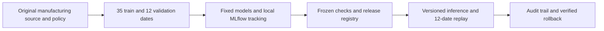

# Manufacturing Model Reliability Lab — F3

A local model-lifecycle system combining date-based regression comparisons, MLflow experiment tracking, predeclared release gates, artifact integrity checks, versioned inference, historical replay diagnostics and verified rollback.

> Lifecycle boundary: model eligibility is determined before later replay outcomes are scored. A feature-distribution alert is not evidence of worsening accuracy, and synthetic input faults have no valid counterfactual outcome labels.

## Contents

- [Overview](#overview)
- [Dataset and data contract](#dataset-and-data-contract)
- [Architecture and components](#architecture-and-components)
- [Processing pipeline](#processing-pipeline)
- [Configuration and metric definitions](#configuration-and-metric-definitions)
- [Recorded results and evidence](#recorded-results-and-evidence)
- [Interpretation and operational use](#interpretation-and-operational-use)
- [Running locally](#running-locally)
- [API reference](#api-reference)
- [Validation and reproducibility](#validation-and-reproducibility)
- [Project structure](#project-structure)
- [Technology stack](#technology-stack)
- [Limitations and next steps](#limitations-and-next-steps)
- [Further technical documentation](#further-technical-documentation)

## Overview

**Does this candidate productivity model deserve a local release, and what evidence would support keeping or replacing it?**

The six sections are **Lab overview → Dataset contract → Experiments → Release console → Replay monitor → Audit & architecture**. A reviewer can inspect model checks, release an eligible artifact, request a prediction with a version stamp, replay later dates, inject a labelled input fault and restore a previous verified version. This is a local model-lifecycle demonstration, not a production factory system.

## Dataset and data contract

[UCI Productivity Prediction of Garment Employees](https://archive.ics.uci.edu/dataset/597/productivity+prediction+of+garment+employees), **1,197 historical team-level observations, 15 source columns and 59 dates**, 1 January–11 March 2015. Attribution: Productivity Prediction of Garment Employees [Dataset]. (2020). UCI Machine Learning Repository. [DOI 10.24432/C51S6D](https://doi.org/10.24432/C51S6D), [CC BY 4.0](https://creativecommons.org/licenses/by/4.0/). The small unchanged CSV is bundled for offline execution; [provenance](data/SOURCE.md) records its checksum and transformations.

| Field | Use and meaning |
|---|---|
| date / source_row | Date partition and traceability; not model inputs |
| targeted_productivity | Authority's team/day target; plausible planning input |
| smv | Standard minute value: time allocated to a task |
| no_of_workers | Reported team worker count; fractional values retained |
| department | Finishing or sewing, after spelling/whitespace normalization |
| actual_productivity | Source productivity ratio: the regression label |

**Input timing is assumed**, not established by observation timestamps. WIP, overtime, incentives, idle measures, team IDs and other fields are excluded. The source describes a 0–1 target but **37 labels exceed 1**, maximum **1.1204375**. All are retained and predictions are not clipped. The excluded WIP column has 506 missing values; selected inputs and labels have none.

| Partition | Dates | Rows | Purpose |
|---|---|---:|---|
| Training | 1 Jan–10 Feb 2015 / 35 distinct dates | 711 |Fit preprocessing and all three models|
| Validation |11–25 Feb 2015 / 12 dates| 232 |Compare models and decide eligibility|
| Replay |26 Feb–11 Mar 2015 / 12 dates| 254 |Post-freeze historical evaluation|

Every date belongs to exactly one partition. **Historical replay is not live monitoring**. The optional **synthetic SMV ×1.8 fault** changes only inputs. Its original outcomes are not valid counterfactual labels, so it receives no error/accuracy score. No paid data, private files, login or cloud service is needed.

## Architecture and components



| Component | Entry points or assets | Responsibility |
|---|---|---|
| [backend/data.py](backend/data.py) | Source contract and partitions | Verify original bytes, normalize labels and create whole-date partitions. |
| [backend/training.py](backend/training.py) | Training, checks and MLflow | Fit fixed pipelines, log real local runs and freeze validation evidence. |
| [data/policy.json](data/policy.json) | Predeclared thresholds | Define date counts, quality limits and numeric drift alert thresholds. |
| [backend/monitoring.py](backend/monitoring.py) | Replay diagnostics | Separate training-reference PSI from label-dependent error measurements. |
| [backend/service.py](backend/service.py) | Lab lifecycle | Serialize local actions, verify artifacts and orchestrate release/replay/rollback. |
| [backend/store.py](backend/store.py) | Registry and ledger | Atomically persist active/previous versions, generations and audit events. |
| [backend/api.py](backend/api.py) | Typed HTTP interface | Validate prediction payloads and expected-generation release requests. |
| [evaluate_lab.py](evaluate_lab.py) | Post-freeze evidence | Export all fixed-model scores, selected replay predictions and a static evaluation plot. |
| [verify_http.py](verify_http.py) | Served workflow verification | Exercise the running local API, record timings and verify exact rollback restoration. |
| [frontend/src/App.tsx](frontend/src/App.tsx) | Model workflow interface | Expose comparisons, release controls, saved replays and audit evidence. |

## Processing pipeline

1. Verify the original CSV's SHA-256, schema, finite selected fields and dates. Normalize two department spelling/spacing variants without removing observations.
2. Fix the [policy](data/policy.json) and 35/12/12-date design before training. Fit the numeric scaler, department encoder and models only on 711 training rows.
3. Compare a training-mean fallback, Ridge regression with α=1 and a fixed random forest with 80 trees, depth 6, minimum leaf 8, random state 42 and one CPU worker. There is no hyperparameter search or refit using later records.
4. Require finite validation predictions and an artifact serialization/reload match. Learned models must also improve reference MAE by at least 2%, have validation MAE ≤0.16, each department MAE ≤0.22 and at least 20 validation rows per department. Ridge's reference is the mean; the forest's is Ridge. These thresholds are illustrative authored policy, not validated business tolerances. The fallback has only the minimal finite-output/artifact gate.
5. Write real parameters, validation metrics and artifacts through the **MLflow Python tracking client** to a local SQLite database and local artifact files. Freeze the comparison with source, policy and model-engine fingerprints before scoring replay labels. Choose the lowest-validation-MAE eligible model.
6. Start with the verified mean fallback. A local release verifies eligibility, code/policy compatibility and model bytes, then atomically updates the active pointer/generation and appends an audit event. Every inference response identifies its version and artifact. Stale generations return 409; invalid prediction fields return 422.
7. Replay the final 12 dates with the active frozen model. Compute observed MAE/RMSE/R² only when valid outcomes are available. Calculate numeric-feature population stability index (PSI) with training-only quantile bins, a 1e-6 floor and an illustrative 0.20 alert threshold. Daily small-batch values are noisy diagnostics, not significance tests.
8. Roll back by checking and restoring the immediately previous verified artifact. A new request must reproduce its earlier prediction and identity. Save/export immutable replay snapshots and append-only API audit events.

[Architecture and contracts](ARCHITECTURE.md) explain the boundaries. MLflow supports direct local database/artifact tracking without a tracking-server process; see its [official architecture](https://mlflow.org/docs/latest/self-hosting/architecture/overview/). This application implements its own SQLite release registry; it does not claim MLflow Model Registry or an MLflow UI server.

## Configuration and metric definitions

### Release and inference contracts

| Setting or gate | Implemented policy |
|---|---|
| Partitions | 35 training dates / 12 validation dates / 12 replay dates |
| Mean fallback | Training-target mean; finite output and artifact round-trip gates |
| Ridge | α=1; at least 2% lower validation MAE than the mean |
| Forest | 80 trees, depth 6, minimum leaf 8, seed 42, one worker; at least 2% lower validation MAE than Ridge |
| Learned-model absolute error | Validation MAE ≤0.16 and each department MAE ≤0.22 |
| Department support | At least 20 validation rows per department |
| Artifact check | Recorded SHA-256 and validation reload equivalence within 1e-12 |
| Release concurrency | Caller supplies expected generation; stale state returns HTTP 409 |
| Prediction contract | Target productivity 0-1; SMV >0 and ≤100; workers >0 and ≤200; sewing/finishing department; no extra fields |
| Input shift | Numeric PSI in training-only quantile bins, 1e-6 floor, alert at 0.20 |

Thresholds and broad API bounds are authored demonstration rules, not verified factory tolerances. Every inference response includes the active model version, generation and artifact hash. A single SQLite transaction updates the active/previous pointers and event ledger. Rollback restores the previous compatible verified artifact with a new generation, rather than rewriting past predictions or events.

The synthetic SMV ×1.8 replay suppresses original outcomes even if labels are requested. Unchanged records may also be replayed with labels hidden; in either case unavailable metrics remain null. MLflow stores real run metadata/artifacts locally, while the application maintains its own release registry.

## Recorded results and evidence

The first comparison froze at **26 October 2026, 12:18 UTC**, before the first browser replay at 12:28 UTC. The models/policy were not changed after viewing replay errors. Saved IDs, full precision and fingerprints are in [frozen_comparison.json](outputs/frozen_comparison.json).

| Fixed model | Validation MAE | Later replay MAE | Replay RMSE | Replay R² | Eligible before replay |
|---|---:|---:|---:|---:|---|
|Mean fallback|0.144607|0.121653|0.169860|−0.102116|Yes / minimal gate|
|Ridge incumbent|0.132481|**0.105153**|0.153938|0.094817|Yes|
|Forest candidate|**0.120537**|0.105865|**0.144332**|**0.204267**|Yes / 6 checks|

The forest was selected on validation MAE, **16.6% lower than the mean fallback**. Ridge had marginally lower later MAE, while the forest had lower later RMSE. This small one-window comparison does not establish a universally better model. There was no switch of selection rules or tuning using replay outcomes.


- **11 automated lifecycle tests passed**, including failed gate enforcement, tampered-artifact rejection, stale generations, API input checks, training-only preprocessing, MLflow artifacts, persistence and exact prediction restoration after rollback.
- Actual localhost verification returned 422 for three invalid input shapes and 409 for a stale release. Ten sequential warm forest requests had **40.52 ms median HTTP round trip** and **17.09 ms median backend duration**, including artifact checking/loading. These are laptop observations, not load-test or production latency claims.
- The sample request `{targeted_productivity:0.8, smv:26, no_of_workers:56, department:"sewing"}` returned a Ridge prediction of approximately **0.7914**; the forest returned **0.8390**. After rollback, the Ridge prediction, version and artifact fingerprint matched exactly, with a later generation number.
- Historical replay SMV PSI was **0.827**; synthetic SMV ×1.8 increased it to **7.777** and placed 10 of 254 records outside the training SMV range. Neither value proves deteriorated model accuracy. **No error score was calculated for the altered inputs.**
- The initial comparison fit/log/freeze took **4.12 seconds**; post-freeze scoring and table export took **0.123 seconds**, excluding Python imports and chart rendering. Machine/setup time varies.

[Application screenshot](outputs/experiments.png)

Evidence: [full reference evaluation](outputs/reference_evaluation.json), [model comparison CSV](outputs/model_comparison.csv), [selected replay predictions](outputs/replay_predictions.csv), [first browser replay](outputs/first_browser_replay.json), [actual HTTP/rollback verification](outputs/api_verification.json), [historical HTTP replay](outputs/http_historical_replay.json), [synthetic HTTP replay](outputs/http_synthetic_replay.json) and [verification record](outputs/verification.md). Screenshots show the [overview](outputs/overview.png), [release/API](outputs/release.png), [monitor](outputs/monitor.png) and [synthetic fault](outputs/synthetic_fault.png).

## Interpretation and operational use

- **Keep validation selection separate from later observations.** The forest passed its declared gate, yet Ridge had slightly lower later MAE. Use additional independent dates and operational error costs before recommending a real deployment; repeated inspection of these 254 rows is not fresh evidence.
- **Investigate drift rather than equating it with failure.** SMV shifted even in the unchanged history, while aggregate replay error was lower than validation error. Inspect input semantics, batch sizes and observed errors together.
- **Make reversibility observable.** Versioned responses and a verified rollback reproduced the earlier Ridge output exactly. This is measurable engineering evidence; it does not establish real factory safety, productivity improvement or savings.

## Running locally

The three setup/launch commands below start at the repository root.

Prerequisites: **Python 3.12+ and Node.js/npm compatible with Vite 8**. Tested here with Python 3.12.14, Node 25.2.0 and npm 11.19.0.

```powershell
cd projects/f3-manufacturing-model-reliability-lab
python setup_project.py
python launch.py
```

Open **http://127.0.0.1:8534**. Later starts need only `python launch.py`. Ctrl+C stops the app. Use `python launch.py --port 8535` to select another local port.

First launch verifies the source, trains/logs three small models locally and bootstraps the mean fallback. **Experiments → Release console → Release locally → Request prediction → Replay monitor → Run historical replay → Roll back to previous** demonstrates the lifecycle. On an existing workspace the previous active version/history is preserved, so the starting model may differ. New comparisons use fixed parameters and preserve the active deployment. Saved reports retain their model/settings even after controls change.

Setup verifies the bundled source, creates this project's ignored `.venv`, installs constrained Python dependencies and builds locked frontend packages. If the original CSV is missing, `prepare_data.py` recovers it from the public UCI ZIP and verifies its bytes; an altered existing file is refused. Installation/recovery may require network access; normal application execution is local/offline and MLflow telemetry is disabled. No model download, API key, account, paid API, cloud, GPU or other project is required.

Optional developer checks, separate from the three launch commands: `.venv/Scripts/python.exe -m unittest discover -s tests -v`; `.venv/Scripts/python.exe evaluate_lab.py` regenerates post-freeze outputs; `.venv/Scripts/python.exe verify_http.py` exercises the running app on 8534 and explicitly releases/restores demo models. The last script mutates local demo history. Reused replay dates must never be described as a new holdout. [PROJECT_FILES.md](PROJECT_FILES.md) contains the folder tree and individual copyable source blocks.

## API reference

The interface and API share one localhost origin. Route declarations are implemented in [backend/api.py](backend/api.py); `/openapi.json` exposes the generated schemas.

| Method | Route | Handler |
|---|---|---|
| GET | `/api/health` | `health` |
| GET | `/api/lab` | `snapshot` |
| POST | `/api/train` | `train` |
| POST | `/api/release` | `release` |
| POST | `/api/rollback` | `rollback` |
| POST | `/api/predict` | `predict` |
| POST | `/api/replay` | `replay` |
| GET | `/api/export/audit` | `export_audit` |
| GET | `/api/replays/{replay_id}/export/{format}` | `export_replay` |

### Versioned prediction request

Example body for `POST /api/predict`:

```json
{
  "targeted_productivity": 0.8,
  "smv": 26,
  "no_of_workers": 56,
  "department": "sewing"
}
```

The response includes the prediction, model version, generation, artifact SHA-256 and measured backend duration. Releases supply `version` and `expected_generation`; rollbacks supply `expected_generation`. A stale generation or failed release check returns 409, and invalid prediction fields return 422. Replay requests use `shifted` and `labels` booleans; changed-input mode never exposes original outcomes as valid new labels. JSON, CSV and Markdown replay exports preserve the saved model identity.

The server is intended for a trusted single-user local environment. These routes do not constitute an authenticated public deployment. Saved output identifiers refer to immutable analytical snapshots rather than editable browser drafts.

## Validation and reproducibility

The automated suite contains **11 tests**. It checks the following implementation boundaries:

Test implementation: [tests/test_lab.py](tests/test_lab.py).

- Source and date boundaries.
- Preprocessing fits training only.
- Failed quality gate is not eligible.
- Gate rejection preserves active pointer.
- Tampered artifact cannot release.
- Stale generation rejected.
- Release and rollback restore prediction and identity.
- Shift has no counterfactual error score.
- Labels can be withheld on unchanged replay.
- Mlflow has real metrics and artifacts.
- Api validation state export and restart.

From the project directory, run:

```powershell
.venv/Scripts/python.exe -m unittest discover -s tests -v
```

Recorded execution and any browser-review evidence is retained in [outputs/verification.md](outputs/verification.md). Reported figures correspond to saved execution artifacts; running a report generator can overwrite its generated outputs. Package requirements, source checksums and fixed parameters define the reproducibility boundary; elapsed times and some model/solver outputs can vary across environments. The setup script also performs TypeScript checking and a production frontend build using the npm lockfile.

## Project structure

```text
f3-manufacturing-model-reliability-lab/
  ARCHITECTURE.md
  constraints.txt
  evaluate_lab.py
  INTERVIEW_GUIDE.md
  launch.py
  prepare_data.py
  PROJECT_FILES.md
  README.md
  requirements.txt
  setup_project.py
  verify_http.py
  backend/
    __init__.py
    api.py
    data.py
    monitoring.py
    service.py
    store.py
    training.py
  frontend/
    package.json
    package-lock.json
    tsconfig.json
    index.html
    src/
      App.tsx
      main.tsx
      styles.css
      types.ts
      vite-env.d.ts
  tests/
    __init__.py
    test_lab.py
  data/
    Bundled inputs, provenance and prepared data
  outputs/
    Recorded metrics, audit files, tables and figures
```

Generated environments, database files, model artifacts and compiled assets follow the project's [.gitignore](.gitignore). The [copyable source bundle](PROJECT_FILES.md) mirrors the README and contains individual file blocks.

## Technology stack

**React + TypeScript + Vite + Lucide**, **FastAPI + Pydantic**, **pandas + NumPy + scikit-learn**, **MLflow skinny 3.17.2** with **SQLAlchemy/Alembic and SQLite**, joblib artifacts and matplotlib evidence. Custom SVG displays daily errors; CSS displays comparison bars. This is a single local server with bundled assets; there are no external fonts or runtime CDN assets.

## Limitations and next steps

Historical 2015 data covers one short setting with no documented prediction-time feature timestamps. The target-range discrepancy and fractional worker counts need source-owner clarification for real operational use. Scores are team-observation errors, not individual-worker assessments or causal effects of staffing/targets.

There is one fixed chronological split and no nested tuning, rolling backtest or uncertainty interval. Thresholds, numeric input bounds, SMV fault size and PSI settings are authored demonstrations. Numeric PSI does not monitor categorical department shift. Tiny daily batches can exaggerate alerts. Finite predictions outside 0–1 are retained and not interpreted as feasible production targets.

The app assumes a trusted single-user localhost with one server worker. Its Python lock serializes local actions; SQLite transactions make pointer/event updates atomic. It has no authentication, multi-worker coordination, signed artifact store, tamper-proof log, live ingestion, scheduling, Docker deployment or hosted CI. A machine owner can alter local databases; checks are accidental-corruption controls, not a hostile-user security boundary. Only locally created trusted joblib files may be loaded.

Rollback restores the immediately previous verified artifact, rather than an arbitrary version selected from a full production registry. Latest 100 events/replays appear in the interface. Code/policy changes require a new comparison; first-time imports, tracking initialization and installation are excluded from request latency. App histories, weights, build outputs and dependency directories are intentionally ignored; a fresh clone trains its own artifacts/IDs while reproducing the fixed calculation design. Re-evaluate on new independent dates before changing a release decision.

## Further technical documentation

- [Dataset attribution, licensing and source transformations](data/SOURCE.md)
- [Pinned Python dependencies](requirements.txt)
- [Recorded transitive dependency constraints](constraints.txt)
- [Frontend dependency lockfile](frontend/package-lock.json)
- [Detailed architecture, contracts and implementation boundaries](ARCHITECTURE.md)
- [Recorded execution and verification evidence](outputs/verification.md)
- [Folder structure and individually copyable source files](PROJECT_FILES.md)

[Back to contents](#contents)
